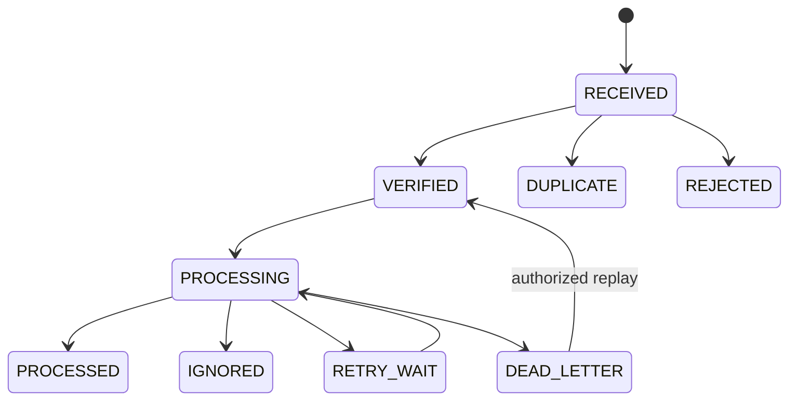

# Active Intake V1 Connector 与事件协议

[总体架构与数据模型](active-intake-v1.md) · [验证与审查](active-intake-v1-review.md)

## 1. 标准与约定

| 项目 | 定位 | V1 用法 |
| --- | --- | --- |
| CloudEvents 1.0.2 | CNCF 规范修订，信封字段 `specversion` 仍为 `1.0`。 | 定义标准事件身份与元数据。原始供应商回调保留供应商格式，需要互换时可导出 structured JSON。 [核心规范](https://github.com/cloudevents/spec/blob/v1.0.2/cloudevents/spec.md) · [JSON 格式](https://github.com/cloudevents/spec/blob/v1.0.2/cloudevents/formats/json-format.md) · [HTTP binding](https://github.com/cloudevents/spec/blob/v1.0.2/cloudevents/bindings/http-protocol-binding.md) |
| AsyncAPI 3.0 | 异步接口描述规范，可描述 channel、message 和应用视角的 send/receive。 | 公开异步接口出现后再出描述，SQLite 工作行与 Python 调用无需虚构 broker。 [AsyncAPI 3.0.0](https://www.asyncapi.com/docs/reference/specification/v3.0.0) |
| OpenAPI 3.1 | HTTP 描述规范，提供 paths、webhooks 和 callbacks。 | HAFlow 自己提供的接收 URL 用 paths 表达。描述供应商主动发送的一方可使用 webhooks，订阅操作的回调可根据关系使用 callbacks。 [OpenAPI 3.1.1](https://spec.openapis.org/oas/v3.1.1.html) |
| JSON Schema 2020-12 | JSON 结构和约束规范。 | 校验 Manifest、每种配置和 canonical data；格式断言显式启用或在服务边界验证。身份匹配和事务不变量须由程序验证。 [JSON Schema](https://json-schema.org/draft/2020-12) |
| Webhook | HTTP 推送集成方式，供应商各有契约。 | 各自实现保真读取、签名、挑战、应答、重试分类。 |
| Transactional Inbox / Outbox | 本地事务保留接收事实或待发布消息的工程模式。 | 用 Event Inbox 消除 ACK 后内存入队的空窗。同库处理无对外消息，V1 只用 Inbox。 [Transactional Outbox](https://docs.aws.amazon.com/prescriptive-guidance/latest/cloud-design-patterns/transactional-outbox.html) |
| Idempotent Consumer | 工程模式。 | 数据库唯一键和同事务结果提交约束消费副作用。 [Idempotent Consumer](https://microservices.io/patterns/communication-style/idempotent-consumer.html) |
| Dead Letter / Replay | 故障隔离和受控重放模式。 | SQLite 事件状态加尝试审计。 [Dead Letter 参考](https://docs.aws.amazon.com/AWSSimpleQueueService/latest/SQSDeveloperGuide/sqs-dead-letter-queues.html) |
| Manifest、事件类型、源坐标、策略和确认 | HAFlow 平台契约。 | 由版本化 Manifest 和服务端策略治理。 |

## 2. CloudEvents 映射

| 字段 | 映射规则 |
| --- | --- |
| `specversion` | 固定字符串 `1.0`。 |
| `source` | 由 Intake 用已认证的稳定来源坐标生成 URI，使用无敏感信息的编码。例如 `urn:haflow:intake:linear:org-opaque:issue-webhook`。同一事实 ID 的作用域必须一致。来源能力使用独立稳定名称，连接、令牌、投递地址及配置代数变化不改变来源。 |
| `id` | 来源内可重复推导的事实 ID。仅在证实唯一且重投稳定时采用供应商 ID。否则对规范化的稳定事实字段或观测三元组计算带版本前缀的摘要。重复交付沿用同一 `source/id`。本地 `event_id` 持久化后保持独立。 |
| `type` | 反向域名加业务事实名称及主版本，例如 `com.haflow.intake.linear.issue.updated.v1`。 |
| `subject` | 来源内稳定外部对象引用，例如 `issue/<uuid>`。不使用标题、手机号或其他 PII。没有业务对象可省略。 |
| `time` | 确切的 RFC 3339 事实时间存在时才填。推送时间单独用于认证，`received_at` 独立。轮询只发现当前状态时表达 observation，来源无可靠事实时间时省略。 |
| `datacontenttype / dataschema / data` | `application/json`，`dataschema` 为不可变 Schema URI。数据仅含最小业务事实或快照。未支持类型可以先保留通过认证的供应商事实及原文引用，随后记 IGNORED。 |
| 扩展与内部元数据 | 对外协作需要时可定义小写 `correlationid` 扩展。租户、租约、验签与处理状态由 Intake 管理。CloudEvents 字段本身无认证或执行授权含义。V1 如提供导出，仅按授权租户导出该租户已保存的信封。如果未来需要合并租户流，跨租户的同一 source/id 必须等价，按租户生成不同 data 的投影须另取稳定 source/id。 |

投递身份、事件身份和工作目的分别去重。验签使用原始请求字节，`raw_digest` 用于审计，`fact_digest` 排除已经明确的传输字段且保留业务语义。一个 `source/id` 与不同事实摘要相撞时，保留正本，隔离新事实并告警。摘要算法、输入字段、编码和版本变更须提供旧键兼容或双读映射，升级不得使旧事件变成新事件。对象版本相同且摘要不同，或收到无法比较的更新时，只能使用可验证的最新读取解决歧义；否则记录发生歧义，阻断缺少一致快照的分配及新确认。

## 3. Python Protocol

以下为接口文档。部署时，核心校验返回值、绑定租户并生成 canonical envelope。Connector 不拥有 SQLite 事务、ACK socket、Inbox 对象或运行时句柄。

```python
from typing import Protocol

class Connector(Protocol):
    def manifest(self) -> Manifest: ...
    def validate_config(self, config: JsonObject) -> ConfigReport: ...
    def test_connection(self, ctx: ReadContext) -> ConnectionReport: ...
    def normalize(self, ctx: SourceContext, record: ObservedRecord) -> EventFact: ...
    def health_check(self, ctx: ReadContext) -> ConnectionHealth: ...

class WebhookConnector(Connector, Protocol):
    def verify_delivery(self, ctx: VerificationContext,
                        delivery: HttpDelivery) -> VerifiedDelivery: ...
    def receive_webhook(self, ctx: SourceContext,
                        delivery: VerifiedDelivery) -> DeliveryBatch: ...

class StreamConnector(Connector, Protocol):
    def verify_delivery(self, ctx: VerificationContext,
                        delivery: StreamDelivery) -> VerifiedDelivery: ...
    def receive_stream(self, ctx: SourceContext,
                       delivery: VerifiedDelivery) -> DeliveryBatch: ...

class PollingConnector(Connector, Protocol):
    def poll(self, ctx: ReadContext, request: PageRequest) -> PollPage: ...

class ObjectReader(Connector, Protocol):
    def fetch_object(self, ctx: ReadContext, key: ExternalObjectKey) -> ObjectRead: ...
```

| 类型 | 数据和语义 |
| --- | --- |
| `Manifest / JsonObject / ConfigReport` | 下节的 Manifest；非敏感 JSON；配置验证结果为字段路径和安全错误码。配置校验无网络副作用。 |
| `SourceContext` | 只读 `tenant_id/connection_id/provider_instance_key/config_revision/config`。绑定来自服务器。 |
| `ReadContext / VerificationContext` | SourceContext 加短时、绑定连接的只读出站客户端或验签凭证句柄。设置时限和调用预算。禁止工厂注入 Inbox、Dispatcher 和运行时端口。 |
| `HttpDelivery / StreamDelivery` | HTTP 的原始 body bytes、受限 headers/query/path、平台接收时间；Stream 的租户绑定会话、消息头及原始消息。两者均有大小上限。 |
| `VerifiedDelivery` | 正文、经验证的来源域、认证方式和认证证据。验签失败、stale、来源不匹配或有歧义时产生 typed error 或可审计的已知旧重复候选；挑战为单独结果。 |
| `DeliveryBatch / ObservedRecord` | 有界记录组，每条带供应商类型、稳定记录身份或可生成键的字段、受控原文、事实时间可空。另含平台通过验证后解释的 ACK 规则标识或控制消息。控制面挑战与心跳无事件副作用。 |
| `PageRequest / PollPage` | 请求含稳定流名、窗口、上一次提交游标、页大小、期限。结果含 ObservedRecord 列表、顺序证据、后继页游标及 `exhausted`。连接暂时失败用 typed error，不得用空页代替。 |
| `EventFact / ExternalObjectKey / ObjectRead` | EventFact 包括稳定事实身份、规范类型、对象坐标可空、最小 data、版本/摘要、候选负责人和事实时间可空。对象键是类型加稳定外部 ID，范围由连接补足。对象读取返回 FOUND/NOT_FOUND/FORBIDDEN，或可重试错误。404 不等于已删除，除非供应商契约给出明确证明。 |
| `ConnectionReport / ConnectionHealth` | 健康码为 OK/DEGRADED/AUTH_REQUIRED/DISABLED，附观测时间、可重试性与安全错误码。来源可见范围、入口握手和实际订阅缺失分别报告。 |

基础五个方法必选。Manifest 声明一种或多种传输，每种声明对应必选方法，`fetch_object` 仅在声明可补读时必选。钉钉 Stream 可选择接入，通过共同的投递验证、写入、应答边界，具体连接生命周期由 Intake 装配管理。健康检查无业务写副作用。健康与测试均有短超时、频率限制和不含凭证的输出。

`normalize` 必须是给定版本及绑定配置下的确定性纯转换。ACK 前只做必要认证、结构拆分、稳定去重和有界转换。网络补读、规则、归属及任务物化都在提交 ACK 之后。ACK 前持久化不可变的最小 canonical data、类型、Schema 和摘要，以及在租户允许范围内可回放的原文。无法解析业务结构但可稳定定位的认证正本使用独立 `com.haflow.intake.raw.accepted.v1` 信封，data 只含原类型和受控摘要，随后送 DEAD_LETTER。重放可修复内部派生的关联或处置，原信封的 `source/id/type/data` 保持不变。原文过期后，仅按原已批准的等价事实重放，缺失所需字段则拒绝。身份未可稳定计算时，不持久肯定应答或推进轮询游标。 空的成功批次只用于经过验证的控制消息，业务批次不能无声丢弃。

### Manifest 字段

`manifest_version` 是平台协议主版本，`connector_version` 是 SemVer。主版本不兼容时拒绝加载。向后兼容的事件字段可加，删除或改变语义需新 schema/type 主版本。连接固定发布版本。升级前先验证现有账本的身份与重放兼容性，旧事件保留写入版本，找不到合规解析器时保留 DEAD_LETTER。供应商账号与权限也要按连接重验。

`provider` 标识静态注册实现。 `transports` 仅允许 webhook、stream、polling。其配置指明认证方式、ACK 或游标协议和最大时限。`auth` 只声明用途、权限、密钥引用名称与绑定范围。`events` 枚举供应商类型、规范类型及 data schema。`object_read` 缺省为 false。配置 schema 必须可解析且保留安全边界，未知必选能力拒绝加载。`health` 声明可观察项目。Manifest 由平台发布注册，租户只能设置相应连接配置，不能上传可执行插件。

| 键 | 类型及必需性 |
| --- | --- |
| `manifest_version/provider/connector_version` | 必填非空字符串。provider 为已注册标识，连接选择版本须精确匹配。 |
| `configuration_schema` | 必填 JSON Schema 对象或不可变、平台可离线解析的 Schema URI。 |
| `auth` | 必填数组，每项必填 `method/ref_slot/scope`，scope 为字符串或字符串数组，`purpose` 可选且为字符串，`required` 为可选布尔值并默认 true。ref_slot 在同 Manifest 内唯一。 |
| `transports` | 必填非空对象，键为传输枚举。Webhook 与 Stream 必填 ACK 标识、毫秒时限和 body 大小上限，签名时钟偏差按 profile 必填。Polling 必填流名、位置协议和请求时限。容量和期限为正整数。 |
| `events` | 必填非空数组，每项为三项必填字符串 `provider_type/type/data_schema`。每个供应商类型有确定的归一化输出，`type` 和 Schema URI 版本固定。 |
| `object_read`、`health` | object_read 为可选布尔值。health 为必填对象，含非空字符串数组 checks。 |


```yaml
manifest_version: "1"
provider: linear
connector_version: "1.0.0"
configuration_schema:
  "$schema": https://json-schema.org/draft/2020-12/schema
  type: object
  additionalProperties: false
  required: [organization_id, webhook_registration_id]
  properties:
    organization_id: {type: string, format: uuid}
    webhook_registration_id: {type: string, format: uuid}
    team_ids:
      type: array
      uniqueItems: true
      items: {type: string, format: uuid}
auth:
  - method: webhook_hmac_sha256
    ref_slot: signing_secret
    scope: registered_organization_and_webhook
  - method: oauth2
    ref_slot: api_read_token
    scope: ["read"]
    purpose: object_read
    required: false
transports:
  webhook:
    ack_profile: linear_http_200_after_commit
    response_deadline_ms: 5000
    max_body_bytes: 262144
    signed_timestamp_max_skew_seconds: 60
object_read: true
events:
  - provider_type: "Issue:create"
    type: com.haflow.intake.linear.issue.created.v1
    data_schema: https://schemas.example.invalid/haflow/intake/linear/issue-fact-v1.json
  - provider_type: "Issue:update"
    type: com.haflow.intake.linear.issue.updated.v1
    data_schema: https://schemas.example.invalid/haflow/intake/linear/issue-fact-v1.json
  - provider_type: "Issue:remove"
    type: com.haflow.intake.linear.issue.removed.v1
    data_schema: https://schemas.example.invalid/haflow/intake/linear/issue-fact-v1.json
health:
  checks: [last_delivery, verified_organization, read_grant_if_configured]
```

Schema URI 使用保留域作为文档示例。实现时由平台发布版本化且可本地解析的 schema。这里的 Linear `read` 权限用于按需读取，安装者管理 webhook 的 admin 权限单独使用，运行凭证可省略，仅影响补读。未配置有效凭证时 `fetch_object` 返回 FORBIDDEN，依赖补读的分配策略禁止启用。不能从 webhook 注册或创建权限推断企业内每个对象均可交给任意用户。 [Linear Webhook](https://linear.app/developers/webhooks) · [Linear OAuth](https://linear.app/developers/oauth-2-0-authentication)

## 4. Event 状态机



| 状态 | 进入、退出及恢复 |
| --- | --- |
| RECEIVED | 入口接收态。常规路径在同一入口操作内认证并持久写 VERIFIED。若未来选用持久 staging，仅限已绑定、配额受控数据，未认证前不可被消费或肯定应答。 |
| VERIFIED | 已通过来源验证、结构边界和持久事务，等待 worker 原子领取。轮询是经过认证的读取，本地计划来源为受管配置，签名三值为 NULL。 |
| PROCESSING | `BEGIN IMMEDIATE` 原子领取，设置租约和递增 `claim_epoch`，插入尝试记录。网络操作在事务外，有短期限；最终写入时核对状态、租期、栅栏和配置授权代数。 |
| PROCESSED | 一次提交当前尝试结果、事件结果、对象更新以及链接和所需 DRAFT。已经写入待分配链接或只更新对象都可完成。后续用户分配以链接为入口，无需重投事件。 |
| RETRY_WAIT | 临时网络故障、限额、SQLite 短时写锁或租约过期。有界指数退避及 jitter，尊重供应商 Retry-After。在成功重领前保留错误证据。 |
| DUPLICATE | 投递层终态。原事件账本状态保持，重复收件保留审计或受控聚合，已知可靠副本正常确认。 |
| IGNORED | 已认证但供应商事件类型或任务策略无动作，或被证实为过时观察。记录 reason，禁止自动重新应用。 |
| REJECTED | 认证、租户绑定、重放新体或结构安全边界失败。终态，限额审计，禁止任务或重放。 |
| DEAD_LETTER | 已验证正本遇到永久错误或耗尽本轮预算。停止自动尝试。管理员按租户权限、原因、版本兼容与数据可用性审核同一事件 ID 的重放。保留全部尝试，重设本轮预算。 |

worker 定期回收过期 PROCESSING，在一个短事务中关闭旧尝试并改 RETRY_WAIT 或 DEAD_LETTER。旧进程续跑因租约代数不匹配而无效。建议本轮最多 6 次，从 5 秒起退避，上限 15 分钟。供应商给出更长退避时遵守，并告警。授权或连接失效暂停新读取，未完成事件待修复后由受控流程继续。`DEAD_LETTER → VERIFIED` 依赖现存且授权的原文或等价规范事实。审计与 replay 控制记录使用同一事务，重复请求靠预期状态 CAS；重放不接受上传正文、不重开终态任务、不重写外部状态。正文到期且保存的 canonical data 无法完成本次恢复时，只能由受管重新扫描或支持的来源补查产生新的观察。

## 5. 接收、提交和轮询

**推送。** 网关只路由注册的 HTTPS 接收端点，限制方法、大小、时限、并发及出处。连接选择来自可信路由或认证会话，用配置中的来源域匹配已认证的组织或账套。读取原样字节、验签，然后检查可信时间及稳定接收身份，常量时间比较签名。当前时间窗口之外只允许已经验证且能精确匹配已存事实的旧副本得到无副作用 ACK；未知旧事实拒绝并告警。已验签 body 和可信会话字段决定身份，签名不覆盖的 header 只用于传输审计。成功 ACK 严格发生在事件事务 durable commit 后。供应商挑战是独立控制流，走供应商对应的认证及响应。仓库与原系统之间的承诺是有界至少一次和可诊断恢复，供应商停止重试后可能有缺口。

**SQLite。** 工作行、游标和任务位于同一实例、同一 SQLite 文件。ACK、游标、事件处置及任务物化路径采用 WAL、`synchronous=FULL`、启用 FK 的专用写连接，在本机可靠文件系统按单写者设计。现有状态库连接 `NORMAL` 的掉电语义不足以声明 Intake ACK 持久。禁止跨库 ATTACH 原子性假设、共享网络盘和持写锁等待外部 I/O。写入事务的忙等待必须小于推送应答时限；时间预算耗尽由发送方重试，账本未提交时不返回成功。 [现有连接](../../herdr/state/connection.py#L72) · [SQLite 事务](https://sqlite.org/lang_transaction.html) · [synchronous](https://sqlite.org/pragma.html#pragma_synchronous)

**原子写入。** 入箱使用同一连接的 Store 写入原语，由调用方控制事务，复用现有内容校验和新建 DRAFT 逻辑。唯一目的链接先保留工作身份。物化与链接更新同一事务，随后写事件状态和尝试结果。禁止用两个分别提交的 API 拼接。并发处理相同对象时，在对象版本、链接和最终处置写入前重读当前状态。完整事务失败后没有可见 DRAFT 半成品。通知演化后可再考虑 Outbox，当前 Console 轮询和 Controller sweep 可恢复。

**Polling。** 每个 connection/stream 以持久租约领取，`poll()` 在数据库外查询固定窗口。首选受供应商保证的稳定续页 token，次选受支持的复合 keyset。使用明确上界、确定性唯一排序、同时间戳 tie-breaker、按范围读取、上限页数及重叠窗口。游标保存 `version/completed_watermark/window_start?/window_end?/page_position?` 与外部时区、时间戳精度及流版本，重复或回退 token 视为无进展错误。窗口上界在开始时持久确定，后继页需单调、同窗且与已提交位置一致。配置切换需另行核实游标语义。一次事务持久化整页正本、已知重复或可审计隔离记录，同时 CAS 更新游标。坏行只有在来源认证、稳定身份和顺序已知且原文可恢复时才可隔离后推进。缺任何一项则整页拒绝推进。完成整窗才推进已完成水位；空页只在供应商成功且明确耗尽时推进。坏行未获可恢复隔离、过滤后为空、供应商超时或租约已过期时，禁止据此推进。崩溃前未提交重抓该页，提交后从已存位置恢复。读取页数据精度或排序无法支持 keyset 时，只有经过验证的供应商快照/稳定分页或严格有界的全量对账可上线；否则暂停连接。重叠补扫只覆盖约定迟到界限，读取当前状态无法保证还原所有短暂变化和删除。

## 6. 信任、保留与操作权

- 链接前核对外部身份的企业/组织、应用权限、数据可见性和 HAFlow 主体。缺映射、冲突或原权限失效时进入受控待处置。仅匹配邮箱、显示名或默认用户无法建立身份。
- `auth_ref` 只能引用实例凭证存储，读取限制于连接、用途和当前授权代数。密钥写入与安装授权由管理员执行，轮换有时间有界的双钥验证及审计。Agent、提示词、事件原文查看和健康探针不能取得 Connector 访问令牌。
- 供应商 HTTPS 目的地址由管理员批准，执行 DNS/IP、重定向、端口和网络分区策略。ERP 内网地址需明确批准且单独限制。外部链接仅展示已校验的预定义域名。查询条件由批准模板生成，供应商输入不能成为任意查询语句。
- 事件正文和附件都是外部数据。快照字段白名单、敏感字段去除、长度限制和提示词数据边界须在执行前强制。主动工作模板固定为已解析内容摘要的受审版本，模板缺失阻断确认。OA 与 ERP 只读建议还要求运行环境没有审批/写回凭证和到对应写接口的授权。模板文字和标签无法提供隔离。
- 原文（含必要的未解析事实）按租户配置加密和限权。试点默认原文 14 天、操作与尝试元数据 90 天，最终取企业签核值。只保留后续业务或审计需要的字段，canonical data 单独受租户保留期和最小化约束。清除数据时保留无正文的幂等墓碑及对象目的链接，已清除内容的事件停止按原信封导出，禁止重建替代内容后沿用同一事件身份。失败日志统一脱敏。加密备份覆盖账本和游标，恢复后先核验配置及运行身份，发现历史游标倒退按幂等补扫和业务对账。
- 自动允许认证接收、只读拉取、限额重试、快照更新和可信映射的草稿创建。连接启停、身份绑定或分配、权限授予、范围确认、重放与有损游标重置需要已授权主体，保留人、原因和变化记录。外部正式审批或业务写回由原系统执行。
- Python Protocol 是能力边界，进程内受信代码仍可访问所在进程资源。V1 仅运行经审查的静态适配器，按租户隔离进程、文件与运行时。接入侧接口协议不给任意插件或脚本运行权限。公开入口无通用 RPC、CLI、Agent 或 Console 路由。将来若允许第三方代码，需单独确认隔离后才能开放。

运维按连接记录接收/拒绝/重复率、提交耗时、最老待处理事件、租约回收、重试及死信、游标滞后和待分配量。日志仅记录获准的关联 ID 及错误分类。监控发现持续拒绝、账本写入失败、游标无进展或 ACK 预算紧张时，告警并暂停受影响通道，避免把异常伪装成扫描成功。
