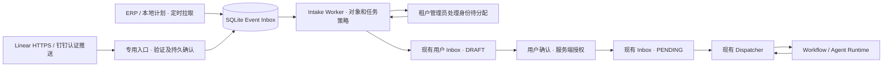
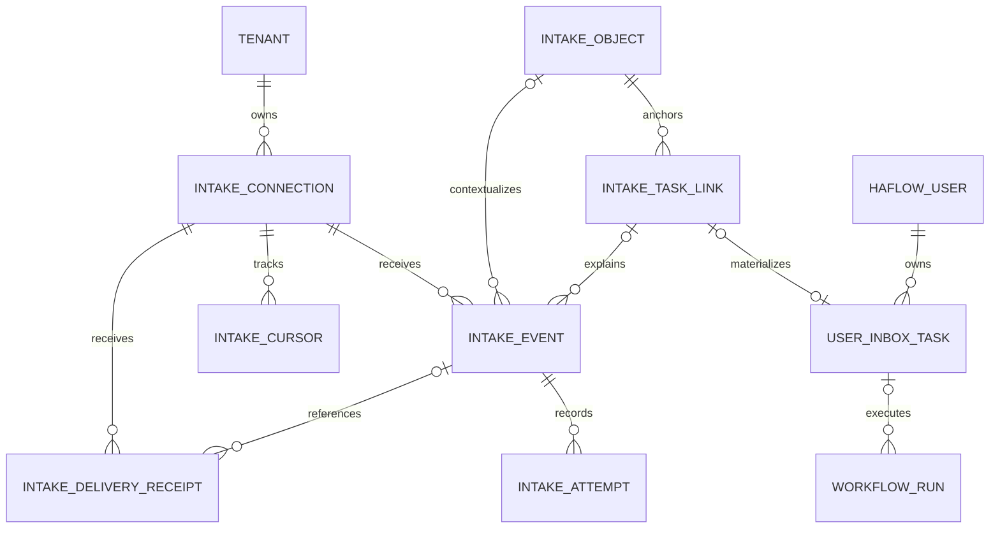
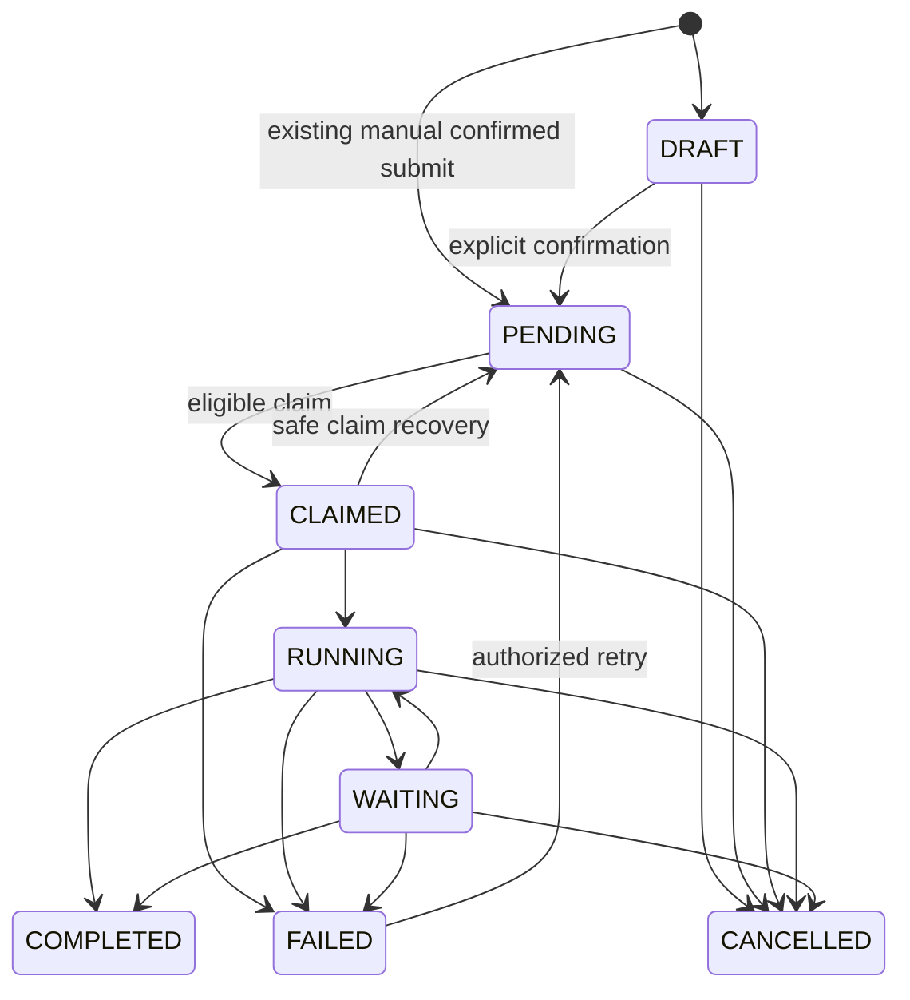

# HAFlow Active Intake V1

状态：设计候选，等待独立验收。源码基线为 `5fb037da23fdf30418f5c412466402b87f810d7c`，调查时与 `origin/main` 一致。

配套文档：[Connector 接口和交付协议](active-intake-v1-connector.md) · [场景验证与对抗审查](active-intake-v1-review.md)。

## 1. 架构裁决

Webhook、定时拉取和受认证的推送统一写入同一 SQLite Event Inbox。一个有界 Intake Worker 处理外部事实、更新对象快照、将符合策略且已映射到用户的工作写为现有 Inbox 的 `DRAFT`。用户在私有 Console 中确认执行范围，服务端校验后进入现有 `PENDING`。Dispatcher 继续负责领取、工作区互斥、Workflow 启动和结果对账。定时巡检也使用同一模型，事件来源为经过注册的本地计划，业务对象为计划的稳定周期实例或检测目标。

### 产品阶段

| 阶段 | 支持范围 | 进入条件 |
| --- | --- | --- |
| V1 首发 | 每个独立 HAFlow 实例一个租户、一个经认证的本地操作主体。可接同企业的多个连接，为该主体接收待办。采购、财务或销售团队成员各自登录并收件属于后续能力。 | 每租户使用独立 SQLite、运行时、项目注册表、工作区与凭证命名空间。私有 Console 依赖可信 OS 或本地认证入口，环境变量、Host 和 Origin 只用于配置或本地请求限制。每个连接绑定一个经核实的企业或账套。未核实或映射为其他用户的工作进入租户待处置，禁止落入操作员 Inbox。主动执行仍受第 4 节门槛约束。 |
| 企业多人阶段 | 一个企业内多个用户按身份分别收件和确认，管理员可按显式授权委派。 | 先验证请求级主体、企业成员映射、用户级 Inbox 的读取和写入授权、对象与 Workflow 的读取授权、跨用户查看/改派的授权和审计，以及执行准入。跨租户共享部署须另外验证租户隔离。 |

## 2. 当前源码复用与差距

| 核查项 | 当前事实 | 后续设计落点 |
| --- | --- | --- |
| 用户 Inbox 与 Schema | `user_inbox_tasks` 强制非空 `user_id`，项目和工作区可空。已有来源、上下文、优先级、队列、Workflow ID、尝试历史及租约。幂等索引按 `(user_id,idempotency_key)`，没有租户、外部对象或事件键。见 [Schema](../../herdr/inbox/schema.py#L37) 和 [DDL](../../herdr/inbox/schema.py#L199)。 | 复用现有任务表与索引。事件、对象和稳定工作目的另有权威记录。 |
| Store 与确认 | `create_task` 自建连接并提交。默认 `DRAFT`，仅完整范围加 `auto_confirm` 直入 `PENDING`。确认函数检查非空和任务状态，在写事务内分配队列顺序。通用状态更新也接受状态机允许的边。见 [Store](../../herdr/inbox/store.py#L66)、[通用转换](../../herdr/inbox/store.py#L272)、[确认](../../herdr/inbox/store.py#L337)。 | 后续需要调用方事务内的同一创建逻辑及主动来源写入边界。当前公开 Store 方法不能参与跨表原子写入。 |
| Dispatcher 与后台 | `claim_next_task` 在 `BEGIN IMMEDIATE` 中检查占用并按 workspace、优先级、顺序领取 `PENDING`。有租约、续租、启动栅栏、对账和失效恢复。Console 有有界后台 sweep，Controller 定期调用同一 sweep。见 [claim](../../herdr/inbox/dispatcher.py#L109)、[launch](../../herdr/inbox/dispatcher.py#L278)、[reconcile](../../herdr/inbox/dispatcher.py#L696)、[recover/sweep](../../herdr/inbox/dispatcher.py#L812)、[Console](../../console/inbox_api.py#L44)、[Controller](../../services/controller/registry.py#L29)。 | 直接复用执行路径。当前 claim 不检查用户授权或确认回执。主动任务执行受第 4 节的发布门槛限制。 |
| Workflow 和执行入口 | 默认 runner 按项目找 root，再经 Console runner 调 `herdr-factory run`。带 Inbox ID 的注册路径校验领取 token 和尝试 ID。Console 另有直接 Workflow 入口。见 [默认 runner](../../herdr/inbox/dispatcher.py#L418)、[Workflow API](../../console/workflow_api.py#L8)、[注册栅栏](../../bin/herdr-factory#L550)。 | Connector 和公开入口均无法访问直接执行入口。沿用 Workflow 注册与状态归属。 |
| 用户、项目、工作区 | `_resolve_current_user` 来自进程环境，`root/admin` 有代理分支。范围校验使用项目注册表和 workspace 关联，缺少企业成员资格或独立请求级 ACL。当前人工 POST 先校验两项都已填写，无法作为无范围主动草稿的入口。检测器给出建议。见 [身份](../../console/inbox_api.py#L62)、[检测与校验](../../herdr/inbox/detector.py#L13)。 | 连接绑定、外部用户映射、显式执行授权需扩展。项目和工作区仍以 HAFlow 注册数据为准。 |
| SQLite | Store 复用状态库连接。状态库初始化设置 WAL 和 busy timeout，Inbox 多条写路径使用 `BEGIN IMMEDIATE`。见 [连接](../../herdr/state/connection.py#L60)、[Inbox 连接](../../herdr/inbox/store.py#L49)。 | 同库附加 Intake 表，独立的索引、租约及短事务。外键与迁移行为须实测。 |
| Console 刷新 | Inbox 使用 GET list/stats，切入页面立即刷新，页面可见时每 5 秒拉取。核查 Inbox HTTP 路由和 JS 未发现 SSE 或 WebSocket 投影。见 [HTTP 读取](../../console/http_server.py#L268)、[UI 请求](../../console/static/console/scripts/inbox.js#L46)、[刷新定时器](../../console/static/console/scripts/inbox.js#L465)。 | 沿用现有刷新。钉钉传输的 WebSocket 与 Console 刷新无关。 |
| API 权限 | HTTP 有 Host/Origin 等信任检查，Inbox 按进程用户过滤及检查所有权。独立的 operator 签名能力用于受控操作，不能替代 Inbox 用户会话。见 [HTTP 门禁](../../console/http_server.py#L128)、[Inbox 路由](../../console/http_server.py#L378)、[operator auth](../../herdr/operator_auth.py)。 | 回调入口只暴露指定路径，不能将控制台放到供应商公网入口后面。 |
| 定时器与外部事件 | Controller 的 registry 循环、持续推进和内部 Done 事件存在。Inbox 的 detect 是同步范围建议，回收和 sweep 处理内部工作。核查 `services/`、`herdr/inbox/`、`console/` 的调度入口，未发现通用供应商 Webhook 注册、游标和接收账本。见 [registry 循环](../../services/controller/registry.py#L88)、[Done 事件](../../services/controller/done_events.py)、[detect](../../console/inbox_api.py#L260)。 | 复用守护进程装配方式和有界执行模式。新增独立 Intake I/O 循环，避免供应商超时拖住 Controller。 |

现有规则说明见 [User Task Inbox Wiki](../../wiki/user-task-inbox.md)。与 Wiki 描述有差异时按上述源码确定现状。

## 3. 对象、约束与数据字典

| 对象 | 权威来源与生命周期 | 关系 |
| --- | --- | --- |
| Event | 供应商事实或经认证读取产生的观察事实。Intake 保存不可变身份、接收证据和独立处理状态。 | 一个 V1 规范事件指向零或一个对象。一个对象可关联多事件。一个传输批次可展开为多事件，子 ID 必须稳定。 |
| External Work Item | 供应商拥有业务状态。Intake 持有有限且可更新的快照、受控 URL、外部版本和归属建议。 | 对象可没有任务或按经过批准的工作目的最多有一条任务。事件通过对象和所选任务链接关联。 |
| Inbox Task | HAFlow 拥有用户归属、规则目的、执行输入、状态和历史。 | 一个任务只绑定一个对象目的。手工任务可无链接。 |
| Workflow | HAFlow 执行引擎拥有模板、运行和 DAG 状态。 | 一个 Inbox Task 可有零或多个历史运行，同一时刻最多绑定一个有效运行。一个受 Inbox 管理的运行只服务一个 task/attempt。Workflow 模板和运行标识分开。 |

下表是逻辑列契约。标 `?` 表示可空，其余必填。ID、枚举和版本为 TEXT，次数与栅栏序号为 INTEGER，时间为 UTC 毫秒 INTEGER，现有 Inbox 的 REAL 秒数保持原样。JSON 字段用有界 JSON，枚举、非空键和数值上限在写入边界校验。租户/连接范围必须进入查询条件，禁止按客户端提供的裸对象 ID 读写。连接 scope、对象键及有效任务链接一旦设置即为稳定键。

| 实体 | 字段及含义 | 键与约束 |
| --- | --- | --- |
| `intake_connections` | `connection_id` 本地 ID，`tenant_id` 由实例确定，`provider` 提供方枚举，`provider_instance_key` 经过认证的组织/企业/账套命名空间，`display_name` 管理名称，`auth_ref` 外部凭证引用，`configuration` 非敏感配置，`connector_version` 固定版本，`config_revision` 配置代数，`status` 为 DISABLED/ACTIVE/DEGRADED/AUTH_REQUIRED，`created_at/updated_at` 时间，`last_health_at?`、`last_error?` 健康摘要。 | PK `connection_id`，复合唯一 `(tenant_id,connection_id)` 供 FK。组织、账套、信任边界变化开新连接。凭证轮换保留连接标识。 |
| `intake_events` | `event_id` 本地 UUID，`tenant_id/connection_id` 接收范围，`provider_event_id?` 可证明的供应商事件 ID，`source/id` CloudEvents 身份，`type` 类型，`data_schema_uri?` 数据 Schema，`data_json?` canonical data，`subject?` 对象引用，`occurred_at?` 事实时间，`received_at` 接收时间，`payload_json?` 原始 JSON 或经允许保留的加密引用，`raw_digest` 原始字节摘要，`fact_digest` 带方案及投影版本的稳定事实摘要，`signature_verified?` 仅签名传输为 true/false，`verified_via?` 为 SIGNATURE/AUTHENTICATED_READ/AUTHENTICATED_STREAM/LOCAL_JOB，`status` 事件状态，`attempt_count` 总尝试数，`retry_budget_used` 本轮已用数，`next_retry_at?` 到期时间，`last_error?` 错误码摘要，`correlation_id` 本地追踪 ID，`object_id?/link_id?` 结果引用，`lease_until?/claim_epoch` 租约与栅栏，`connector_version/config_revision/policy_revision` 解释证据，`payload_expires_at?` 原文到期。 | PK `event_id`，唯一 `(tenant_id,source,id)`。索引 `(tenant_id,status,next_retry_at,received_at)` 与过期 lease 查询。认证失败的投递无正本身份，按回执或入口安全审计记录。 |
| `intake_objects` | `object_id` 本地 UUID，`tenant_id/provider/provider_instance_key/object_type/external_id` 稳定外部坐标，`observed_connection_id` 当前有权读取的来源，`version?` 可比较版本或 opaque token，`snapshot_digest` 快照摘要，`url?` 经过来源白名单校验的外链，`snapshot_json` 最小业务字段，`external_status?` 外部状态，`last_event_id` 最近采用的证据，`first_seen_at/updated_at`。 | PK `object_id`，唯一 `(tenant_id,provider,provider_instance_key,object_type,external_id)`。两个已授权连接覆盖同一对象时共用键，读取另外连接观察到的数据仍须核验授权。 |
| `intake_task_links` | `link_id` 本地 UUID，`tenant_id/object_id` 范围，`purpose_key` 已批准的稳定工作目的，`user_id?` 被授权收件人，`task_id?` 现有 Inbox 任务 ID，`disposition` 为 UNASSIGNED/LINKED/IGNORED，`reason_code?` 未分配或忽略原因，`created_at/updated_at`，`confirmation_json?` 已核实主体、项目、工作区、配置/授权版本、用户确认和执行快照摘要。 | PK `link_id`，唯一 `(tenant_id,object_id,purpose_key)`，非空 `task_id` 唯一。这个键有意排除当前负责人及投递连接。复合 FK 或同事务检查禁止跨租户引用，且事件同时引用 link 和 object 时必须属于同一对象。 |
| `intake_cursors` | `tenant_id/connection_id/stream_key` 扫描范围，`cursor` 已提交水位及窗口内容，`last_sync_at?` 最近完成窗口，`sync_status` 为 IDLE/RUNNING/RETRY_WAIT/PAUSED，`last_error?`，`next_poll_at`，`lease_until?`，`claim_epoch`，`config_revision`。 | 复合 PK `(tenant_id,connection_id,stream_key)`。游标 opaque、带版本；只能由同代数持租约者 CAS 提交。 |
| `intake_attempts` | `attempt_id` UUID，`tenant_id/event_id/attempt_number`，`started_at/finished_at?`，`outcome?` 结果，`error?`，`next_retry_at?`，`claim_epoch`，`trigger` 为 INITIAL/RETRY/REPLAY，`actor_ref?` 与 `replay_reason?` 供授权重放审计。 | PK `attempt_id`，唯一 `(tenant_id,event_id,attempt_number)`。尝试记录可从 open 完成一次，完成后保持。 |
| 身份绑定（受管配置） | `tenant_id/provider/provider_instance_key/subject_type/external_subject_id`，`user_id`，映射状态、核验人和核验时间。 | V1 使用租户私有、原子更新、带修订号的持久配置，外部坐标唯一。配置更新保留变更审计。任务物化、改派及确认使用有效的映射版本，跨存储一致性按第 4 节的授权门槛验收。 |
| `intake_delivery_receipts` | `receipt_id` UUID，`tenant_id/connection_id` 已建立的可信接收范围，`received_at`，`outcome` 为 ACCEPTED/DUPLICATE/REJECTED，`canonical_event_id?`，`reason_code?`，`raw_digest?`，`transport_id_digest?`，`batch_id?`。 | PK `receipt_id`，索引 `(tenant_id,connection_id,received_at)`。ACCEPTED/DUPLICATE 必须引用正本，REJECTED 的正本引用为空。多个回执可指向同一正本，回执不参与消费或重放。 |

六张核心表是 V1 的必需逻辑实体。V1 按六张独立物理表落地，并在同一 SQLite 文件新增第七张 `intake_delivery_receipts`。身份绑定使用前述受管配置。Webhook-only 连接无需游标行。

- **数据库强制的外键。** 新表使用同库、带 `tenant_id` 的复合 FK。事件、游标、回执和对象的观察连接引用连接，尝试及非空回执正本引用事件，任务链接及事件的非空对象引用对象，事件的非空任务链接引用同一对象下的链接。目标表提供对应复合唯一键，历史引用使用限制删除，清理正文保留必要墓碑。
- **事务内维护的关系。** `intake_objects.last_event_id` 在更新快照的同一事务验证租户和事件归属，避免与事件反向引用形成循环 FK。链接的 `task_id` 保留唯一约束，通过同库创建或改派事务验证现有 Inbox 任务及其用户、实例归属，避免依赖现有 Inbox 表迁移时的临时重建行为。现有 Inbox 到 Workflow 的关联沿用注册栅栏与对账。身份及项目/工作区来自受管配置和现有注册表，禁止将其当作 SQL FK。

事件尝试无法复用 Inbox 的 Workflow 重试历史。事件→对象/任务的零一关系用事件上的可空引用承载，重放不能重定向已有链接。入箱后的对象更新仅写独立快照及事件关联，UI 可以展示“来源更新”和“来源已结束”，执行读取仍用已批准内容。长期保留最小身份墓碑，禁止清理原文时一并释放幂等键。

## 4. Inbox 归属与任务状态机

`user_id` 是收件人及工作负责人，`project_id` 是工作归属，`workspace_id` 是执行位置。用户 Inbox 不受项目或工作区筛选的默认约束。人工创建沿用已有表单，显式确认项目和工作区后可立即入列或先保存现有 `DRAFT`。自动来源的新任务必须用已映射用户创建 `DRAFT`，建议显示为建议，持久执行范围在确认时写入。没有唯一、有效、可授权用户的工作停留在租户管理员的待分配视图；它是一条未物化链接。已分配用户但范围不明确的任务显示待分配范围，仍是 `DRAFT`。

确认应绑定经认证的用户、任务 ID、内容摘要、项目/工作区元组、已确认的项目 root/执行目标和授权版本。服务端重新检查当前用户、租户成员关系、外部数据可见性、项目/工作区关联与执行权限、模板白名单，并在同一事务将确认回执和 `DRAFT → PENDING` 一起提交。拒绝将外部角色、正文中的用户名或客户端的 `auto_confirm` 当执行授权。更换建议不会隐式修改确认内容；外部负责人变更只提示，撤销访问时隐藏外部快照和主动任务正文并阻断执行，保留内部运行审计。V1 不自动转移已物化任务。确认前，管理员可对已失去访问且从未领取的 DRAFT 做受审计的同任务改派，旧用户的读取立即撤销，唯一键与 task_id 保持。已进入执行的任务不改派，只走既有停止和审计路径。明确已关闭的待办与过期访问须在新确认前阻断；不以缓存或一次订阅身份代替当前可见性证据。

**执行授权发布门槛。** 现有 Store、API 和领取逻辑不足以把确认、授权撤销、项目重新绑定与启动线性化。首条主动 DRAFT 落地前先启用服务端 DRAFT-only 门闸。通过同库可信 Intake link 的 task_id 识别主动任务，禁止根据客户端 source_type、source_id 或按钮判断。旧确认、重试、通用状态写入及不支持门闸的旧进程都不能把它推进。上线确认所有写进程已升级。回滚先停止入口、消费和确认，隔离所有主动任务及其旧路径，不能让旧版直接接管仍在线的主动草稿。启用主动任务执行前，须在受信服务端覆盖主动任务的所有 `PENDING` 写入口（含 retry 和通用状态更新），并在既有领取/启动准入点复验授权代数和目标绑定。派发查询跳过授权受阻项，再对领取和启动做校验。可用实现方向是在同库已有注册栅栏绑定一条单次授权，确认回执固定租户、task、负责人、已审模板摘要、实际执行 root、workspace 和配置/授权代数，实际准入还绑定领取 worker、attempt 和 token。授权撤销与单次授权的消费须在同一权威边界串行。若撤销先完成，拒绝启动；若启动授权先消费，撤销停止后续准入，已承诺运行用受控停止。项目 JSON 不受 SQLite 事务保护，实施需固定和验证实际目标，受管换绑与授权失效必须在同一边界约束，绕过该边界的动态目标不可用。可核查锚点为 [当前注册栅栏](../../bin/herdr-factory#L697)。还要证明授权决定之前不会发生需要启动授权的副作用、既有运行的对账不会误认另一个运行。实现阶段如无法验证这些条件，继续 DRAFT-only。此阶段只记录最小准入扩展，具体落点需经独立验收，Dispatcher 的排序、租约、互斥和 Workflow 引擎均沿用。

| 可见状态 | 持久状态与进入条件 | 合法退出和恢复 |
| --- | --- | --- |
| UNASSIGNED | 无归属用户时为 Intake link；已知用户、缺范围时为 `DRAFT` 的界面投影。 | 经管理员核实用户后物化，或确认合法范围后排队。无用户时可按政策记 IGNORED。 |
| NEEDS_CONFIRMATION | `DRAFT`，用户已知，可展示建议。 | 用户确认且服务端通过才进入 PENDING。草稿可取消。 |
| PENDING | 现有 `PENDING`，持有效确认及授权的任务可领取。 | CLAIMED 或 CANCELLED。授权失效时保持 PENDING 并跳过领取。用户可取消，或在受管入口重新确认范围并更新同一条任务及回执，保持 PENDING。 |
| CLAIMED | Dispatcher 原子领取，有 attempt/token/lease。 | RUNNING，或领取已安全释放时回 PENDING，耗尽为 FAILED，安全取消为 CANCELLED。 |
| RUNNING | 通过栅栏绑定当前 Workflow。 | Workflow 运行证据触发 WAITING、COMPLETED、FAILED 或经停止确认后 CANCELLED。 |
| WAITING | 由现有 Workflow 对账投影阻塞。 | 可回 RUNNING，或结束为 COMPLETED、FAILED、CANCELLED。互斥以现有 Workflow 与工作区真实状态为准。 |
| COMPLETED | 现有 Workflow 结果投影。 | 终态，供应商更新不会再排队。 |
| FAILED | 启动耗尽或 Workflow 失败证据。 | 明确 retry，重新校验授权和已确认范围后 PENDING，保留历史；过期确认须在受管重试入口重确认。 |
| CANCELLED | 用户撤销，运行中须有停止/解绑证据。 | 终态，保留链接以阻止重复创建。 |
| IGNORED | 无任务时为链接处置。已物化、未运行的草稿若由用户明确忽略，可用 CANCELLED 加链接处置原因表达。 | 自动更新保持处置。运行后的来源变化只改外部快照。 |

Inbox 状态边沿用 [现有定义](../../herdr/inbox/transitions.py#L41)。Workflow 独立经历 pending、running/in_progress、paused、closing 和结果，允许引擎自己的恢复边。现有对账将暂停或待裁决投影为 WAITING，从运行中恢复则返回 RUNNING。Workflow 的 completed 伴失败 outcome 时 Inbox 得到 FAILED，Workflow 被取消或 halted 也可对账为 FAILED。由 Inbox 发起的取消另走既有取消路径。Workflow 后续重开不自动重开终态 Inbox。 [Workflow 转换](../../herdr/transitions.py#L150) · [Dispatcher 对账](../../herdr/inbox/dispatcher.py#L696)事件处理成功、任务处理成功和外部业务完成分别留痕。HAFlow 只输出内部产物，正式审批、ERP 审核和状态变更由原系统完成。

## 5. 技术与实施顺序

| 选项 | 裁决 |
| --- | --- |
| 同库 SQLite Event Inbox | 采用。事件、游标和本地副作用具有事务边界。写事务短、无网络等待，按负载测写锁延迟。 |
| 独立 Intake Worker | 采用一个轻量守护服务，含有界消费和轮询执行，推送适配在独立入口或同服务隔离执行。沿用 Controller 的守护、限流和健康模式，避免在现有 Agent Worker 或 Controller 轮询中发供应商请求。 |
| Webhook 与定时 Polling | 均采用，两个入口共用账本和消费器。Webhook 低延迟，Polling 支持无推送的 ERP 和有界受管补扫。 |
| Kafka、RabbitMQ、Redis Streams | V1 不引入。它们增加基础设施、故障面和双写交付问题。只有测出当前 SQLite 持久队列瓶颈且单实例吞吐目标无法满足，才重新选型。 |
| Outbox | V1 同库没有另一个需要原子通知的服务。将来若跨库或对外发布，届时用事务 Outbox 加幂等消费者。 |

实施按以下顺序，阶段成果由独立验收决定是否推进。

1. 交付同库 Event Inbox、投递回执、重试和游标。用合成推送与轮询样本验收幂等、重复确认、故障恢复和配额。
2. 建立 Event 到 External Work Item 的关联和对象目的唯一键。用三类匿名样本验证乱序、重复和跨连接关联。
3. 先部署服务端 DRAFT-only 门闸及回滚保护，再开放自动物化与待分配。验证老数据、改派和人工 Inbox 回归。
4. 验收执行授权、撤权竞态、目标换绑和直接入口。通过后才允许主动来源由人工确认进入执行队列。
5. 接入 Linear，验证真实重投、事实身份和只读权限。
6. 接入钉钉 OA 与 ERP，分别验证 Stream 确认、审批转交以及真实账套的排序、游标和断点恢复。企业多人阶段继续单独裁决。

当前交付止于设计和文档检查。
