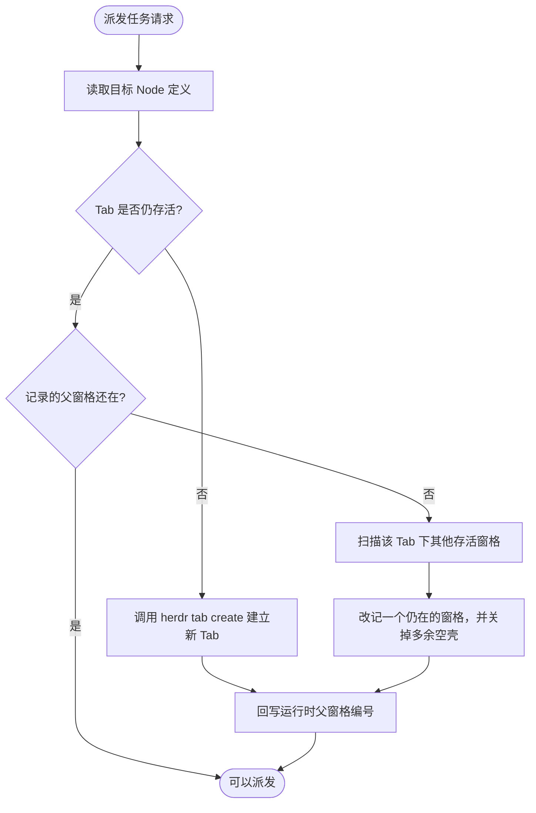

# Tab = Workflow Node 架构模型与现场机制

> **上海共事智能科技有限公司 · 共事 · HAFlow**  
> *让人和多个 AI Agent 一起把事情做完 (Human + Agent, in Flow)*  
> 本文档详细阐述 HAFlow “Tab 作为工作流节点、Pane 作为 Agent 工位、Agent 作为执行者”的设计哲学、Anchor Pane 锚点机制与动态现场自愈原理。

---

## 1. 设计哲学演进

过去版本将软件开发写死为固定 6 阶段：
`requirements` ➔ `plan` ➔ `implementation` ➔ `test` ➔ `review` ➔ `wrapup`。

这种硬编码模式存在两个根本缺陷：
1. **领域受限**：无法用于标书制作、合同审批、客户投诉处理、数据分析等非研发类流程。
2. **脆弱的运行时绑定**：系统强依赖初始化时生成的 `w9:t2` / `w9:pN`，一旦用户误关 Tab 或清理 Pane，后续任务调度直接由于 `pane_not_found` 崩溃。

### 核心革新：Tab = Workflow Node
- **Tab 语义化**：Tab 不再代表固定的“开发步骤”，而是通用的**工作流拓扑节点 (Workflow Node)**。
- **按需生成**：选择什么模板，就自动生成多少个 Tab；包含几层分支，就呈现几组工位。
- **解耦核心原则**：
  > **Workflow Definition 是逻辑事实，Tab ID / Pane ID 是动态运行时映射。**

---

## 2. 空间模型与现场层次

```text
Workspace (项目空间)
  │
  ├── Tab 1: Coordinator (流程大脑 / 调度现场)
  │     └── Pane 1: Coordinator Agent (系统协调员)
  │
  ├── Tab 2: Node 1 (工作流节点现场)
  │     ├── Pane Anchor: 只读母体锚点 (保持 Tab 存活与分裂工位)
  │     ├── Pane Task-A: Agent 工位 1 (现场执行)
  │     └── Pane Task-B: Agent 工位 2 (并发执行)
  │
  └── Tab N: Node N (其他工作流节点现场)
        ├── Pane: 本阶段第一个任务直接占用页签自带的窗格
        └── Pane Task-X: 父窗格已有任务时再 split 出的工位
```

---

## 3. 阶段页签的父窗格

创建新 Tab 时会自带一个窗格。再开一个工位时，`herdr pane split` 必须指定一个还活着的父窗格。页签里最后一个窗格被关掉时，页签会一起消失，下次派发会把页签建回来。

因此不再为每个节点留一个名为 `Anchor` 的空窗格：
1. 第一个任务直接占用页签自带的窗格。
2. 这个窗格已经有 Agent 时，才从它 split 出下一个工位。
3. 同页已经有任务窗格时，停在项目根目录且没有 Agent 的空壳会被关掉。

---

## 4. 运行时自愈流程 (`ensure_node_runtime`)

每次任务启动前，系统执行严格自愈保障：



通过这一闭环，无论用户在 Herdr 终端中如何关闭窗格或切换标签，工作流引擎均能自适应恢复，保证生产级鲁棒性。
