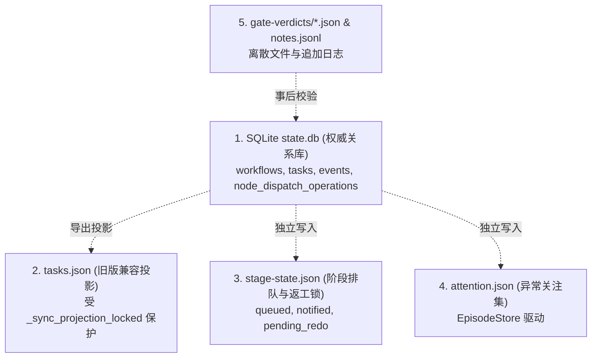

# HAFlow 统一节点决策表与状态一致性审计 (Decision Table)

> 借鉴思想：Slack 统一通知决策系统架构（Normalized Inputs ➔ Unified Decision Evaluator ➔ Deterministic Actions ➔ Explainable Invariants）  
> 审计基线：Git Commit `739ef0d`  
> 审计日期：2026-10-29

---

## 1. 统一决策模型设计（Slack 决策系统映射）

Slack 过去曾面临跨设备、多场景通知逻辑分散、冲突与静默丢失的问题。Slack 团队最终将分散在数十个微服务中的 `if` 逻辑收敛为一个统一的决策评估器：定义标准的输入状态元组、单点评估、返回确定性的决策与可解释的规则编号。

如果将该思想投射到 HAFlow 工作流编排系统中，任何一个节点在任意时刻的决策，输入都应归一化为如下标准维度：

```text
Input Tuple = (
    Node_Type,           # agent | gate | docs | ...
    DAG_Deps_Status,     # satisfied | unsatisfied
    Active_Tasks_State,  # none | running | agent_done | completed | failed | blocked
    Deliverables_State,  # valid | invalid | missing | not_applicable
    Gate_Verdict,        # pass | blocked | missing | conflict | not_applicable
    Candidate_SHA_State, # matches_frozen | mismatched | unproven | not_applicable
    Attention_State,     # clear | human_required | bypassed | retry_blocked
    Recovery_Budget      # within_limit (< 3) | exhausted (>= 3)
)
```

编排系统根据此元组，应当能给出**唯一、互斥、确定且可解释**的下一步动作。

---

## 2. 节点决策全景对照表（实际代码行为 vs 预期架构行为）

下表对 10 个典型核心场景，对比 HAFlow 现有代码的实际决策路径与规范预期决策：

| 场景编号 | 场景描述 | 现有代码输入条件 | 实际代码决策与后续动作 | 预期标准决策 | 判定评价 (差距分析) | 涉及代码位置 |
|---|---|---|---|---|---|---|
| **S-01** | 前置依赖未满足 | `get_ready_nodes()` 发现 `depends_on` 存在未在 `completed_nodes` 的项 | **等待 (Wait)**：不加入 `ready_nodes`，不产生调度 | **等待 (Wait)** |  符合预期 (DAG 纯函数判定清晰) | [`herdr/workflow.py:606`](../../../herdr/workflow.py#L606) |
| **S-02** | 依赖满足且允许启动 | 依赖全满足；无活跃任务；Join 门禁放行；获取 SQLite 租约成功 | **调度 (Dispatch)**：生成 TaskSpec，通过 `herdr-task launch` 拉起工位 | **调度 (Dispatch)** | ⚠️ 基本符合，但 Join Gate 在此链路上被重复计算了 3 次 | [`services/controller/direct_dispatch.py:279`](../../../services/controller/direct_dispatch.py#L279) |
| **S-03** | Agent 正常运行中 | 任务状态为 `working` 或 `rework`；Socket 定期收到存活事件 | **保持运行 (Maintain)**：维持监听，旁路 Observer 采集，重置退避 | **保持运行 (Maintain)** |  符合预期 | [`services/controller/registry.py:218`](../../../services/controller/registry.py#L218) |
| **S-04** | Agent 完成且验收通过 | 状态跃迁至 `agent_done`；非门禁节点通过 `try_auto_accept()` 或门禁节点通过 `try_auto_verdict()` | **推进 (Advance)**：任务转为 `completed`；Git 任务触发 commit & integrate；下游节点在下轮就绪 | **推进 (Advance)** |  符合预期 (快路径正常闭环) | [`services/controller/task_events.py:32`](../../../services/controller/task_events.py#L32) |
| **S-05** | Agent 完成但验收失败 (非门禁) | 状态为 `agent_done`；但 `validate_requirements_deliverable_content` 等正则失败 | ❌ **静默挂起 (Deadlock)**：记录 Attention Note，直接 `return`；任务卡死在 `agent_done` | **返工补派或明确阻断 (Rework/Fail)**：告知 Agent 具体缺陷重试，或升级阻断 | 🔴 **严重缺陷 (死胡同)**：无下游推进，无自动重试，无总指挥兜底 | [`services/controller/task_events.py:53-64`](../../../services/controller/task_events.py#L53-L64) |
| **S-06** | Agent 完成但门禁被阻断 | 门禁节点 (`test`/`review`) 输出 `HERDR_GATE_VERDICT: blocked`；预算未耗尽 | **回流返工 (Fix-Loop)**：目标实现任务标记 `superseded`，写入 `pending_redo` 闩，重新调度实现 | **回流返工 (Fix-Loop)** | ⚠️ 机制完整，但要求实现任务重新全量派发，代价较高 | [`services/controller/fix_loop.py:24`](../../../services/controller/fix_loop.py#L24) |
| **S-07** | Agent 执行超时 | 超过任务 SLA；Sentinel 探测未响应或看门狗触发 | **超时恢复 (Timeout Watchdog)**：Sentinel 判为 `failed` (`hard_timeout_watchdog`)；Controller 尝试自动作废补派 | **超时隔离并重试 (Retry)** | ⚠️ 存在 Sentinel 判死与 Controller 补派的时序竞争 | [`services/herdr-sentinel.py:120`](../../../services/herdr-sentinel.py#L120) |
| **S-08** | 可恢复的基础设施中断 | 任务失败原因是 `dispatch_delivery_fuse` 或 `agent_process_crash` | **自动作废补派 (Auto-Recover)**：作废失败任务，重置计数，在预算内重新派发 | **自动作废补派 (Auto-Recover)** |  符合预期 (受 `AUTO_RECOVER_MAX_ATTEMPTS` 约束) | [`services/controller/infra_recovery.py:40`](../../../services/controller/infra_recovery.py#L40) |
| **S-09** | 已完成节点再次收到重复事件 | 节点已处于 `completed` 或 `integrated`；又收到旧的 Socket `idle` 或 `done` 事件 | **幂等忽略 (Drop)**：检查当前状态属于 `TERMINAL_LIKE_STATUSES`，直接 `return` | **幂等忽略 (Drop)** |  符合预期 (状态机天然防重) | [`services/controller/task_listener.py:26`](../../../services/controller/task_listener.py#L26) |
| **S-10** | 全流程结束且验收通过 | 所有节点均处于 `completed_nodes`；所有门禁均为 `pass`；未置压制标志 | **完成关闭 (Close)**：打印 `[WORKFLOW COMPLETE]`，状态置为 `completed` | **完成关闭 (Close)** |  符合预期 | [`services/controller/advancement.py:190`](../../../services/controller/advancement.py#L190) |

---

## 3. 六大核心不变量系统性审计

根据 Slack 决策系统的系统性验证方法，审计 HAFlow 在以下六项不变量上的实际表现：

### 3.1 完备性 (Completeness)：合法状态是否都有明确决策？
- **审计结论：不完备**。
- **事实与代码证据**：
  在 `software-development-v1` 中，当非门禁任务（`requirements` 或 `plan`）的交付物未能通过 `auto_acceptance.py` 的文本正则校验时，系统既不将任务跃迁为 `rework`，也不将其跃迁为 `failed`，而是任由其留在 `agent_done`。
  此时系统没有任何一条规则（无论是自动推进、返工机制还是重试调度）能够消费处于 `agent_done` 且 `auto_acceptance_rejected` 的任务。该状态成为决策盲区。

### 3.2 互斥性 (Mutual Exclusivity)：同一状态是否可能触发互相矛盾的动作？
- **审计结论：存在局部冲突**。
- **事实与代码证据**：
  在门禁任务超时场景下，[`services/herdr-sentinel.py:650`](../../../services/herdr-sentinel.py#L650) 将任务置为 `failed` 并准备释放窗格；但与此同时，[`services/controller/auto_verdict.py:83-93`](../../../services/controller/auto_verdict.py#L83-L93) 的 `process_gate_verdict_reconciliations` 会并发读取该任务的 `gate-verdict.json`，如果发现存在 `pass`，会试图调用 `try_auto_verdict` 将任务强行翻案跃迁为 `completed`。两者产生直接竞态。

### 3.3 确定性 (Determinism)：相同输入是否产生相同的合法决策？
- **审计结论：缺乏强确定性**。
- **事实与代码证据**：
  1. **计划节点的并发时序竞争**：在 `plan` 阶段，系统同时派发 `executor` 和 `challenger`。两者的完成先后顺序具有随机性。若 `challenger` 稍快（`chal_ts < plan_ts`），后续 `verify_plan_and_challenger` 会判定 `challenger_outdated` 而拒绝派发；若 `executor` 稍快且 `challenger` 精准引用了 `Plan-Ref`，则判定通过。相同的工作流定义由于执行微秒级差异导致完全相反的流转结果。
  2. **自然语言输出的不确定性**：Agent 输出即使语义完全一致，只要漏掉一个中文特定词组（如将“用户目标”写成“设计目的”），即从“允许推进”变为“静默挂起”。

### 3.4 幂等性 (Idempotency)：重复事件是否会触发重复执行？
- **审计结论：基本保证，但文件锁存在泄漏风险**。
- **事实与代码证据**：
  任务状态流转依靠 SQLite CAS 乐观锁版本号校验（`expected_version`），在任务级别做到了良好的幂等性。
  但阶段级别的 `stage-state.json` 锁（如 `mark_stage_advance_queued`）依赖本地 JSON 文件写入。在进程异常崩溃或强杀时，文件锁可能永久停留在 `"notified"`，必须依赖 `reconcile_stage_advance_states()` 的启发式逻辑尝试解锁。

### 3.5 可终止性 (Terminability)：是否存在无法结束的等待或循环？
- **审计结论：存在多处无界挂起**。
- **事实与代码证据**：
  1. `task_events.py` 的 Staged Bypass 导致的任务停滞是永久性的，无超时机制打破；
  2. 在 `plan` 节点的 `parse_plan_tasks()` 中，若提取的任务存在文件重叠（`validate_task_decoupling` 报错 `file_overlap`），`direct_dispatch` 返回 `mode: "refusal"`，控制器写 Attention Note 后不再重试，工作流进入无界等待；
  3. 尽管 `fix-loop` 设有 `FIX_LOOP_MAX = 3`，但仅针对门禁明确打回（`blocked`），不覆盖规划失败或格式校验失败等上游错误。

### 3.6 可解释性 (Explainability)：能否根据现有日志与轨迹清晰解释原因？
- **审计结论：可解释性较弱，关键拒绝原因被掩盖**。
- **事实与代码证据**：
  当自动验收拒绝或规划拒绝时，日志仅输出简短标记：
  `[STAGED TASK EVENT BYPASS] task=... event=done reason=...`
  而在 Console 界面或常规工作流查询中，用户仅能看到工作流处于 `running`，当前阶段卡在 `99%` 或某个任务停在 `agent_done`，完全无法得知是因为缺少中文关键字还是 Challenger 缺少引用。必须深入翻查 `~/.herdr-controller/attention.json` 原始 JSON 才能获悉原因。

---

## 4. 多事实源（Multi-Store）状态一致性缺口分析

当前 HAFlow 内部同时存在 5 种异构持久化媒介：



### 关键缺口与冲突场景：
1. **数据权威性与持久化交互核查**：
   经核查源码 [`services/controller/persistence.py:load_tasks()`](../../../services/controller/persistence.py)，其实际实现为 `return ports._get_store().list_tasks()`，直接由 SQLite 存储提供权威事实，并不从静态 `tasks.json` 读取。`tasks.json` 仅作为磁盘上的只读导出视图/离线快照，Controller 决策并不依赖其导出时效，不存在投影时延导致的决策滞后。真正的状态不一致风险集中在跨外部进程通信与外部文件锁隔离（如 `stage-state.json` 与数据库事务未绑定）。
2. **`stage-state.json` 与 SQLite 事务分离**：
   调度时先在 SQLite 获得操作租约（`claim()`），随后再更新 `stage-state.json`。若在此之间进程被调度中断或重启，SQLite 显示已租借，但 JSON 显示未排队，造成状态裂脑。
3. **`gate-verdicts` 文件的孤岛性**：
   结论文件落在文件系统，而任务状态在数据库。若磁盘权限异常或路径变更，任务无法跃迁，数据库中无任何错误记录。
