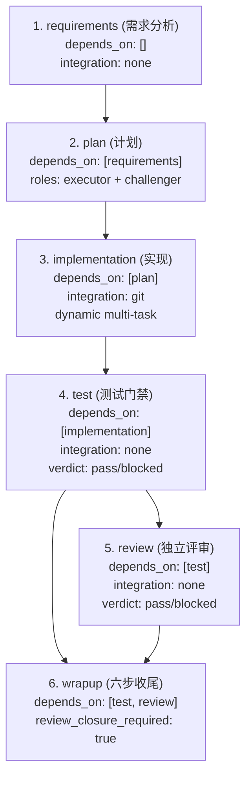

# HAFlow 真实执行链深度还原报告 (Execution Chain)

> 审计对象：`software-development-v1` 标准 6 阶段软件开发与评审流程  
> 审计基线：HAFlow Git 主干（PR #356 合并后最新代码，Commit `739ef0d`）  
> 审计日期：2026-10-29

---

## 1. 软件开发全流程拓扑与目标模型

`software-development-v1` 声明在 [`workflow_templates/software-development-v1.yaml`](file:///Users/user/haflow/workflow_templates/software-development-v1.yaml)，采用固定的 6 阶段 DAG 拓扑：



各节点的关键契约属性：
- **`requirements`**：单 Task，无 Git 集成，依赖空，产物为需求规格文档或 shared notes。
- **`plan`**：最多 2 Tasks（`executor` 架构师 + `challenger` 对抗质询），无 Git 集成，依赖 `requirements`。
- **`implementation`**：动态 1~3 并发 Tasks（上限 12），Git 集成模式，依赖 `plan`。完成交付物需通过 `herdr-task commit` 和 `herdr-task integrate` 汇入候选基线。
- **`test`**：单 Task 门禁节点，无 Git 集成，依赖 `implementation`，面向冻结 `candidate_sha`。输出机器门禁结论 `HERDR_GATE_VERDICT: pass / blocked`。
- **`review`**：单 Task 门禁节点，无 Git 集成，依赖 `test`，面向同一冻结 `candidate_sha`。输出机器门禁结论 `HERDR_GATE_VERDICT: pass / blocked`。
- **`wrapup`**：单 Task 收尾汇聚节点，汇聚依赖 `test` 和 `review`，核对同一候选的双 pass 结论；默认交付上限为 `workspace`。

---

## 2. 真实调用链全生命周期追踪 (Step-by-Step)

### 阶段 1：工作流实例创建与初始化

1. **入口**：
   - CLI 命令：`bin/herdr-task workflow launch --name <wf_id> --template software-development-v1 --project <project_id>` 或 Console 创建接口 [`console/handlers.py`](file:///Users/user/haflow/console/handlers.py)。
   - 核心调用：[`herdr/projects.py:provision_workflow_run()`](file:///Users/user/haflow/herdr/projects.py#L320-L400) 与 [`herdr/workflow.py:load_template()`](file:///Users/user/haflow/herdr/workflow.py#L75-L103)。
2. **规范化与拓扑校验**：
   - [`herdr/workflow.py:normalize_workflow()`](file:///Users/user/haflow/herdr/workflow.py#L178) 和 [`herdr/workflow.py:validate_workflow_dag()`](file:///Users/user/haflow/herdr/workflow.py#L104) 检查 DAG 是否存在环、孤岛或非法依赖。
3. **状态持久化**：
   - 权威持久化：[`herdr/state_db.py:save_workflow()`](file:///Users/user/haflow/herdr/state_db.py) 写入 SQLite `~/.herdr-controller/state.db` 中的 `workflows` 表，初始状态为 `status = 'running'`。
   - 兼容投影：[`herdr/state_store.py:export_workflows_json()`](file:///Users/user/haflow/herdr/state_store.py) 导出至 `~/.herdr-controller/workflows.json`。
   - 项目上下文：注册至 `~/.herdr-controller/projects.json`。
4. **决策特征**：
   - 同步调用，执行模式为纯函数规范化 + 本地 SQLite 事务写入。
   - PR #356 特性：在 [`herdr/projects.py:ensure_coordinator_running()`](file:///Users/user/haflow/herdr/projects.py#L280-L310) 中，由于 `software-development-v1.yaml` 声明了 `coordinator_required: false`，系统完全跳过全局常驻 LLM 总指挥（Coordinator）的创建与窗格探活。

---

### 阶段 2：节点就绪判定与调度入队

1. **守护进程主轮询**：
   - 常驻进程 [`services/herdr-controller.py:main()`](file:///Users/user/haflow/services/herdr-controller.py#L380-L419) 启动后台 `registry_watcher` 循环。
   - [`services/controller/registry.py:registry_watcher()`](file:///Users/user/haflow/services/controller/registry.py#L76-L104) 每 2 秒调用一次 `ports.check_all_workflows_stage_advance()`。
2. **阶段推进核验**：
   - 进入 [`services/controller/advancement.py:check_workflow_stage_advance()`](file:///Users/user/haflow/services/controller/advancement.py#L78-L155)。
   - **闭合状态检查**：`workflow_closed(workflow_id)` 与 `wf_st in ("completed", "paused")`。
   - **自愈与重算**：[`herdr/recovery_store.py:reconcile()`](file:///Users/user/haflow/herdr/recovery_store.py) 和 [`herdr/workflow_progress.py:assess_workflow()`](file:///Users/user/haflow/herdr/workflow_progress.py)。
   - **完成节点计算**：
     ```python
     completed_nodes = {
         n["id"]
         for n in workflow_cfg.get("nodes", [])
         if ports.is_node_complete(workflow_id, n["id"])
     }
     ```
     `is_node_complete()` 委托至 [`herdr/scheduler.py:node_is_complete()`](file:///Users/user/haflow/herdr/scheduler.py#L182-L231)。
   - **就绪节点查找**：
     调用纯函数 [`herdr/workflow.py:get_ready_nodes()`](file:///Users/user/haflow/herdr/workflow.py#L606-L625)：
     当 `completed_nodes` 为空时，仅 `depends_on: []` 的 `requirements` 节点就绪。
3. **汇聚门禁与调度保护**：
   - [`herdr/scheduler.py:join_gate_allows()`](file:///Users/user/haflow/herdr/scheduler.py#L620-L710) 验证前置节点是否在同一 candidate_sha 判定 pass（根节点直接通过）。
   - SQLite 持久化调度占位：[`herdr/node_dispatch_store.py:claim()`](file:///Users/user/haflow/herdr/node_dispatch_store.py) 在 `node_dispatch_operations` 表写入持久化租约。
   - 内存/文件互斥锁：[`services/controller/stage_state.py:mark_stage_advance_queued()`](file:///Users/user/haflow/services/controller/stage_state.py) 写入 `~/.herdr-controller/stage-state.json`。
4. **入队**：
   - 将 `stage_advance` 事件放入内存安全队列 [`services/herdr-controller.py:coordinator_queue`](file:///Users/user/haflow/services/herdr-controller.py#L233)。

---

### 阶段 3：直接派发规划与 Worker 启动

1. **队列分发器消费**：
   - 线程池 [`services/controller/coordinator_queue.py:coordinator_worker()`](file:///Users/user/haflow/services/controller/coordinator_queue.py#L12-L25) 消费事件，按 `workflow_id` 获取专属并发锁。
   - 调用 [`services/controller/stage_delivery.py:_handle_stage_advance_item()`](file:///Users/user/haflow/services/controller/stage_delivery.py#L12-L76)。
2. **直派决策执行**：
   - 调用 [`services/controller/direct_dispatch.py:try_direct_stage_advance()`](file:///Users/user/haflow/services/controller/direct_dispatch.py#L6-L100)。
   - 核心纯逻辑下沉至 [`herdr/direct_dispatch.py:plan_stage_dispatch()`](file:///Users/user/haflow/herdr/direct_dispatch.py#L624-L950)：
     - **requirements 节点**：生成 1 个 TaskSpec（`dispatch_role: "executor"`, `task_type: "docs"`）。
     - **plan 节点**：根据 `node.roles`（`executor` 与 `challenger`）同时生成 2 个 TaskSpecs。
     - **implementation 节点**：触发 [`herdr/plan_parser.py:parse_plan_tasks()`](file:///Users/user/haflow/herdr/plan_parser.py#L140-L240)，解析 Markdown 中的解耦任务并做文件重叠校验；无冲突时直接生成 1~3 个 TaskSpecs。
     - **test/review/wrapup 节点**：生成单工位验证/收尾 TaskSpec，注入冻结的 `candidate_sha`。
3. **物理派发（Imperative Shell）**：
   - [`services/controller/direct_dispatch.py`](file:///Users/user/haflow/services/controller/direct_dispatch.py#L295-L350) 使用 `subprocess.run` 调用 CLI：
     ```bash
     bin/herdr-task launch \
       --task-id <task_id> \
       --workflow-id <workflow_id> \
       --node <node_id> \
       --source <project_root> \
       --agent auto \
       --task-type docs|feat|test \
       --integration-mode none|git \
       ...
     ```
4. **Worker 工位装配**：
   - [`herdr/task_cli_launch.py`](file:///Users/user/haflow/herdr/task_cli_launch.py) 承接命令：
     - 调用 [`herdr/git_coordination.py:ensure_no_git_processes()`](file:///Users/user/haflow/herdr/git_coordination.py#L95) 检查 Git 独占。
     - 调用 [`herdr/agent_router.py:choose_agent()`](file:///Users/user/haflow/herdr/agent_router.py) 动态选择 Agent（排除历史冲突 Agent）。
     - 在独立 CoW 目录（`~/.herdr-controller/clones/<task_id>`）拉取 Git 克隆或共享工作区。
     - 启动常驻窗格进程 [`services/herdr-worker.py`](file:///Users/user/haflow/services/herdr-worker.py) 或连接 tmux 窗格。
   - 初始任务状态落盘为 `status: "dispatched"` 然后转为 `"working"`（SQLite `tasks` 表）。

---

### 阶段 4：Agent 执行与完成状态感知

1. **运行时监控**：
   - 外部探针 [`services/herdr-sentinel.py`](file:///Users/user/haflow/services/herdr-sentinel.py) 定期抓取终端屏幕、进程状态与心跳。
   - Socket 订阅：[`services/controller/task_listener.py:listen_task()`](file:///Users/user/haflow/services/controller/task_listener.py#L103-L215) 连接 `~/.config/herdr/herdr.sock`，监听 `pane.agent_status_changed` 事件。
2. **状态判定与采样**：
   - 当 Agent 在窗格中退出或恢复空闲，Socket 产生 `agent_status: "idle"` 或 `"done"` 事件。
   - [`services/controller/task_listener.py:handle_event()`](file:///Users/user/haflow/services/controller/task_listener.py#L6-L100)：
     - 对门禁节点检查 [`services/controller/auto_acceptance.py:gate_verdict_ready()`](file:///Users/user/haflow/services/controller/auto_acceptance.py#L230)。
     - 采样平滑通过后，CAS 乐观更新任务状态：`status -> "agent_done"`。
3. **完成网关过滤 (Done Gateway)**：
   - [`services/controller/done_events.py:emit_done_if_allowed()`](file:///Users/user/haflow/services/controller/done_events.py#L6-L64)：
     - 触发 Trajectory Observer 旁路观察。
     - 调用 Semantic Supervisor 检查点 [`herdr/supervisor/`](file:///Users/user/haflow/herdr/supervisor/)。
     - 若通过，向 `coordinator_queue` 投递 `done` 事件。

---

### 阶段 5：交付物检查与自动验收 (Auto-Acceptance)

1. **事件消费与分流**：
   - [`services/controller/task_events.py:_handle_task_event()`](file:///Users/user/haflow/services/controller/task_events.py#L6-L64) 处理 `event_type == "done"`。
2. **规则化验收快路径 (Fast-Path)**：
   - **非门禁节点 (`requirements`, `plan`, `implementation`)**：
     调用 [`services/controller/auto_acceptance.py:try_auto_accept()`](file:///Users/user/haflow/services/controller/auto_acceptance.py#L42-L190)：
     - `requirements`：读取 `requirements.md` 或 notes，通过 [`herdr/stage_skills.py:validate_requirements_deliverable_content()`](file:///Users/user/haflow/herdr/stage_skills.py#L428) 匹配必须包含的 5 大结构段落。
     - `plan`：读取 `plan.md` 或 notes，通过 [`herdr/stage_skills.py:validate_plan_deliverable_content()`](file:///Users/user/haflow/herdr/stage_skills.py#L454) 校验 executor 与 challenger 交付内容。
     - `implementation`：调用 `verify-baseline` 校验克隆工作区存在受控代码变更（`TASK_CHANGED`）。
     - 校验通过直接更新状态为 `status = "completed"`。
   - **门禁节点 (`test`, `review`, `wrapup`)**：
     `try_auto_accept()` 遇到门禁节点直接返回 `False`，转由 [`services/controller/auto_verdict.py:try_auto_verdict()`](file:///Users/user/haflow/services/controller/auto_verdict.py#L95-L174) 校验：
     - 读取 `~/.herdr-controller/gate-verdicts/<task_id>.json` 或终端 `HERDR_GATE_VERDICT:` 标记。
     - 结论为 `pass` 或 `blocked` 时，调用 `bin/herdr-task set <task_id> completed --verdict <verdict>`。
3. **PR #356 Staged 流程旁路截断**：
   - 若 `try_auto_accept()` 与 `try_auto_verdict()` **均未成功**（例如：需求文档缺中文关键字、Challenger 缺少 Plan-Ref 引用、测试未输出标准标记）：
     ```python
     if is_staged_dev_flow_workflow(_wf_cfg):
         ports.attention_note(key, _task_pre, event_type, reason=f"auto_acceptance_rejected: {_r}")
         print(f"[STAGED TASK EVENT BYPASS] task={task_id} event={event_type}")
         return
     ```
     **执行链在此静默中断**！既不重试，也不唤醒 LLM 总指挥，任务永久停留在 `agent_done`。

---

### 阶段 6：终化、集成与候选冻结 (Git Finalize & Freeze)

1. **Git 终化提交与合流**：
   - 对已完成的 Git 任务（如 `implementation`），[`services/controller/git_finalize.py:finalize_completed_task()`](file:///Users/user/haflow/services/controller/git_finalize.py#L11-L100) 触发：
     - `bin/herdr-task commit <task_id>`：在 CoW 克隆中提交代码，状态跃迁为 `committed`。
     - `bin/herdr-task integrate <task_id>`：合入本地交付分支，状态跃迁为 `integrated`。
2. **候选版本冻结 (Candidate Freeze)**：
   - 当 `implementation` 节点所有任务均达到 `integrated`，在下一轮 sweep 的 [`services/controller/advancement.py:_scheduler_resolve_candidate_and_plan()`](file:///Users/user/haflow/services/controller/advancement.py#L11-L76) 中：
     - 调用 [`herdr/scheduler_facts.py:record_candidate_frozen()`](file:///Users/user/haflow/herdr/scheduler_facts.py)，将当前分支的 Git Commit 40-hex SHA 冻结为不可变 `candidate_sha`。
     - 记录 `candidate_frozen` 事件于 `state.db`。下游 `test` 和 `review` 节点将绑定此 SHA 独立派发。

---

### 阶段 7：门禁汇聚、下游推进与返工分支

1. **测试与评审推进**：
   - `test` 运行完毕并产生 `pass` 门禁结论后，DAG 识别 `review` 依赖满足，派发 `review`。
2. **汇聚门禁 (Join Gate)**：
   - `wrapup` 节点依赖 `[test, review]`。
   - [`services/controller/join_gates.py`](file:///Users/user/haflow/services/controller/join_gates.py) 和 [`herdr/scheduler.py:evaluate_join_gate()`](file:///Users/user/haflow/herdr/scheduler.py#L650)：
     严格比对 `test` 任务与 `review` 任务记录的 `candidate_sha` 是否与当前工作流冻结的 SHA 完全相同。两者均 `pass` 且一致方放行。
3. **返工分支 (Fix-Loop)**：
   - 若 `test` 或 `review` 任一节点产生 `blocked` 结论：
   - 触发 [`services/controller/fix_loop.py:handle_fix_loop()`](file:///Users/user/haflow/services/controller/fix_loop.py) 与 [`herdr/fix_loop.py`](file:///Users/user/haflow/herdr/fix_loop.py)。
   - 作废 `implementation` 历史任务（标记为 `superseded`），在 `stage-state.json` 写入 `pending_redo` 闩，累计 `fix_loop_count`。若未超过 `FIX_LOOP_MAX`（默认 3 次），重新将 `implementation` 标记为待派发；若耗尽则停在 `attention.json` 等待人工介入。

---

### 阶段 8：收尾与全流程关闭

1. **收尾节点执行**：
   - `wrapup` 节点运行：默认在 `delivery_ceiling_default: workspace` 下，核对全流程成果、调用 `knowledge-capture` 提取教训，产出交付报告。
2. **全流程完成裁决**：
   - [`services/controller/advancement.py`](file:///Users/user/haflow/services/controller/advancement.py#L190-L234) 评估 [`herdr/workflow.py:is_workflow_completed()`](file:///Users/user/haflow/herdr/workflow.py#L641)：
     当所有 6 个节点均出现在 `completed_nodes` 中且无未决门禁时，打印 `[WORKFLOW COMPLETE]`。
   - 调用 [`services/controller/workflow_close.py:maybe_close_completed_workflow()`](file:///Users/user/haflow/services/controller/workflow_close.py)，工作流状态落盘为 `completed`。

---

## 3. 关键状态权威持久化地图

| 状态对象 | 事实源 (Single Source of Truth) | 派生投影 (Read Projections) | 风险与不一致敞口 |
|---|---|---|---|
| **Workflow 元数据** | SQLite `state.db` (`workflows` 表) | `~/.herdr-controller/workflows.json` | 存在双写同步窗口，直接读 JSON 可能读到旧状态 |
| **Task 生命周期** | SQLite `state.db` (`tasks` 表) | `~/.herdr-controller/tasks.json` | `tasks.json` 由 `_sync_projection_locked` 导出，高频写入时可能发生跨进程脏读 |
| **调度排队锁** | `~/.herdr-controller/stage-state.json` (`mark_stage_advance_queued`) | 内存字典 `state` | 进程崩溃或异常重启后可能残留 `notified` 锁，导致节点不再就绪 |
| **异常/挂起关注** | `~/.herdr-controller/attention.json` (`EpisodeStore`) | Controller 日志与通知中心 | 仅追加与清理，无自动过期淘汰机制，挂起后除非人工清除否则阻止重试 |
| **门禁裁决结论** | `~/.herdr-controller/gate-verdicts/<task_id>.json` + 任务 `stage_verdict` | 窗格终端屏幕标记 `HERDR_GATE_VERDICT:` | 双通道不一致时发生回退或截断 |
| **候选冻结身份** | SQLite `state.db` (`events` 表 `candidate_frozen`) | `workflows.candidate_sha` | Wrapup 更新代码若未重走冻结，会导致下游校验 SHA 不匹配 |
| **调度持久租约** | SQLite `state.db` (`node_dispatch_operations` 表) | 无 | 进程强杀可能留下非终态 lease |

---

## 4. 同步与异步决策路径识别

```text
[主同步驱动环 (2s Tick)]
  services/controller/registry.py (registry_watcher)
    │
    ├── 同步重算: check_workflow_stage_advance()
    │     ├── 纯逻辑计算: get_ready_nodes() + is_node_complete()
    │     └── 发现就绪: coordinator_queue.put(stage_advance)
    │
    └── 同步轮询: process_structured_completions() + process_gate_verdict_reconciliations()

[异步工作流执行链 (Queue -> ThreadPool)]
  services/controller/coordinator_queue.py (coordinator_worker)
    │
    ├── 异步消费: _handle_stage_advance_item()
    │     └── plan_stage_dispatch() -> 启动子进程 bin/herdr-task launch (非阻塞外壳)
    │
    └── 异步消费: _handle_task_event(done)
          ├── 尝试 try_auto_accept() / try_auto_verdict()
          └── 失败时: 记录 attention_note 并直接 return (异步丢弃)
```

**关键架构发现**：
HAFlow 的决策骨干实际上由两套节拍驱动：
1. **2 秒周期的轮询扫描器（`registry_watcher`）**：负责全局 DAG 就绪探测与超时兜底；
2. **事件队列与线程池（`coordinator_queue`）**：负责具体的调度动作与完成响应。
当事件在第二套异步队列中被条件拒绝（如 PR #356 的 staged bypass）且未修改底层任务状态时，第一套扫描器在后续轮询中只能持续感知到未就绪的任务，导致整体流程进入无人推进的永久静默区。
