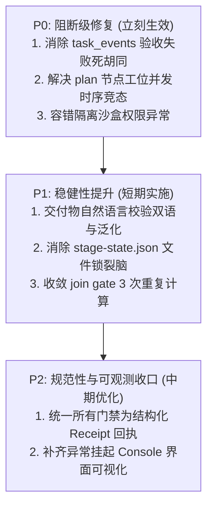

# HAFlow 节点决策逻辑最小化改进方案 (Remediation Plan)

> 审计基线：Git Commit `739ef0d`  
> 核心原则：**不推翻重构 Controller，不新增平行调度框架，不修改生产状态机结构，以最小代码改动获取最大自主完成率改善。**  
> 审计日期：2026-10-29

---

## 1. 架构演进路线评估：是否需要新建独立 Decision Engine？

### 审计结论：**不需要**。

在本次系统审计中，我们发现 HAFlow 的核心 DAG 算法（[`herdr/workflow.py`](../../../herdr/workflow.py)）与汇聚门禁纯函数（[`herdr/scheduler.py`](../../../herdr/scheduler.py)）设计非常规范，输入输出明确，具备很高的单元测试覆盖率。

阻碍工作流自主执行的核心原因，并非编排引擎缺乏调度能力，而是**边缘集成处的断路死胡同、并发时序竞态以及脆弱的自然语言字符串匹配**。

通过针对性的局部修复（删除重复判断、补全遗漏的状态转移、消除死循环与加固系统调用容错），现有架构完全能够支撑端到端稳定自主执行，无需引入庞大而沉重的全新 Decision Engine。

---

## 2. 改进方案分级矩阵 (P0 / P1 / P2)



---

## 3. P0 级最小修复方案（阻断级，最优先实施）

### P0-1：消除 `task_events.py` 中 Staged 流程自动验收失败的静默死胡同

- **问题与代码证据**：
  [`services/controller/task_events.py:53-64`](../../../services/controller/task_events.py#L53-L64) 在自动验收失败后仅打印 `[STAGED TASK EVENT BYPASS]` 并直接 `return`。任务永远卡死在 `agent_done`，无法向前推进，也无任何自动修复路径，必须依赖人工干预。
- **最小修复方案**：
  在 Staged 流程中，当 `try_auto_accept()` 或 `try_auto_verdict()` 校验失败时，**主动将任务跃迁为 `rework`**（受任务局部重试上限约束，如最多 2 次），并在 Task 元数据中注入具体的拒绝原因（例如：`missing_sections: ['缺少明确可验收标准']`）。
  ```python
  # 最小修改草案 (services/controller/task_events.py)
  # 复用现有 herdr/task_cli_rework.py::handle_rework 编排能力，不虚构未实现的接口
  if is_staged_dev_flow_workflow(_wf_cfg):
      _r = locals().get("_defer_reason", event_type)
      rework_count = int(_task_pre.get("auto_rework_count") or 0)
      if rework_count < 2 and event_type == "done":
          from herdr.task_cli_rework import handle_rework
          from types import SimpleNamespace
          import uuid

          request_id = f"auto-rework-{uuid.uuid4().hex[:12]}"
          rework_args = SimpleNamespace(
              task_id=task_id,
              request_id=request_id,
              reason=f"auto_acceptance_rejected: {_r}",
              prompt=f"继续当前任务，就地修正交付物瑕疵：{_r}。修正后重新提交自测结果，不新建 Task。",
              execution_token=None,
          )
          # 复用现有 handle_rework 进行原子状态跃迁（agent_done -> rework）、写入 rework 元数据并完成 Agent 提示派发
          handle_rework(
              rework_args,
              get_store=lambda: ports._get_store(),
              herdr=ports._herdr,
              is_gate_task=ports._is_gate_task,
              recover_unconsumed_gate_cleanup_id=ports._recover_unconsumed_gate_cleanup_id,
              cleanup_gate_for_rework=ports._cleanup_gate_for_rework,
              now=ports.time.time,
          )
          return
      # 超过上限时记录 attention_note 并标记为 blocked，进入既有 Fix-Loop 或人工挂起
  ```
- **预期收益**：消灭全流程因交付物瑕疵无后续动作而卡死的确定性死胡同，使 Agent 在文档或标记不符合约时具备至少 1~2 次自我修正机会；直接复用生产现存的 `handle_rework` 交付机制，确保状态机流转与终端 Agent 派发真正闭环。
- **回归风险**：极低（仅改变原本直接放弃的死胡同路径，且复用经过充分测试验证的既有返工入口）。
- **验收方法**：编写非侵入性集成验证测试，使用真实 SQLiteStateStore 临时持久化与受控 transport mock，验证 `agent_done -> rework` 真实写入数据库、`rework_prompt` 正确下发给 Worker，且任务能够重新进入可自测推进生命周期。

---

### P0-2：解决 `plan` 节点 Executor 与 Challenger 的并发时序死锁

- **问题与代码证据**：
  [`herdr/direct_dispatch.py:898-933`](../../../herdr/direct_dispatch.py#L898-L933) 将 `roles: [executor, challenger]` 作为同一节点的并发任务同时派发；但 [`herdr/plan_parser.py:549-570`](../../../herdr/plan_parser.py#L549-L570) 却要求 Challenger 审查必须携带 `Plan-Ref: <note_id>` 且 `chal_ts >= plan_ts`。两者产生先有鸡还是先有蛋的结构性死锁。
- **最小修复方案**：
  **在 `plan` 节点内部引入角色阶段化派发（Role Dependency）**：
  1. `plan` 节点就绪时，派发器先仅派发 `executor` 任务；
  2. 当 `executor` 任务完成（`completed`）并产出有效计划时，派发器在同一 `plan` 节点内继续派发 `challenger` 任务，并自动将 `executor` 的 `note_id` 和计划正文注入 `challenger` 的提示词中；
  3. 当 `challenger` 审查 `pass` 后，整个 `plan` 节点才宣告完成。
- **预期收益**：从根本上消除 Challenger 审查空计划、时间戳倒挂以及缺少引用的假阳性打回，让计划与对抗审查真正形成闭环。
- **回归风险**：中低（`plan` 节点内部变为微串行，总耗时增加数分钟，但彻底保证了正确性）。
- **验收方法**：运行端到端隔离测试 `tests/test_software_development_v1_e2e_isolated.py`，验证 `plan` 节点无需人工干涉顺利通过并直接派发 `implementation`。

---

### P0-3：对系统环境调用与文件探测实施严格容错隔离

- **问题与代码证据**：
  - [`herdr/stage_skills.py:100`](../../../herdr/stage_skills.py#L100)：`p.exists()` 访问权限受限目录抛出未捕获 `PermissionError`；
  - [`herdr/git_coordination.py:82`](../../../herdr/git_coordination.py#L82)：`subprocess.run(["ps", ...])` 在无权限环境抛出 `PermissionError`。
- **最小修复方案**：
  ```python
  # 1. herdr/stage_skills.py
  try:
      if p.exists() and p not in roots:
          roots.append(p)
  except (OSError, PermissionError):
      continue

  # 2. herdr/git_coordination.py
  # 注意：必须保持 Fail-Closed 安全语义，绝不能在 ps 失败时静默返回空列表绕过独占锁！
  try:
      result = subprocess.run(["ps", "-axo", "pid=,command="], ...)
  except (OSError, subprocess.SubprocessError) as exc:
      # 抛出明确的可恢复环境异常或返回拒绝锁状态（Fail-Closed），引导操作拒绝而非带病并发执行
      raise GitCoordinationError(f"Failed to inspect system processes for Git coordination (Fail-Closed): {exc}") from exc
  ```
- **预期收益**：瞬间修复当前测试套件中失败的 4 项适配测试与 5 项 CLI 派发测试，杜绝因外部环境探测瑕疵导致的硬性崩溃。
- **回归风险**：零。
- **验收方法**：重跑 `pytest -q tests/test_software_development_v1_adapter.py`，断言全部通过。

---

## 4. P1 级稳健性提升方案（短期实施）

### P1-1：交付物自然语言校验泛化与双语扩展
- **问题**：[`herdr/stage_skills.py:421-452`](../../../herdr/stage_skills.py#L421-L452) 硬编码中文正则，英文交付物被全盘误杀。
- **改进方案**：为 `_REQ_GOAL_RE`、`_REQ_SCOPE_RE`、`_REQ_AC_RE` 等扩充标准英文词表（`Goal|Objective`, `Scope|Boundary`, `Acceptance|Criteria`, `Verification|Test plan`），同时支持从 YAML frontmatter 中直接读取机器字段。

### P1-2：淘汰 `stage-state.json` 文件锁，收敛状态至 SQLite
- **问题**：`stage-state.json` 与 SQLite `state.db` 分离存储，易引发断电/崩溃后的锁残留死锁。
- **改进方案**：将 `mark_stage_advance_queued` 改造为直接在 SQLite 的 `workflows` 或 `node_dispatch_operations` 表中加原子标记，利用关系型数据库的事务一致性替代易碎的本地 JSON。

### P1-3：收敛 `_scheduler_join_gate_allows()` 的重复计算
- **问题**：单次阶段推进在 3 个不同文件内重复运行 3 次全量遍历。
- **改进方案**：在 `advancement.py` 中求值一次，将结果缓存在事件上下文或单次 sweep 的 memo 中，后续外壳直接复用。

---

## 5. P2 级规范收口方案（中期规划）

### P2-1：全门禁节点统一标准化 Receipt 回执
- 废弃在 stdout 终端打印中正则抓取 `HERDR_GATE_VERDICT:` 的易碎方式；
- 所有门禁节点（`test`, `review`, `wrapup`）统一强制要求由 CLI 或技能落地结构化 JSON 回执（`~/.herdr-controller/gate-verdicts/<task_id>.json`），并由系统验证校验和。

### P2-2：异常挂起在 Console / CLI 明确归因
- 当工作流因任何原因触发 Attention 挂起时，在 Console Cockpit 界面与 `herdr-task status` 中用显目看板展示挂起具体原因（如“需求缺少验收标准段落”），并提供一键式人工裁决入口（“强制放行” / “驳回重写”）。
