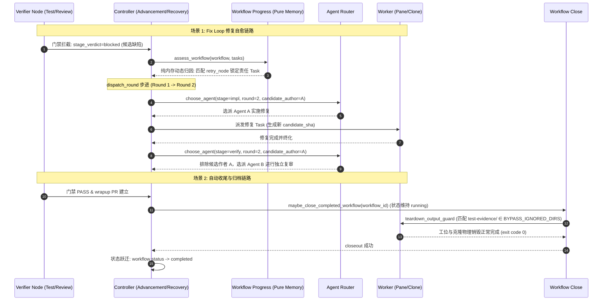

# HAFlow 工作流自主执行阻塞治理与自愈机制设计规范 (HAFlow Workflow Autonomy & Blocker Remediation)

*   **Author:** HAFlow Engineering Team
*   **Status:** Approved & Finalized
*   **Date:** 2026-11-01

---

## Overview

HAFlow 是共事智能打造的多 Agent 协同编排引擎。工作流依照 YAML 模板定义的 DAG 拓扑、节点策略与门禁规则调度执行；除需要人工审批的高风险操作外，调度层针对预期的重试与状态不一致提供自愈处理。

在生产长程任务（如 `wf-haflow-1029-02`，跨度 20 小时、衍生 28 个 Task）的执行记录中，系统自动化推进多次中断，依赖人工介入执行 CLI 命令解除死锁并手动调度派发。

本文档定义了一套系统性自愈与阻断治理规范，旨在消除跨轮次累积导致的路由隔离死锁、修复恢复状态机过度保守而陷入的人工介入挂起 (`waiting_human`)、清理工位测试产物阻断，并打通自动收尾与异常告警链路，恢复工作流在既定质量红线约束下的端到端自主执行能力。

---

## The Problem

当前 HAFlow 在长程运行、缺陷修复（Fix Loop）及任务收尾阶段存在四个导致自动化断层的核心卡点：

1. **路由隔离在多轮修复场景下的候选池累积耗尽（Deadlock via Flat Exclusion）**：
   `agent_policy` 规定“实现者与审查者必须分离”以确保质量客观性。然而，现有调度器维护覆盖整个工作流历史的全局扁平排除集（`stage_used_agents`）。在包含多轮修复（Fix Loop）的工作流中，随着各阶段使用的 Agent 逐个累加，整个 Agent 池（通常为 3–5 个实例）迅速被全量排除，触发调度拒绝（`No available Agent for stage`），系统陷入逻辑死锁。
2. **故障恢复状态机面对状态微调时过度防御（Over-Defensive Halting）**：
   当审查门禁未在结构化数据中显式填充 `affected_task_ids` 时，恢复机制因 `candidate_responsible_source` 硬编码了 `'implementation'` 节点名称，导致生产模板（如 `code-craft-v1.yaml` 中节点名为 `'craft'`）完全无法匹配责任任务，触发 `affected_tasks_unknown` 并直接转为 `waiting_human`；当前序任务状态因版本推进或替换发生变更时，`node_dispatch.py` 立即判定 `dispatch_predecessor_changed` 并直接转入 `waiting_human`，导致工作流在无人工干预时中断停滞。
3. **未受管测试副产物阻断工位物理销毁（Teardown Lockout）**：
   测试与浏览器验证任务在运行中生成非版本跟踪的诊断产物（如 `test-evidence/`、`test-results/`、`playwright-report/`、`.coverage` 等）。由于上述目录未登记于销毁旁路白名单（`BYPASS_IGNORED_DIRS`），工位 Teardown 守卫以“存在未提交/未保留文件”为由抛出退出码 2，阻断工位和克隆的物理销毁，导致系统资源滞留。
4. **自动收尾管线异常退避导致工作流停滞无进展（Silent Closeout Backoff）**：
   系统已具备自动收尾机制（`maybe_close_completed_workflow`），但在触发收尾时，由于上述测试产物导致的 Teardown 失败，收尾子进程异常终止并触发指数退避（最高达 600 秒），且未向操作人员发出包含具体阻断文件列表与排障命令的高优先级 Attention 告警，导致工作流在数据库与 UI 中持续停留于执行态而无实际进展。

---

## Goals

*   **Goal 1：实现轮次级路由隔离（Round-Scoped Isolation）**：将 Agent 隔离的作用域严格限定于当前活动修复轮次。审查节点仅排除生成当前候选代码的实现 Agent，消除小规模 Agent 池在多轮修复时的排空死锁。
*   **Goal 2：设定回炉轮次与成本硬熔断**：通过 `herdr/node_capacity.py` 与 `herdr/workflow_progress.py` 设定单节点修复轮次上限 `MAX_REMEDIATION_ROUNDS = 2`。超过 2 轮时确定性转入人工仲裁（`waiting_human`），避免因模型判断分歧产生非预期 Token 消耗。
*   **Goal 3：纯函数架构下的单点精确回炉（Targeted Remediation）**：在保持 `herdr/workflow_progress.py` 纯内存计算无 I/O 的前提下，消除对 `'implementation'` 节点名称的硬编码，动态根据门禁配置的 `retry_node` 匹配责任 Task，并在多任务并行交叠无法单点归因时安全回退至活动实现任务集合，避免误打回无关任务。
*   **Goal 4：前序变更的自主有界重规划（Autonomous Re-dispatch）**：改造 `herdr/node_dispatch.py`，前序任务变更时首先核验在运行 Worker 的状态，确保旧进程终结后再转入 `superseded`，在 operation 级别限制 `max_replan_attempts = 2`，实现受控的就地重新规划。
*   **Goal 5：扩展清理忽略目录白名单**：在 `herdr/clone_archive.py` 的 `BYPASS_IGNORED_DIRS` 中追加常用测试与覆盖率产物目录（`test-evidence`、`test-results`、`playwright-report`、`coverage`、`.coverage`、`htmlcov`），保证工位正常销毁，退出码为 0。
*   **Goal 6：收尾状态一致性与诊断告警提升**：在收尾完成前保持工作流生命周期状态为 `running`，避免状态机不可逆死锁；在收尾连续重试失败时，调用 `ports.attention_note` 发布高优先级 Attention Episode，输出阻断文件明细与排障命令。

---

## Non-Goals

*   **Non-Goal 1：禁止原作者对自身代码进行 Review PASS 裁决**：同轮次内严格禁止原作者自审自验。在多轮修复中，原作者 A 修复其代码缺陷并提交新候选版本，审查者 B 对新候选版本再次复核，审查者与候选代码作者严格分离。
*   **Non-Goal 2：不构建平行于既有 DAG 的收尾状态机**：不新增基于 PR 事件的第二套收尾引擎，复用已有的 `maybe_close_completed_workflow` 管道。
*   **Non-Goal 3：不绕过生产分支合并的人工最终确认**：涉及将代码合入生产主干或推送远端的高危动作，依然保留人工确认签署门禁。
*   **Non-Goal 4：不在状态机核心评估层引入外部 I/O**：保持 `workflow_progress.py` 的纯函数约束，不调用 `git log` 或执行数据库写操作。

---

## Critical User Journeys (CUJs)

### CUJ 1: Fix Loop 审查拦截后的无人值守自主修复旅程
*   **Given**: 工作流包含实现节点与审查门禁，可用 Agent 池包含 2 个实例（Agent A 与 Agent B），当前处于 Round 1（A 编码，B 审查）。
*   **When**: Agent B 审查发现缺陷，返回 `stage_verdict: blocked`（打回重做）。
*   **Then**: 
    1. 调度器将修复轮次步进至 Round 2；
    2. 调度器派发 Agent A 对缺陷进行针对性修复（Author A 修复自身代码），此时不触发路由互斥；
    3. 修复完成后生成新候选版本 $C_2$，门禁节点再次派发时，排斥集合仅包含 $C_2$ 的作者 Agent A，系统自然选派 Agent B 作为审查者，全过程严格保证审查独立性；
    4. 调度器依据门禁关联的 `retry_node`（如 `craft`）精准反向锁定实现 Task，全过程自动完成调度，不触发 `waiting_human`；
    5. 若在 Round 2 内再次 blocked 且达到 `MAX_REMEDIATION_ROUNDS = 2` 上限，系统确定性挂起并生成结构化诊断信息。

### CUJ 2: 测试门禁通过后的自动收尾与归档旅程
*   **Given**: 实现代码修复，测试任务输出了包括 `test-evidence/` 和 `playwright-report/` 在内的测试产物，门禁判定全部通过 (PASS)。
*   **When**: wrapup 节点成功提交 PR 并记录审核闭环，DAG 所有节点达成 completed。
*   **Then**: 
    1. `services/controller/advancement.py` 自动检测到工作流完成，触发异步收尾管道 `maybe_close_completed_workflow`，工作流生命周期维持 `running`；
    2. Teardown 守卫将测试产物识别为 `BYPASS_IGNORED_DIRS` 允许项放行，工位正常销毁，退出码为 0；
    3. 工作流正常推进至 `completed` 终态并释放所有运行锁，无需操作人员手动执行 `herdr-task close-workflow` 命令。

---

## Technical Plan (Architecture)

### 1. 系统端到端架构与自主执行状态流转

本方案在现有 HAFlow 调度与状态机分层上实现，保持既有系统不变量与架构边界。



---

### 2. 轮次级路由隔离模型 (Round-Scoped Isolation Engine)

*   **修改组件**：[`herdr/agent_router.py`](file:///Users/user/haflow/herdr/agent_router.py)
*   **核心机制**：
    1.  **公共入口与参数扩展**：
        扩展公共函数 `choose_agent(...)` 及其内部调用链 `_choose_agent_impl` 与 `_choose_agent_locked`，接收可选参数 `dispatch_round: Optional[int] = None` 与 `candidate_author: Optional[str] = None`。
    2.  **验证者排除范围局部化**：
        在 `_choose_agent_locked` 中，当判定当前阶段属于验证节点（`is_verifier_node_id`）时，排除集仅针对生成当前候选版本的作者 Agent，不再全量累加历史所有轮次使用的 Agent。
    3.  **作者修复自主性**：
        实现节点不属于审查验证阶段，不排斥原作者对自身代码进行缺陷修复。在 2 个 Agent 的典型配置下，Round 1（A 实现、B 审查）被阻断后，Round 2 由 A 执行修复、B 再次审查，审查者与被审查代码作者严格隔离。
    4.  **修复轮次上限控制**：
        复用现有 [`herdr/node_capacity.py`](file:///Users/user/haflow/herdr/node_capacity.py) 与 [`herdr/workflow_progress.py`](file:///Users/user/haflow/herdr/workflow_progress.py) 的 `max_tasks_per_node` 机制，将单节点最大修复任务限制为 2 次，超限后触发 `verifier_budget_exhausted` 转入 `waiting_human`。

---

### 3. 动态自愈归因与安全重规划 (Pure Recovery & Safe Re-dispatch)

*   **修改组件**：[`herdr/workflow_progress.py`](file:///Users/user/haflow/herdr/workflow_progress.py), [`herdr/node_dispatch.py`](file:///Users/user/haflow/herdr/node_dispatch.py), [`herdr/node_dispatch_store.py`](file:///Users/user/haflow/herdr/node_dispatch_store.py)
*   **核心机制**：
    1.  **消除硬编码，支持动态节点归因**：
        在 `herdr/workflow_progress.py` 中修改 `candidate_responsible_source`，移除 `(task.get('node') or task.get('stage')) != 'implementation'` 的硬编码限制，改为根据 DAG 门禁中声明的 `retry_node`（例如 `craft`、`feat`、`core`）进行匹配。
    2.  **补齐候选匹配凭据**：
        在 `workflow_progress.py:assess_workflow` 与 `_identity_reason` 中，补齐对 `task.get('integrated_commit')` 的比对，确保候选版本集成 commit 与 Task 记录严格对应。
    3.  **多任务交叠安全回退**：
        若无法单点锁定单一责任任务，安全回退至目标重试节点的全部活动任务列表：
        ```python
        affected.update(t['task_id'] for t in current if (t.get('node') or t.get('stage')) == retry and t.get('status') not in ('superseded', 'failed'))
        ```
    4.  **前序变更并发安全重规划**：
        在 `herdr/node_dispatch.py:result` 中，当前序任务变更（`not predecessors_current`）时：
        - 若当前任务的 Worker 仍在执行（处于活跃运行状态），先等待 Worker 退出或发出取消信号，避免并发进程碰撞；
        - 若任务已处于终态，在 `operation['detail']` 中递增 `replan_count`；当 `replan_count < 2` 时返回 `('superseded', {'reason': 'dispatch_predecessor_changed', 'replan_count': count})`；达到 2 次后转入 `('waiting_human', {'reason': 'dispatch_replan_exhausted'})`。

---

### 4. 工位清理旁路白名单扩展 (Teardown Bypass Whitelist)

*   **修改组件**：[`herdr/clone_archive.py`](file:///Users/user/haflow/herdr/clone_archive.py)
*   **核心机制**：
    在 `herdr/clone_archive.py` 的常量集合 `BYPASS_IGNORED_DIRS` 中一次性纳入标准测试、浏览器与代码覆盖率临时目录：
    ```python
    BYPASS_IGNORED_DIRS = frozenset({
        ".codegraph",
        ".cache",
        "node_modules",
        "dist",
        ".pytest_cache",
        "test-evidence",
        "test-results",
        "playwright-report",
        "coverage",
        ".coverage",
        "htmlcov",
    })
    ```
    上述目录均为 Worker 运行期瞬态副产物，核心测试结论与证据已在任务结束时入库持久化，忽略此类目录保证了工位释放零阻碍。

---

### 5. 稳健收尾管道与诊断告警提升 (Robust Closeout & Diagnostic Alerting)

*   **修改组件**：[`services/controller/advancement.py`](file:///Users/user/haflow/services/controller/advancement.py), [`services/controller/workflow_close.py`](file:///Users/user/haflow/services/controller/workflow_close.py), [`services/herdr-controller.py`](file:///Users/user/haflow/services/herdr-controller.py)
*   **核心机制**：
    1.  **保持生命周期状态一致性**：
        工作流在收尾子进程执行期间保持 `status = 'running'`，避免因过早进入 `closing` 状态导致主循环调和跳过或不可逆状态机异常。
    2.  **退避异常日志传递与 Attention 告警**：
        修改 `workflow_close.py:_note_close_backoff` 签名，接收子进程的 `error_output`。当连续退避重试次数 `>= 2` 时，调用 `ports.attention_note(...)` 记录 Attention Episode，附带阻断文件列表与排障命令（`herdr-task close-workflow <id> --dry-run`）。

---

## Risks & Limits / Mitigations

| 风险 / 边界场景 | 影响程度 | 触发条件 | 缓解方案与系统保证 |
| :--- | :--- | :--- | :--- |
| **循环回炉导致配额消耗** | 中 | 修复后代码持续无法通过门禁 | 由 `node_capacity.py` 严格施加 `MAX_REMEDIATION_ROUNDS = 2` 限制，超限后转入 `waiting_human` 人工介入。 |
| **多任务并行归因模糊** | 低 | 多个并行开发任务同时合入同一 Candidate | 回退至目标重试节点的全部活动任务集合统一重测，避免单点盲猜。 |
| **Worker 进程与新任务冲突** | 中 | 前序任务变更时旧 Worker 尚未退出 | 在 `node_dispatch.py` 中增加运行态检查，仅在旧任务终结或完成取消后再触发 `superseded` 重规划。 |
| **未知测试框架产物阻断清理** | 低 | 用户在工作流中使用了非标准输出目录 | 已一次性将常用测试与覆盖率产物纳入 `BYPASS_IGNORED_DIRS`；收尾失败时输出 `--dry-run` 排障命令。 |

---

## Alternatives Considered

### 1. 路由隔离策略 (Routing Isolation Alternatives)

#### Alternative 1A: 允许原作者自审自验 (Self-Review)
*   **Pros**: 任意小规模池无需调度约束即可闭环。
*   **Cons**: 大模型对自身生成的代码存在极高的正向确认偏差，自写自审实质上等同于放弃质量门禁。
*   **Reason for Rejection**: 坚决守住质量独立性红线。

#### Alternative 1B: 全局硬隔离不变 + 强制外部 Agent 扩容 (Pool Expansion)
*   **Pros**: 调度算法无改动。
*   **Cons**: 随着长程工作流轮次增加，任意固定数量的 Agent 池都会最终耗尽，增加不必要的外部依赖与运行成本。
*   **Reason for Rejection**: 未解决代际隔离作用域过宽的根本缺陷。

---

### 2. 回炉自愈归因机制 (Remediation Attribution Alternatives)

#### Alternative 2A: 在 Controller 主循环中穿透执行 Git Commit 溯源 (`git log -1`)
*   **Pros**: 借助版本控制历史推导提交者。
*   **Cons**: 破坏 `herdr/workflow_progress.py` 纯函数无 I/O 的架构不变量；在 Merge Commit 场景下极易归因错误。
*   **Reason for Rejection**: 架构分层违规，且在复杂 DAG 下失真率高。

#### Alternative 2B: 门禁未归因时无差别全量重派所有实现任务 (Broadcast Remediation)
*   **Pros**: 覆盖所有潜在修改。
*   **Cons**: 盲目重做已通过验收的无关模块，产生非预期的 Token 消耗与状态震荡。
*   **Reason for Rejection**: 违背最小改动集原则。

---

### 3. 工位清理阻断治理 (Teardown Unblocking Alternatives)

#### Alternative 3A: 构建受管证据归档与远端托管子系统 (Managed Artifact Archival)
*   **Pros**: 统一打包上传所有未知的临时产物。
*   **Cons**: 增加系统复杂度与磁盘开销；大体积测试视频可能耗尽存储资源。
*   **Reason for Rejection**: 核心测试结论早已入库 SQLite，配置白名单即可满足瞬态目录忽略需求。

---

### 4. 工作流末端收尾 (Workflow Closeout Alternatives)

#### Alternative 4A: 基于 PR 创建事件另起一套独立的收尾状态机 (Ghost State Machine)
*   **Pros**: 形式上独立的扩展。
*   **Cons**: 与现有 `advancement.py` 及 `workflow_close.py` 收尾链路职责重叠，引入重复状态机增加维护成本。
*   **Reason for Rejection**: 现有收尾机制完善，只需消除清理阻断并增强异常可见性。

---

## Non-Functional Requirements

### 1. Security & Privacy (安全性与隐私保护)
*   **脱敏与凭据安全**：将测试副产物目录纳入瞬态忽略白名单，确保未脱敏的临时网络 dump、截屏及环境缓存不会被意外归档至版本库或泄露至下游 Agent 上下文中。
*   **审计凭证追加记录**：所有轮次隔离判定、角色分配以及状态推导，以 Append-Only 方式记入 `events` 表的结构化事件中，保留完整审计记录。

### 2. Performance & Scalability (性能与成本控制)
*   **纯函数主循环零 I/O 保证**：`herdr/workflow_progress.py` 严格保持纯内存计算，单次评估耗时控制在 $< 5\text{ms}$，严禁引入磁盘或 Git 子进程 I/O，避免高频扫描引起锁争用。
*   **Token 消耗熔断硬围栏**：通过 `MAX_REMEDIATION_ROUNDS = 2` 严格截断无效的对抗性修复，避免循环回炉超出 API 配额预算。

### 3. Rollout & Rollback (发布与回退预案)
*   **特性开关回退支持 (Feature Flag)**：
    轮次级隔离引入环境变量开关 `HERDR_ROUTER_ROUND_SCOPED_ISOLATION`（默认值 `1`）。若生产环境发生非预期路由行为，将其置为 `0` 可直接回退至旧版全局累积排斥算法。
*   **向后兼容性契约**：
    存量 Task 若未显式记录 `dispatch_round`，路由引擎自动回退为默认轮次 1，确保历史工作流现场无损流转。

---

## Detailed Implementation Plan

本实施计划分为四个有序里程碑实施，每个里程碑均包含明确的代码修改与单元验证。

### Milestone 1: 工位清理旁路白名单扩展 (Teardown Hygiene Bypass)

*   **目标文件**:
    - [`herdr/clone_archive.py`](file:///Users/user/haflow/herdr/clone_archive.py) (Modify)
    - [`tests/test_repo_hygiene_whitelist.py`](file:///Users/user/haflow/tests/test_repo_hygiene_whitelist.py) (Create)
*   **修改要点**:
    - 在 `herdr/clone_archive.py` 的常量集合 `BYPASS_IGNORED_DIRS` 中追加 `"test-evidence"`, `"test-results"`, `"playwright-report"`, `"coverage"`, `".coverage"`, `"htmlcov"`；
    - 在 `tests/test_repo_hygiene_whitelist.py` 中构造包含临时测试证据目录的工作区，断言 `teardown_output_diagnosis` 返回阻断原因列表为空，工位可正常完成销毁。
*   **验证门禁**:
    ```bash
    pytest -q tests/test_repo_hygiene_whitelist.py
    ```

---

### Milestone 2: 轮次级路由隔离与审查独立性保证 (Round-Scoped Router Isolation)

*   **目标文件**:
    - [`herdr/agent_router.py`](file:///Users/user/haflow/herdr/agent_router.py) (Modify)
    - [`tests/test_agent_router_rounds.py`](file:///Users/user/haflow/tests/test_agent_router_rounds.py) (Create)
*   **修改要点**:
    - 扩展公共入口 `choose_agent(...)` 及其底层调用 `_choose_agent_impl` 与 `_choose_agent_locked`，接收 `dispatch_round: Optional[int] = None` 与 `candidate_author: Optional[str] = None` 参数；
    - 在 `_choose_agent_locked` 行 588–601 中提取/重构已用 Agent 过滤逻辑：验证节点仅排除当前候选版本的作者 Agent，不排除跨轮次历史中的其他非本轮作者；
    - 在 `tests/test_agent_router_rounds.py` 中测试双 Agent 环境下 Round 1 与 Round 2 的派发，断言审查者与作者严格分离，不触发死锁拒派。
*   **验证门禁**:
    ```bash
    pytest -q tests/test_agent_router_rounds.py
    ```

---

### Milestone 3: 动态缺陷归因与节点重规划自愈 (Dynamic Defect Attribution & Safe Re-dispatch)

*   **目标文件**:
    - [`herdr/workflow_progress.py`](file:///Users/user/haflow/herdr/workflow_progress.py) (Modify)
    - [`herdr/node_dispatch.py`](file:///Users/user/haflow/herdr/node_dispatch.py) (Modify)
    - [`herdr/node_dispatch_store.py`](file:///Users/user/haflow/herdr/node_dispatch_store.py) (Modify)
    - [`tests/test_workflow_recovery_autonomy.py`](file:///Users/user/haflow/tests/test_workflow_recovery_autonomy.py) (Create)
*   **修改要点**:
    - 在 `herdr/workflow_progress.py:candidate_responsible_source` 中移除硬编码的 `'implementation'`，动态根据门禁的 `retry_node` 匹配；
    - 在 `workflow_progress.py:assess_workflow` 中添加对 `task.get('integrated_commit')` 的对比，并在无单点匹配时回退为目标节点所有活动实现任务；
    - 在 `herdr/node_dispatch.py:result` 中：前序任务变更时先核查当前运行任务状态，若已终态则由 `node_dispatch_store.py` 在 operation 的 `detail` 中递增 `replan_count`，未达上限时返回 `('superseded', {'reason': 'dispatch_predecessor_changed', 'replan_count': count})`，达到 2 次后转入 `waiting_human`；
    - 编写 `tests/test_workflow_recovery_autonomy.py` 验证动态归因与前序变更重规划。
*   **验证门禁**:
    ```bash
    pytest -q tests/test_workflow_recovery_autonomy.py
    ```

---

### Milestone 4: 收尾可见性、诊断告警提升与全链路回归 (Closeout Visibility, Alerts & E2E Validation)

*   **目标文件**:
    - [`services/controller/workflow_close.py`](file:///Users/user/haflow/services/controller/workflow_close.py) (Modify)
    - [`services/herdr-controller.py`](file:///Users/user/haflow/services/herdr-controller.py) (Modify)
    - [`tests/test_e2e_full_autonomous_flow.py`](file:///Users/user/haflow/tests/test_e2e_full_autonomous_flow.py) (Create)
*   **修改要点**:
    - 确保 `services/controller/advancement.py` 中收尾处理期间工作流保持 `status = 'running'`，收尾成功后再转为 `completed`；
    - 扩展 `_note_close_backoff` 接收子进程输出，在连续退避重试 `>= 2` 时通过 `ports.attention_note(...)` 抛出 Attention 告警，包含阻断文件列表与排障命令；
    - 编写 `tests/test_e2e_full_autonomous_flow.py`，使用 Mock 调度和临时数据库仿真全流程，断言不触发非预期的 `waiting_human` 且平稳收尾。
*   **验证门禁**:
    ```bash
    pytest -q tests/test_e2e_full_autonomous_flow.py
    pytest -q tests/test_adaptive_router.py tests/test_workflow_stall_regressions.py tests/test_task_cli_workflow_close.py
    ```

---

## Verification Plan

*   **静态语法与编译验证**:
    ```bash
    python3 -m compileall -q herdr services bin tests
    python3 -m py_compile bin/herdr-task bin/herdr-factory
    git diff --check
    ```
*   **全阶段回归测试矩阵**:
    ```bash
    pytest -q tests/test_repo_hygiene_whitelist.py
    pytest -q tests/test_agent_router_rounds.py
    pytest -q tests/test_workflow_recovery_autonomy.py
    pytest -q tests/test_e2e_full_autonomous_flow.py
    pytest -q tests/test_adaptive_router.py tests/test_workflow_stall_regressions.py tests/test_task_cli_workflow_close.py
    ```
*   **基线不变量核验**:
    - 确保纯函数层 `workflow_progress.py` 零 I/O 契约；
    - 确保 operation 哈希 `identity_key` 未被可变计数污染；
    - 确保状态机未引入非法转换边。
