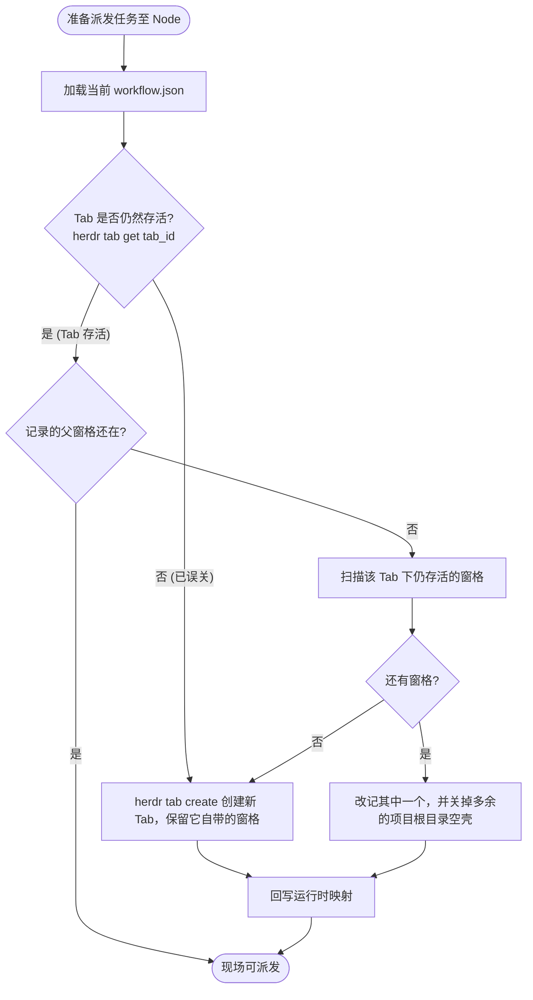

# 空间现场模型与动态自愈机制 (tab-node-model.md)

> **公司：上海共事智能科技有限公司**  
> **品牌：共事**  
> **产品：HAFlow**  
> **一句话：让人和多个 AI Agent 一起把事情做完**  
> *Human + Agent, in Flow*  
> **Tab = Node 空间现场、Anchor 母体机制与任务派发前拓扑自动自愈**  
> 关联索引: [[index]] | [[system-overview]] | [[domain-model]] | [[task-lifecycle]]

---

## 1. 核心设计哲学：Tab = Workflow Node

在早期的硬编码设计中，系统将步骤固化为 `requirements` ➔ `plan` ➔ `implementation` 等固定 6 个阶段，导致无法编排非研发类流程，且一旦用户误关终端窗格，整个调度直接崩溃。

现代 HAFlow 确立了根本性解耦原则：
> `FACT` **Workflow 拓扑定义是逻辑事实；终端的 Tab ID 与 Pane ID 仅仅是易失的运行时现场缓存。**

```text
Workspace (项目全局空间，如 w9)
  │
  ├── Tab 1: Coordinator (总指挥大脑)
  │     └── Pane 1: 总指挥 Agent (交互式总指挥，接收 Controller 指令)
  │
  ├── Tab 2: Node 1 (工作流节点现场，如 2需求分析)
  │     ├── Pane 0 (Anchor): 母体锚点 (保持 Tab 存活，只读，专供分裂新工位)
  │     ├── Pane 1: Task A (Agent 1 现场)
  │     └── Pane 2: Task B (Agent 2 并发工位)
  │
  └── Tab N: Node N (其他工作流节点现场)
        ├── Pane 0 (Anchor): 母体锚点
        └── Pane Task-X: 业务工位
```

Evidence:
- `docs/architecture/tab-node-model.md`
- `herdr/projects.py#ensure_node_runtime`
- `scripts/herdr-topology-selfheal-install.sh`

---

## 2. 阶段页签的父窗格

`FACT` 在已有标签页里再开一个工位，要指定一个还活着的父窗格：

```bash
herdr pane split <parent_pane_id> --direction right ...
```

新建标签页时终端会自带一个窗格，所以页签不能是空的。这个窗格不再命名为 `Anchor`，也不留在任务旁边空转。

1. 本阶段第一个任务直接占用这个窗格，标签改为 `task:<task_id>`。
2. 父窗格上已经有 Agent，或标签已是 `task:` 开头时，才从它 split 出下一个工位。
3. 同页已经有任务窗格时，停在项目根目录且没有 Agent 的空壳会被关掉。最后一个窗格保留，避免标签页一起消失。
4. `anchor_pane_id` 只保存下一次 split 用的父窗格编号。回收时仍保护这个编号。

Evidence:
- `herdr/topology.py#_resolve_or_create_anchor`
- `services/herdr-worker.py#allocate_task_pane`
- `herdr/pane_pool.py#list_slots_for_project`

---

## 3. 动态自愈引擎 (`ensure_node_runtime`)

`FACT` 在每次任务派发（`herdr-task launch` 或 `bin/herdr-task:resolve_node`）前，系统**强制**执行拓扑自愈检查。



### 关键自愈规则：
1. `FACT` **工作区不灭原则**: 缺失 Anchor 或 Tab 仅属于可自愈的局部现场故障，**绝对不会**触发重新 provision 整个项目 Workspace。
2. `FACT` **不覆盖已有工位**: 已经有 Agent 的窗格只作为下一次 split 的父窗格，不会在里面再启动一个任务。
3. `FACT` **自动回写**: 一旦检测到 Tab 或 Anchor ID 发生变化，系统立即通过原子写入更新 `<project_dir>/workflow.json`。

Evidence:
- `herdr/projects.py#ensure_node_runtime`
- `herdr/topology.py#ensure_stage_topology`
- `RULES.md:拓扑动态自愈红线`
- `CLAUDE.md:坑点 3：Tab 与 Anchor Pane 误关与易失性`
