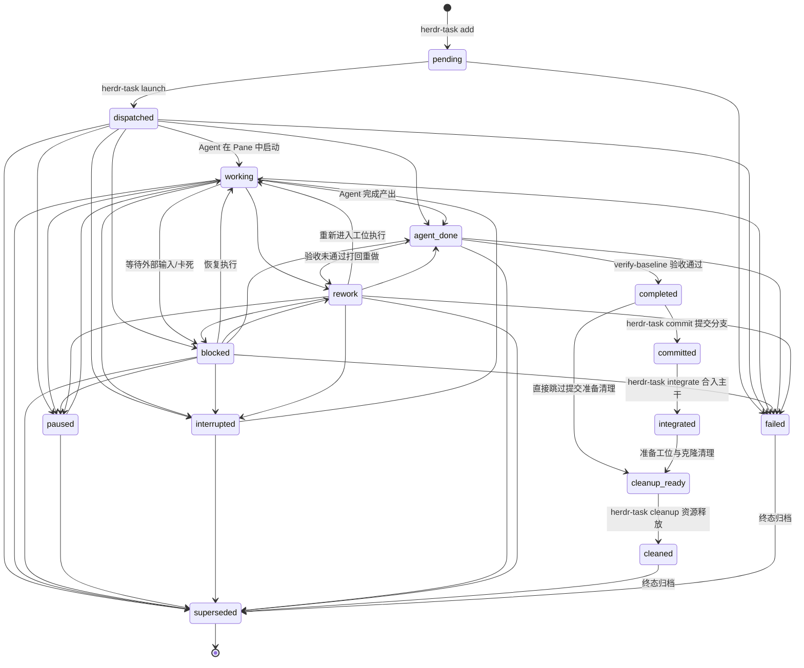

# 任务生命周期与基线验收机制 (task-lifecycle.md)

FACT：`herdr/state_db.py` 保留状态库兼容门面；Task/Workflow 状态迁移实现分别位于 `herdr/state/transition_task.py`、`herdr/state/transition_gate.py`，检查点实现位于 `herdr/state/checkpoint.py`。

Evidence:
- `herdr/state_db.py#__all__`
- `herdr/state/transition_task.py#transition_task`
- `herdr/state/transition_gate.py#transition_workflow`
- `herdr/state/checkpoint.py#create_checkpoint`

> **公司：上海共事智能科技有限公司**  
> **品牌：共事**  
> **产品：HAFlow**  
> **一句话：让人和多个 AI Agent 一起把事情做完**  
> *Human + Agent, in Flow*  
> **任务 15 状态机、CoW 克隆隔离与基线快照验收**
> 关联索引: [[index]] | [[system-overview]] | [[domain-model]] | [[dag-workflow-engine]]

---

## 1. 任务状态机 (Task State Machine)

`FACT` HAFlow 任务生命周期严格由 15 个离散状态及其状态转换矩阵（`TRANSITIONS`，权威定义见 `herdr/transitions.py`）定义，任何越权状态变更将被 CLI 直接拦截。

Evidence:
- `herdr/transitions.py:TASK_TRANSITIONS, WORKFLOW_TRANSITIONS, validate_task_transition`
- `herdr/kernel.py:transition_task, transition_workflow`
- `herdr/state_db.py:transition_task, transition_workflow`
- `bin/herdr-task:set_status, supersede_task`

`FACT` **状态集合语义解耦（SC-008）**：
系统内存在两个容易被误认为同义的“活跃/占用”状态集合，已在架构和代码上显式解耦：
1. **任务生命周期活跃状态集 (`ACTIVE_TASK_STATUSES`)**：
   - 权威定义：`herdr/transitions.py:ACTIVE_TASK_STATUSES`；
   - 集合成员：`{"dispatched", "working", "blocked", "agent_done", "rework", "paused", "interrupted"}`；
   - 业务语义：表示任务已被 launch 启动进入生命周期执行管线，尚未进入归档终态。它包含 `paused` 与 `interrupted`（管线已启动但处于暂停管理态），不包含 `pending`（刚创建尚未启动的草稿态）。
2. **路由负载占用状态集 (`ROUTER_OCCUPIED_STATUSES`)**：
   - 权威定义：`herdr/agent_router.py:ROUTER_OCCUPIED_STATUSES`；
   - 集合成员：`{"pending", "dispatched", "working", "blocked", "agent_done", "rework"}`；
   - 业务语义：表示 Agent 工位与任务排队容量的占用情况（用于路由负载均衡与 Least Loaded 选人）。它包含 `pending`（已指派给 Agent 的待处理任务占用了该 Agent 的排队并发配额），不包含 `paused` 与 `interrupted`（任务已休眠停止执行，不消耗 Agent 活跃执行算力）。
3. **架构解耦原则**：“同名不等于同义”。生命周期管理关注管线进展（Pipeline Active），路由调度关注工位容量（Capacity Occupied），二者正交，禁止混用。

`FACT` **任务恢复（resume）目标收敛规则（SC-016）**：
任务处于 `paused` 状态时，执行 `herdr-task resume <task_id>` 的目标状态严格收敛至状态机合法边：
- `TASK_TRANSITIONS["paused"]` 允许流转的目标包括 `working` 与 `rework`，但**严格禁止**直接流转到 `dispatched` 或 `blocked`；
- `herdr/task_cli_workflow.py:resume_task` 仅在任务最新暂停来源为 `rework` 时将其恢复为 `rework`；若最新来源为 `working`、`dispatched`、`blocked` 或无历史，均统一安全收敛恢复至 `working`（进入工位继续执行）；
- 该防御性收敛杜绝了从 `dispatched` 或 `blocked` 暂停的任务在恢复时产生非法状态转移（`Illegal transition: paused -> dispatched/blocked`），确保任务不会被卡死在暂停态。
- 证据链：`herdr/task_cli_workflow.py:395-405`、`tests/test_resume_transition.py`。

`FACT` **任务创建（add）单条写入与防状态回退保证（SC-017）**：
- `herdr-task add` 注册新任务时仅将新增任务单条写入持久化层（`save_tasks({"tasks": [task]})`），杜绝了旧实现遍历全量已有任务重新 upsert 导致的并发状态回退（State Regression）与版本号（version）误自增；
- `add_task` 对重复 `task_id` 施加内存快照与数据库双重强一致性拦截（`Task already exists: <task_id>`），拒绝重复注册并保护已有任务不被覆盖。
- 证据链：`herdr/task_cli_tasks.py:140-174`、`tests/test_task_add_overwrite_verification.py`。

`FACT` **控制台强制复审（force-review）特权契约与 CAS 守卫保证（SC-019）**：
- 控制台通过 `/api/task/force-review` 接口触发人工强制转入复审状态（`agent_done`），已收敛至受控特权流转契约 `console-force-review`（见 `herdr/transitions.py:PRIVILEGED_TASK_TRANSITIONS["console-force-review"]`）；
- **跃迁边界防护**：仅允许处于非终态（`working`, `blocked`, `paused`, `dispatched`, `rework`）的任务跃迁至 `agent_done`，严格拦截并拒绝任何终态任务（`completed`, `superseded`）非法跃迁；
- **并发 CAS 乐观锁守卫**：支持客户端显式传递 `expected_version` 与 `expected_status`，底层统一在 `compare_and_set_task_transition` 独占事务内完成原子核验与流转，版本或状态不匹配时 fail-closed 拒绝踩踏并发写；
- **权威事件与审计记录**：在同一事务内原子记录 `task_transition` 权威审计事件，透传操作人 `operator`、原因 `reason`、来源 `source: "console-force-review"` 与意图 `intent: "console-force-review"`，杜绝无守卫或无审计事件的裸写。
- 证据链：`console/task_api.py:266-320`、`herdr/transitions.py:84-87`、`tests/test_d1_privileged_transitions.py`、`tests/test_console_force_review_guard.py`。

`FACT` **门禁豁免版本守卫与并发防踩踏对称性（SC-015）**：
- 门禁豁免入口在 CLI 与 Web 控制台之间建立了完全对称的乐观锁（CAS）版本守卫机制：
  1. **任务级旁路放行 (`herdr-task bypass-gate <task_id> --reason <why> [--expected-version <ver>]`)**：支持传递可选的 `--expected-version`，底层在应用预检及 `compare_and_set_task_transition` 独占事务内双重比对；若版本已被并发推进，则 fail-closed 抛错拒绝，保护现有任务不被陈旧豁免写覆盖；
  2. **工作流门禁强制放行 (`herdr-factory force-pass <wf_id> <gate_node_id> [--task-id <id>] [--expected-version <ver>] [--expected-task-versions <json>]`)**：
     - 若指定 `--task-id` 单任务放行，通过 `--expected-version` 进行版本 CAS 保护；
     - 若不指定 `--task-id` 进行节点级批量放行，严格禁止使用单一 `expected_version`（防止误伤多任务并发），要求必须提供 `--expected-task-versions` 字典映射对节点下全部有效任务进行完整版本校验；
  3. **架构对称性**：消除历史版本中仅 Web 控制台携带 `expected_version` 而 CLI 无参数保护的非对称漏洞，使脚本与自动化管线同样享有数据库强一致性防踩踏保护。
- 证据链：`herdr/kernel.py:839-868`、`bin/herdr-task:234-245`、`bin/herdr-factory:652-675`、`tests/test_gate_exemption_version_guard.py`。

`FACT` **门禁豁免操作人规范与审计有效性契约（SC-010）**：
- 门禁人工放行与特权变更必须具备明确归属与可追溯的操作人标识（`operator`），杜绝匿名或占位符形式的放行操作：
  1. **纯逻辑校验器 (`herdr/transitions.py:validate_operator`)**：
     - **非空与非空白限制**：禁止 `None`、空字符串或全空白字符；
     - **长度与格式边界**：去除首尾空白后的有效长度必须在 1 至 128 字符之间；
     - **注入与破坏性字符拦截**：严格拦截 ASCII 控制字符（`ord(c) < 32`）、路径遍历与路径分隔符（`/`、`\`、`..`）、脚本注入字符（`<`、`>`）及复合数据类型；
     - **匿名与占位标识阻断**：大小写不敏感拒绝 `none`、`null`、`nil`、`undefined`、`unknown`、`anonymous` 等占位符；
  2. **端到端接入与审计透传**：
     - **核心写入通道**：在 `kernel.bypass_task_gate`、`kernel.force_pass_gate` 与 `state_db.force_pass_gate` 入口强制执行校验，规范化后记录至旁路凭证（`receipt`）、任务阶段说明（`stage_verdict_note: [GATE BYPASS by <operator>]` 或 `[FORCE PASS by <operator>]`）、工作流覆盖记录（`gate_overrides`）与审计轨迹事件中；
     - **Web 控制台策略**：在 `console/workflow_policy.py:_validate_force_pass_params` 与 `console/task_api.py:api_task_force_review` 中执行校验，拦截非法操作人标识并转换为标准 `RuntimeError`，缺省时安全回退至已知上下文合法主体（`human` 或 `human_console`）；
     - **CLI 门禁命令**：`bin/herdr-task bypass-gate` 与 `bin/herdr-factory force-pass` 透传 `--operator`，并在非法输入时以非零状态码 fail-closed 终止。
- 证据链：`herdr/transitions.py:validate_operator`、`herdr/kernel.py:force_pass_gate`、`herdr/kernel.py:bypass_task_gate`、`herdr/state_db.py:force_pass_gate`、`console/workflow_policy.py:_validate_force_pass_params`、`console/task_api.py:api_task_force_review`、`tests/test_gate_exemption_operator_audit.py`。

`FACT` 当前内循环耗尽的blocked是等待仲裁的持久事实，Agent working/idle/done不能代替明确恢复决策。实时事件保留该状态；重启在已知运行信号下恢复仲裁队列。最新blocked转换reason优先于可遗留的sentinel_reason；历史缺失时保留legacy行为。证据：`tests/test_inner_loop_arbitration_recovery.py`。旧屏幕跨恢复epoch（C03c）仍单独待修。仲裁卡及人工升级提示使用现有合法blocked→working命令，不增状态边或force；真实CLI参数执行回归见`tests/test_blocked_recovery_command_contract.py`（C30）。

### 1.1 门禁结论 (Gate Verdict) 与 fix-loop

`FACT` 门禁阶段（test/review/wrapup，`GATE_DEFAULTS`；节点/全局 stage-policy
的 `gate` 配置可覆盖）验收落盘时携带机器可读结论：
`herdr-task set <task> completed --verdict pass|blocked --note "<blocker 清单>"`
（blocked 必填 note），持久化为任务的 `stage_verdict` / `stage_verdict_note`。

`FACT` Controller 在两处消费 verdict（fail-safe 语义：节点内任一未 superseded
任务的 blocked 即 blocked；无 verdict 时 lenient 放行，存量 workflow 行为不变）：

1. **阶段推进门禁**（`blocked_gate_dependency`）：ready_node 的依赖中存在
   blocked 门禁 → 不推进，执行**原子作废**——gate 节点及其全部下游节点的
   非 superseded 任务被 supersede（completed/cleanup_ready 先 finalize 规范化，
   规避 `completed→superseded` 非法转移窗口；pending/committed 跳过），随后
   投递一次 `fix_loop` 事件（含 blocker 清单、建议 `--onto` 分支、launch 骨架、
   循环计数）。作废使相关节点回归未完成——节点未完成本身就是闩，周期 sweep
   不会重发；fix 完成后 DAG 自动按 test→review→wrapup 顺序重流。
2. **交付终态门禁**：全部节点完成后，任一门禁节点 verdict=blocked → 不打
   `[WORKFLOW COMPLETE]`、不触发 auto-close，走同样的回流。

`FACT` 循环计数记录于 stage-state（`<wf>|fixloop|<retry_node>`，持锁写入），
超过 `HERDR_FIX_LOOP_MAX`（默认 3）后 fix_loop 事件切换为"必须请示用户"的
升级文案——上限是纪律+通知，非引擎硬闸。

`FACT` `close-workflow` 遇未作废的 blocked verdict 拒绝执行（exit 2）；显式
`--abandon` 可放弃交付（记录 workflow `outcome: abandoned`，正常关闭记录
`delivered`）。console 的 `create_candidate`（真实 git merge）与
`manual_advance` 对 blocked verdict 一律拒绝——三处旁路封堵。

`FACT` `reopen-workflow` 重开已关闭 workflow：`suppress_auto_close` 闩封住
reopen 后旧任务仍全为完成系导致的 sweep 自消除窗口，任一任务进入 ACTIVE
时摘除（`bin/herdr-task set_status`）。

Evidence:
- `services/herdr-controller.py` #resolve_gate_config / #gate_verdict /
  #invalidate_for_fix_loop / #handle_fix_loop / #build_fix_loop_message
- `bin/herdr-task` #set_status（verdict 落盘）/ #close_workflow（--abandon、
  outcome）/ #reopen_workflow / #_clear_suppress_auto_close
- `console/herdr_factory_console.py` #create_candidate / #manual_advance
- `tests/test_fix_loop_pr1.py`、`tests/test_fix_loop_gates.py`

### 1.1.1 评审闭环操作员旁路认证（issue #228 后契约，2026-10-19）

`FACT` wrapup 评审闭环的紧急操作员旁路（`herdr/review_closure.py::authenticate_operator`）遵循
**显式呈现原则**：presented token 只能来自调用方显式通道（`--operator-token` /
`--operator-credentials` / `HERDR_OPERATOR_TOKEN` / `HERDR_OPERATOR_CREDENTIALS` 环境变量），
服务端已注册凭据的自动加载兜底已删除——同源自动发现会使 compare 退化为同一文件的自比较，
同 UID worker 无需任何密钥即可绕过门禁。registered token 只查单一权威源
`state_db.get_user_token`。`operator_id` 在任何文件系统使用前拒绝 `/`、`\`、`..` 并按
`[^a-zA-Z0-9_\-]` → `_` 净化（与写入端一致），阻断把查找路径引向 worker 克隆目录的遍历向量。

`FACT` 已知部署边界 R1：同 UID 进程间没有机密性——worker 读取服务端凭据库后可自行凑齐
presented==registered。模块内无解，登记任何应急操作员前须由负责人决策隔离方案。
成功旁路必须落 `review_closure_skipped` 事件并绑定任务头，供审计回读。

Evidence:
- `herdr/review_closure.py` #authenticate_operator
- `tests/test_wrapup_review_closure.py`（B1 向量 a/b 对抗用例、B2 凭据目录零污染断言）
- `docs/bug-reports/2026-10-19-wf-haflow-1019-01-craft-228-r3.md`、lessons §175

### 1.2 Trajectory Ledger：一次执行的历史事实流

`FACT` Task 的当前状态仍由 Runtime State/StateStore 表示；Trajectory Ledger
只记录已经发生的历史事实，不参与状态机判定、调度或 Observer 决策。一次正常
`herdr-task launch` 在构造 task 时先生成新的 `run_id`，并在 `save_tasks()`
之前写入 task；因此 `run_id` 表示一次完整的 Workflow/Task 执行实例，不能与
`task_id`、`agent_session_id` 或 `workspace_id` 混用。真正没有该字段的历史旧
task 才使用 `run_<task_id>` 兼容 fallback。

Trajectory 事件复用现有 SQLite `events` 表，由 `herdr/trajectory.py` 的
`TrajectoryLedger` 提供 append-only `append_event()` 与按 run 查询的
`list_events(run_id)`。同一 run 的事件使用持久化 sequence 恢复顺序；
`source=trajectory` 的事件不改变既有 StateStore 通用事件查询语义。

典型生命周期是：

1. launch 持久化 task 后写入 `run_started`、`task_started`、`agent_started`；
2. Task 状态真实变化时，在底层状态转移事务内原子写入单一权威事件 `task_transition`，并在事务提交后由内核向轨迹账本记录 best-effort 轨迹事件 `task_status_changed`；
3. evaluator 产生 `tests_completed` 事实时写入 `verification_completed`，其中
   `verification.passed` 直接使用 evaluator 的 `converged`，并保留有界的
   failing/lint/type/composite/evidence_id 字段；
4. Task/Run 终态写入 `task_completed`、`task_failed`、`run_completed` 或
   `run_failed`（仅在现有执行路径能够确认时记录）。

这些事件与 Runtime State 分层：Runtime State 回答“现在是什么状态”，Ledger
回答“这次执行之前发生过什么”，Observer 或后续分析器可直接按 run 重放事实流。

`FACT` **状态事件命名与写入权威分层（SC-007）**：
- **同事务权威事件 `task_transition`**：由 `state_db.py:transition_task` 在底层 SQLite `BEGIN IMMEDIATE` 强事务锁内与任务行变更同步原子写入（`events` 表，`event_type="task_transition"`，载荷含 `from_status`、`to_status`、`reason`、`forced`）。它是全系统状态流转唯一不可丢失的单一事实源，供状态机审计与 CAS 校验使用。
- **事后最佳努力轨迹事件 `task_status_changed`**：由内核网关 `kernel.py:transition_task` 在底层状态事务成功提交之后，通过 `TrajectoryLedger` 异步/事后追加到轨迹账本（`source="trajectory"`，`event_type="task_status_changed"`）。该事件专供观察者（Trajectory Observer）与执行轨迹重放（execution trace）消费；其采取 best-effort 旁路语义（捕获异常、不阻塞流转、允许在极端进程崩溃时丢失），不作为状态流转权威。

`FACT` 在 Ledger 之上，Trajectory Observer（[[trajectory-observer]]）按
`run_id` 读取事实流 + Runtime + bounded 日志，输出结构化 Finding
（`trajectory_findings` 表，与 events 事实表物理分离）；它只检测/解释/建议，
绝不改变任务状态机或调度。

Evidence:
- `herdr/state_db.py:transition_task, compare_and_set_task_transition`（`task_transition` 同事务原子写入权威）
- `herdr/kernel.py:transition_task`（`task_status_changed` best-effort 轨迹旁路写入）
- `herdr/trajectory.py:TrajectoryEvent, TrajectoryLedger, run_id_for_task`
- `bin/herdr-task:_launch_task`
- `services/herdr-controller.py:check_task_tests_completed`
- `herdr/state_db.py:record_trajectory_event, list_trajectory_events`
- `tests/test_trajectory.py`
- `tests/test_supervisor_tests_completed.py`
- `tests/test_state_transition_gateway.py`

### 1.3 完成标记的折行容错契约 (Wrap-Tolerant Marker Detection)

`FACT` 无receipt-v1协议的legacy任务，其终端观测通路是「Pane 可见屏幕上出现
`HERDR_TASK_DONE:<task_id>` + `agent_status == idle` + elapsed ≥ 60s + 两次
间隔确认」。Sentinel 只写 `completion_observations` 样本，Controller 独占
`compare_and_set_completion_transition` 的 CAS 落盘（见 §1.2 的 FR-1 分层）。

`DECISION` **Pane 是被硬折行的终端屏幕，不是逻辑文档。** TUI 消息体自带左边距，
折行的续行必然以水平缩进开头。因此：

- 标记探测的唯一接缝是纯函数 `herdr.completion.marker_present()`；
- 探测前只消解**缩进续行**（`\r?\n[ \t]+(?=\S)`），硬换行（空行、纯空白行、
  无缩进行）**保留换行符**，因此无关文本永远无法被拼成假标记；
- 命中后必须做**标识符边界校验**：`...-v1` 不得满足 `...-v1b`，跨 Task 证据
  不得完成别人的 Task；
- 三个前缀共用同一接缝：`HERDR_TASK_DONE:` / `HERDR_TASK_BLOCKER:` /
  `HERDR_ORCH_TASK:`。

`WHY` 历史上两个守护进程各自用 `literal in screen` 裸子串匹配。标记长度
= 16 + `len(task_id)`，`plan-arch-*`（51 字符）单行放下所以正常，
`plan-adversarial-*`（58 字符）超宽被折成两行 → `marker_present` 恒为 False →
`consecutive_samples` 恒为 0 → CAS 永远以 `completion_marker_absent` 拒绝 →
**产物与台账全部落盘、Agent 已 idle 的任务仍永久卡在 `working`，节点永不推进**。
该缺陷与产物质量无关，只取决于 `task_id` 长度与 Pane 宽度之差，属可复现的活性空洞。

`GUARD` 纯层测试（`tests/test_completion_marker_wrapping.py`）只覆盖函数行为；
防复发的真正门禁是**源码级契约**：任一守护进程重新内联 `f"HERDR_TASK_DONE:{task_id}"`
即测试失败（`test_daemon_has_no_raw_marker_substring_check`）。

Evidence:
- `herdr/completion.py:marker_present, marker_literal, _SOFT_WRAP_RE`
- `services/herdr-sentinel.py:main` (done / blocker / orch 三处探测)
- `services/herdr-controller.py:_completion_marker_snapshot`
- `herdr/state_db.py:compare_and_set_completion_transition`（`completion_marker_absent` 拒绝分支）
- `tests/test_completion_marker_wrapping.py`
- `docs/lessons/lessons-learned.md` §100

### 1.4 陈旧观测的 CAS 前置跳过

`FACT` §1.3 的完成观测走 `compare_and_set_completion_transition`，观测校验、CAS 与
观测消费在**同一个 SQLite 写事务**内完成，因此不会重试同一份样本。

`DECISION` **blocked 观测读在事务外**，必须自己承担漂移。`herdr-task set-status`、
人工 reopen、其它 Controller 写入都会抬 `tasks.version`；此后那份
`blocked_marker_observed` 样本的 `observed_version` 永远对不上。发起一次已知不可能
赢的 CAS、再记一条拒绝事件，然后下一轮 sweep 原样重来 —— 实测
`impl-t6-mock-retire` 刷出 **238 条完全相同的 `blocked_observation_cas_rejected`，
跨 25 分钟零进展**，最终成功纯靠 Sentinel 碰巧再次看见标记。

`RULE` 能否发起 CAS 由纯函数 `herdr.completion.observation_is_current()` 前置判定：

- `observed_status` / `observed_version` 任一与权威行不符 → **静默跳过**，等 Sentinel
  补新样本；不打事件、不占用转换预算；
- 非预期拒绝（判据说该赢却没赢）仍记录，但按 `(task_id, observed_version)` **去重**，
  一个样本一条事实；
- 缺 version（样本侧或权威侧）→ 返回 True 交由权威 CAS 裁决，避免用缺字段误杀新鲜样本；
- 非法 version（`"v5"` / `""` / 非数字）→ 判为陈旧，fail-closed。

`GUARD` 判据是"只减少明知会拒的尝试"，**不放宽任何已有拒绝**。陈旧闩与去重表在任务
离开 active 状态时清键，避免进程内 map 随任务数无界增长。

Evidence:
- `herdr/completion.py:observation_is_current`（纯判据，与 `cas_allows` 同居 FR-1 契约层）
- `services/herdr-controller.py:process_blocked_observations`（前置跳过 + 去重 + 清键）
- `tests/test_blocked_observation_cas_storm.py`（15 passed，含反向验证）
- `docs/lessons/lessons-learned.md` §101

---

### 1.5 StateStore 命名空间与 JSON 投影

`FACT` CLI 的隐式 tasks/workflows 投影跟随选定 SQLite 实例父目录；只有显式环境、模块或函数参数路径覆盖此目标。默认 workflow.json 保留配置读取职责，不作为显式数据库选址覆盖。steering 的隐式 tasks/steering 投影、SQLite 默认全量导出和 opt-in JSON 迁移同样跟随实例父目录。

`FACT` opt-in迁移对缺失配套文件仍传所选路径；不得将缺失转换成None，否则底层迁移将其解释为宿主默认输入。存在性由迁移reader判断；显式源路径仍有效。

`GUARD` 测试只设置临时 HERDR_STATE_DB 时不能读入或覆盖宿主默认JSON；显式目标路径仍按既有契约生效。本地修复不自动修复已经损坏的生产投影，也不改变SQLite权威来源。

Evidence:
- `bin/herdr-task:TASKS_FILE, WORKFLOWS_FILE, _get_store, save_tasks`
- `herdr/steering.py:get_tasks_file, get_steering_file, save_steering_data`
- `herdr/state_store.py:resolve_tasks_projection_file, _maybe_auto_migrate, export_all_json`
- `tests/test_state_projection_namespace.py`
- `docs/lessons/lessons-learned.md` §91复发补证

### 1.6 评估脚本步骤隔离

`FACT` `init_loop`生成的test/lint/repro命令分别在子shell执行，完整stdout/stderr重定向到对应日志。cd/export/exit仅影响该步骤，外层读取真实退出码后继续其它检查。步骤命令内容保留。

`FACT` 单次执行还要求外层runner成功、每个所需步骤唯一且有效的回执及本轮可读日志。程序生成的GOAL复现配置决定必需步骤；旧repro契约已移除时不复用旧日志。整体执行失败否决收敛并写原子EVAL_DONE与求助单；绿色测试数和有效lint基线语义保留。

`FACT` eval/init/基线写入在工位评估命名空间复用既有内核文件锁，竞争者busy退出75，不改持有者产物；持有者异常或进程退出后锁释放。日志新鲜性检查在所有权内执行。评分仍不是业务验收报告；runner与lint基线采集复用`run_evaluation_command`，在新session启动，超时/中断/异常/正常返回清理本次进程组后释放锁；TERM有限等待，必要时KILL。基线采集持锁覆盖命令和写入，超时不写基线，作用域内主线程SIGTERM可清理并恢复原handler。不可捕获SIGKILL及主动脱离session的子进程不在本地保证内。

`FACT` 原生CLI与Task自动初始化启用init_loop(capture_baseline=True)，同一锁覆盖初始化、旧baseline失效、受管采集和发布。默认standalone init不执行命令，仍清除旧契约债务；缺基线保守按0。CLI超时失败，Task继续保留既有best-effort告警/启动契约。missing-linter、历史receipt故障顺序与自由文本配置另卡，不以这一修复声明已全部关闭。

`FACT` 初始化先发布旧回执history并校验同hash内容，再失效current，最后换输入；history故障/中断保留旧契约及current，重试不丢原始字节。当前重置失败/新GOAL失败不允许旧成功被解释为新契约证据；相关测试`tests/test_loop_history_publication.py`。

`FACT` Supervisor的现代工位摘要状态/count统一来自单份EVAL_DONE，遗留BLOCKER仅当前exhausted时可报告存在；坏/薄/不可读receipt unknown不回退显示文件，只有absent receipt保留legacy兼容（非跨文件原子性）。共享reader服务extract和summary，各一次原子读取。验证`tests/test_loop_current_summary.py`。

`FACT` 测试隔离默认禁Observer模型，单例不继承host Jev凭据；假key cleanup必须精确restore absence/value，确定性gateway明示零transport。本机provider失败测试明确opt-in，生产配置不变。入口`tests/test_model_test_environment_isolation.py`。

`FACT` 测试日志进入parser前复用终端ANSI清洗，仅内存解析视图规范化，磁盘日志原字节保留；绿色标记的FAIL/✕名称不等于失败，真实失败/非零exit门禁不变。验证`tests/test_evaluator_ansi_test_output.py`。

`FACT` repro requirement来自GOAL末尾program typed标记，不扫描自由goal/DoD/command literal；旧格式仅唯一完整单行配置兼容，歧义goal_configuration_invalid需re-init。真实repro receipt/fresh log仍独立要求完整性。入口`tests/test_goal_repro_configuration.py`。

`FACT` 静态检查reserved退出124/126/127、负值及128以上不能被baseline抵扣，采集拒绝发布，评分与收敛独立否决旧污染baseline；工具实际exit1/2的历史欠账差值契约保留。验证入口`tests/test_lint_execution_failure_gate.py`。

`FACT` 自动npm默认测试命令为`CI=1 npm test`，避免继承Agent TTY时进入Vitest watch；显式任务命令完整保留。Java子任务测试范围仍须明确契约，不能从根package.json推断。

Evidence:
- `herdr/evaluator.py:init_loop`
- `tests/test_evaluator_step_isolation.py`
- `docs/lessons/lessons-learned.md` §110、§111
- `bin/herdr-loop:run_evaluation, _exit_receipts, _fresh_step_log`
- `herdr/evaluator.py:calculate_metrics, is_converged, generate_blocker_report`
- `tests/test_evaluator_runner_contract.py`
- `tests/test_evaluator_process_isolation.py`
- `tests/test_evaluator_process_cleanup.py`
- `tests/test_task_loop_noninteractive.py`
- `herdr/evaluator.py:run_evaluation_command, capture_lint_baseline`
- `tests/test_task_baseline_process_cleanup.py`
- `tests/test_loop_init_baseline_atomicity.py`

## 2. CoW (Copy-on-Write) 沙盒隔离机制

`FACT` 任何研发修改类任务绝不在项目主干目录执行，而必须在独立克隆中运行：
- **物理路径**: `~/.herdr-controller/clones/<task-id>`
- **秒级克隆实现**: 在 macOS APFS 文件系统上，调用底层 `cp -cR <source_project> <clone_path>` 实现毫秒级、零初始磁盘占用的 Copy-on-Write 克隆。
- **分支规范**: 在克隆目录中切换至任务专属分支：  
  `agent/{agent}/{task_type}-{slug_task_id}`（如 `agent/codex/feat-task-001`）。

Evidence:
- `services/herdr-worker.py#create_clone`
- `services/herdr-worker.py#create_task_branch`
- `RULES.md:空间隔离红线`

### 2.1 Context 模式的 Task Workspace（无 Git 执行路径）

`FACT` 当模板声明 `execution.mode: context` 时，Task 不走 CoW Clone/Branch：
- **物理路径**: 仍为 `~/.herdr-controller/clones/<task-id>`（与 CoW clone 同根同级，
  使 `delete_clone_safely`/retention/finalize 生命周期零改动复用）。
- **装配**: `create_context_task_workspace` 只创建纯目录；`branch=None`、
  基线指纹为空集合（context 任务的一切文件生来都是"本任务产出"）。
- **只读引用**: Context 绑定路径以短小 "Workflow Context" 块注入派发 prompt
  （id + 绝对路径），Agent 按任务需要自行读取，系统不展开文件内容/不做 RAG；
  Agent 严禁写入 context 原始目录（客户工作区），产物只落 Task Workspace。
- **验收**: `verify-baseline` 在 context 模式改用 `context_workspace_fingerprint`
  （全文件按 untracked 计的递归 SHA256 指纹，过滤 `.agent-task-context`/
  `.herdr-loop`/`.git` 等内部装配文件），TASK_CHANGED/BASELINE_MATCH 协议不变。
- **防呆**: commit/integrate 对 context 任务 fail-fast exit 2。

Evidence:
- `services/herdr-worker.py#create_context_task_workspace`
- `bin/herdr-task#context_workspace_fingerprint`
- `tests/test_execution_context_contract.py`

---

## 3. 基线指纹快照 (Baseline Fingerprint) 核心机制

### 3.1 为什么普通 `git status` 在沙盒中会产生严重误判？
> [!IMPORTANT]
> **代码中的核心隐性知识**  
> 当开发者或主干工作区在派发任务前存在尚未提交的改动或未跟踪文件时，`cp -cR` 会将这些主干未提交文件**一并完整克隆到沙盒中**！  
> 如果在沙盒中仅仅执行普通的 `git status`，所有主干原有的未提交文件都会被列出，导致验收工具或 Agent 误以为这些文件都是当前 Task 的修改产出。

### 3.2 基线指纹解决方案
`FACT` Herdr 通过任务启动瞬间的指纹采样来解决此问题：
1. **采样阶段 (`build_baseline_fingerprint`)**:
   - 任务派发瞬间，Worker 扫描克隆目录中已跟踪的脏文件（`git diff --name-only -z HEAD`）和未跟踪文件（`git ls-files --others`）。
   - 对每个文件内容计算 SHA1 校验和，形成快照并记录入 `tasks.json` 的 `baseline_fingerprint` 字段。
   - 特殊规则：内部控制文件 `.agent-task-context` 自动从指纹中过滤。
2. **验收阶段 (`verify-baseline`)**:
   - 运行 `./bin/herdr-task verify-baseline <task-id>`。
   - 系统将当前克隆文件状态与 `baseline_fingerprint` 进行逐项对比。
   - 只有真正由 Agent 在任务期间修改或新增的文件，才会归入 `TASK_CHANGED` 列表。
   - 若未发生任何实质改动，报告 `BASELINE_MATCH`，拒绝盲目合并。

Evidence:
- `services/herdr-worker.py#build_baseline_fingerprint`
- `bin/herdr-task#cmd_verify_baseline`
- `CLAUDE.md:坑点 2：CoW Clone 变化识别与验收假象`

---

## 4. E2E 自动化测试验收的特殊规则

`FACT` 在针对工作流进行 E2E 自动化测试时（如 `workflow_id` 以 `e2e-` 开头）：
- 终端 CLI 在 alternate-screen（备用屏幕缓冲）模式下运行，可能导致 `herdr pane read` 读到的终端可见内容暂时为空白。
- 验收准则：**严禁依赖终端是否能读取到固定文本**。
- 只要 Herdr 任务生命周期到达 `agent_done`，且 `verify-baseline` 返回变更合规，即判定任务成功，直接流转为 `completed`，禁止因屏幕空白打回 `rework`。

Evidence:
- `workflow_templates/software-development-v1.yaml:rules`
- `workflow_templates/bidding.yaml:rules`

---

## 5. 物理收尾与证据固化 (Physical Teardown)

`FACT` 任务遵循"生而隔离,死而清零"生命周期:出生时独立 pane + CoW clone +
全新 agent 会话;验收收敛后由 `finalize` / `close-workflow` 执行物理销毁。
上下文只在任务体内生存,跨任务合法信息通道收敛为两类:
1. **固化产物**:git commits / integration branch / 转写证据 / 任务记录;
2. **Workflow 共享文档区**（受控共享,2026-09-18 引入）:追加式账本
   `~/.herdr-controller/workflows/<workflow_id>/shared/notes.jsonl`,
   代码仍物理隔离,文档/证据按 workflow 共享。权威层级为
   `git commits / verify-baseline > controller 机器证据 > 本区文档(仅上下文)`；
   stale 在读取时计算(base 漂移作废 evidence/gate;fix-loop 作废早于作废点的
   目标节点条目);controller 在派发时按节点相关度注入 prompt。
pane 从不复用——`_claimed_panes` 的永久占用是该原则的执行机制,而非缺陷。

Evidence:
- `herdr/workflow_docs.py` (append/load/annotate/summarize/render)
- `bin/herdr-task` #note_add/#note_list/#_record_gate_note
- `services/herdr-controller.py` #shared_docs_block/#_record_invalidation_note
- `services/herdr-worker.py` #write_task_context (shared_docs 注入)

### 5.1 finalize 序列(幂等)

1. **闸门**:仅允许非活跃状态;`failed` 需 `--force`。
2. **证据先行**:herdr 不持久化终端 scrollback,销毁 pane 前必须
   `pane read --source recent-unwrapped` dump 到
   `~/.herdr-controller/logs/tasks/<task_id>/terminal.log`(+ `meta.json` 含 agent_session)。
3. `pane close`;4. clone 处理;5. 状态沿 `completed→cleanup_ready→cleaned` 推进。

### 5.2 clone 删除安全档位

- 有 `integration_ref/branch`(已完成 integrate)或 `superseded` → 可删;
- `committed` 未 integrate → 拒删(commit 仅存于 clone);
- 单任务 `finalize` 对 mode=none 的 docs/test/review、context 工作区仍默认保留，
  避免阶段结束后破坏下游输入；`cleanup` 也只做逻辑清理。
- **整个 Workflow 关闭**时，所有仍存在的受管 Task clone（含 failed）先生成私有
  本地恢复归档并校验，再回收目录；不再将文档与失败现场默认永久保留在 clones 下。
  Git 集成、业务验收及身份门禁仍适用，归档不证明代码已经集成。

### 5.2.1 Workflow 关闭时的恢复归档

`FACT` `close-workflow` 在受管工作流锁内，将尚存 clone 的完整内容（包括 Git 历史、
文档、失败诊断）压缩保存到 Workflow 共享目录下的 `clone-archives/<身份摘要>/`。
归档目录权限为 0700、文件为 0600，不发送给 Provider，不作为已脱敏的模型证据。
Task 的 SQLite 元数据 `clone_archive` 保存归档位置、SHA256、清单摘要及成果目录。
Console 继续以原成果 ID 预览/下载经过哈希校验的归档文件；敏感文件与符号链接不开放读取。

- 先校验归档字节、源内容和目录实例，再执行删除；单 clone 上限 1 GiB / 100000 条目，
  读取散列和目录扫描设有时间预算。超限、归档失败或源发生变化则保留并报告，工作流不宣称关闭成功。
- 无副作用的产物、身份及预算预检通过后，先原子进入 `closing` 再发布归档和元数据；
  暂停先赢则没有归档副作用，关闭先赢则拒绝暂停。关闭转移在 SQLite 写事务内匹配预检
  观察到的 `expected_status`；`--force` 也不能覆盖预检期间新发生的暂停，而初始已暂停时
  显式 force 仍可执行。该条件不代表完整版本/ABA 校验。归档写入失败保持 `closing` 并可重试。
- `--purge-clones`、`--force`、`--abandon`、`--accept-escalated` 可授权处理未集成产物，
  但不能跳过恢复归档。工作流的实际删除入口强制要求归档，预检后才出现的 clone 也不会被裸删。
  无显式授权的 Git Task 在归档完成、引用发布前重验输出门禁，恢复点不能隐式授权新出现的未集成改动。
- `--dry-run` 只读验证归档资格，报告 `archive_required`、`archive_would_create` 及
  归档校验通过后有条件的 `clone_would_delete`，包括文档/context/failed，不创建归档或修改状态。
- 首份归档为不可变恢复点；真正删除前持久化 `clone_reclaim_started`。删除中断后，
  仅同一目录实例且剩余内容为归档子集时允许续删，不用残余目录覆盖完整归档。
- 外部旁路产物排除：`.codegraph/`、`*.sock`、`.DS_Store` 等已知外部旁路/索引进程产物不纳入归档清单（`_inventory`），
  归档后向这些目录的写入不阻断 `verify_source`。
- 外部工具残壳安全回收：clone 回收删除后，若被常驻索引服务（如 CodeGraph MCP）在原路径复活出
  仅含旁路产物的残壳目录（无 `.git`、无 identity、且全目录仅含白名单旁路条目），
  `verify_source`、`_teardown_output_guard` 与 `owns_clone` 自动识别为残壳并允许回收删除，
  避免由于 inode 漂移引发 `clone instance changed` 收尾死锁。即使放行残壳，
  `verify_source` 仍必须完整校验归档文件清单与 SHA-256 完整性，损坏归档坚决阻断；残壳遍历对已知旁路目录原地剪枝防长耗时阻塞。

- failed Task 回收 clone 后仍为 failed；阶段 `cleanup` 不执行此归档删除策略。
- 恢复归档不自动过期，也不保证释放与原沙盒等量的磁盘空间。未登记的手工沙盒、
  无 Task 归属的启动失败目录及历史已完成关闭回执不在本路径中自动扫描删除。

Evidence:
- `herdr/clone_archive.py:preserve_clone,verify_source,read_archived_file`
- `bin/herdr-task:_close_workflow_owned,_finalize_one,cleanup_task`
- `herdr/workflow_close.py:CloseClaim.action`
- `herdr/deliverables.py:project_for_tasks,read_deliverable`
- `tests/test_workflow_clone_reclaim.py`

### 5.3 close-workflow、所有权预占与共享 tab 守卫

`herdr-task close-workflow <wf>`:
1. **Preflight 门禁与所有权预占**: 首先执行 `validate_workflow_transition(cur_status, "closing", force=force)` 前置校验，通过后在任何物理清理前原子将工作流状态推进为 `closing`；在 `closing` 状态下并发 `pause` 会被状态机天然拒绝，消除物理现场已毁但工作流停在 paused 的 TOCTOU 竞态；
2. **活跃任务闸门与逐任务 finalize**;
3. **关阶段 tab（共享 tab 守卫）**: 连续 workflow 常复用同一 workspace 的阶段 tab, 关 tab 前必须校验 tab 内全部存活 pane 均属本 workflow(锚点 + 本 workflow 任务); 有外来 pane 或 pane list 不可用时跳过该 tab 并写入报告 `tabs_skipped`；
4. **终态流转**: 物理资源销毁完成后，通过 Gateway 将工作流从 `closing` 原子推进为 `completed`；
5. **清 stage-state 并输出收尾报告**。
- `--accept-escalated` 是对已升级 Git Task 的人工确认，报告 outcome 为
  `escalated_accepted`；它允许物理收尾，但不提升 Task 集成状态。已提交未集成的
  Clone 在经过人工确认、完整恢复归档及校验后回收，未集成提交仍保存在归档内；
  报告逐项列出 Pane 关闭结果、Task 状态和 Clone 删除结果，工作流 outcome 记录为
  `escalated_accepted`，不能据此宣称已集成。
- **总指挥 pane 例外**: 默认保留至知识沉淀 + PR 合并后由 `--include-coordinator` 关闭。
- **自动触发**: Controller 在 `is_workflow_completed` 时后台调用 `close-workflow`(in-flight 防重入 + status=completed/closing 短路); 零任务的已登记运行视为平凡完成。

Evidence:
- `bin/herdr-task#finalize_task` `#close_workflow` `#_tab_foreign_panes` `#dump_transcript`
- `services/herdr-controller.py#maybe_close_completed_workflow`
- `docs/walkthroughs/20260913-workflow-finalize.md`

### 5.4 Test/review delivery baseline 与 PR 交付核对

- test/review 在运行时资源创建前必须解析到唯一、有效的 workflow 交付身份；使用有效
  delivery 或 CLI 校验接受的本 Workflow 当前显式冻结 pin。缺失、歧义或 invalidated
  候选一律 exit 2，并通过 StateStore 写 `test_baseline_rejected` actionable event。
- delivery 候选必须是 clone baseline 的 ancestor；无法证明时拒绝派发，不以 Agent 隔离策略
  替代 FR-6.2 baseline 门禁。
- `herdr-task check-delivery` 查询指定 head branch 的已合并 GitHub PR，并从 repo path 解析
  candidate/head tree。相同分支旧 PR SHA 与当前候选不同时输出非阻断 review warning；查询失败
  必须显式报告 evidence unavailable，不能声称无历史 PR。
- `integrate` 在写 `refs/herdr/tasks/<task>`、force branch 或 integration ref 前检查主仓 tracked
  状态；脏仓 exit 5 且不写 ref。
- Router 的 `router_opt_out_used` event 在实际选择 reused agent 后写入，`selected` 必须与返回
  给 CLI 的 agent 相同；审计失败仍 fail-closed。
- Sentinel SQLite 观察失败按旁路故障记录并继续下一轮；记录本身也失败时只写 stderr，不能让
  单次 SQLite 异常退出哨兵主循环。

### CoW Clone 来源为 Git Worktree

FACT: Worktree 根的 `.git` 是指向源仓库的文件，直接 CoW 复制会共享 HEAD 与 index。`create_clone` 在任何 reset、clean、branch 切换前，用 `git clone --no-hardlinks --no-checkout` 创建独立元数据并替换 Clone 中的指针；保留源 origin URL。普通 `.git` 目录仍使用 CoW 复制。

Evidence:
- `services/herdr-worker.py#create_clone`
- `tests/test_herdr_worker.py#TestCleanSandbox.test_worktree_source_clones_have_independent_git_state`

FACT: Herdr runtime `done` 与 `idle` 均表示可接收输入；完成策略接受两者，但仍要求新完成标记、两轮间隔采样、至少 60 秒、当前任务版本与 CAS。`done` 不是独立完成证据。

Evidence:
- `herdr/completion.py#should_accept`
- `herdr/state_db.py#observe_completion`
- `herdr/state_db.py#compare_and_set_completion_transition`
- `tests/test_impl_fix1_regression.py#test_done_runtime_completion_persists_with_existing_gates`

FACT: `agent/*-init` 是本地 Worktree 锚点，integrate 在现有 source/Clone 锁内 fetch source 的 `refs/heads/<base>` 到 Clone 的 `refs/herdr/bases/<task>`，再 rebase 和校验。普通分支仍 fetch origin。此操作不会把 anchor 推到远端，也不会改 source 的 HEAD/index；集成仍只导入 task/integration refs，后续候选合流另行处理。

Evidence:
- `bin/herdr-task#integrate_task`
- `tests/test_legacy_adopt_converge.py#IntegrateOutcomeTest.test_local_agent_anchor_integrates_without_remote_anchor`

FACT: 内循环评估的 Vitest/Jest 失败提取先识别行首✓/√通过标记，避免将用例名称中的FAIL/✕解释为失败；真失败与非零退出的评分门禁保留。

Evidence:
- `herdr/evaluator.py#_is_failing_test_line`
- `tests/test_loop_evaluator.py#EvaluatorTest.test_green_titles_with_failure_words_still_converge`
- `tests/test_loop_evaluator.py#EvaluatorTest.test_true_failure_is_retained_beside_green_failure_title`

### 实现完成与 Candidate 冻结的边界（2026-09-30）

Git 模式任务的 Agent 完成、提交成功和集成成功是三种事实。节点依赖完成须等到 integrated/cleanup_ready/cleaned；非 Git 任务保持既有完成集合。Controller、node-status 与 ops-center 复用 `scheduler.node_is_complete`，不得在 completed 时提前启动 verifier。

可在节点配置 `required_task_ids` 声明已批准计划的必需 Task。未派发项、缺失替代项、替代环拒绝完成；只沿真实 `superseded_by` 链解析替代，不按任务名猜谱系。新的 `superseded` 转换由 SQLite 原子写入 `replacement_pending=true`，即使没有必需清单，也不会因作废而删除未完成义务。无此字段的历史记录保留旧兼容。该清单由节点完成读取方实施，独立调用验证汇聚接口时仍须由调用者先完成节点依赖校验。

Worktree Clone 转换须保留 source 本地 heads，而不是只把它们映射到 origin/*；`--update-head-ok` 仅在临时 no-checkout 独立元数据导入时使用，不作用于 source。源 dev/anchor 落后于远端时仍需正常同步并重跑验证；保留分支不能代替新基线验收。Candidate 选择排除 superseded/有 superseded_by 的旧任务。

证据：`tests/test_scheduler_dispatch_e2e.py::PlannedImplementationCoverageTest`、`tests/test_herdr_task_ops_center.py::PlannedNodeStatusTest`、`tests/test_herdr_worker.py::TestCleanSandbox` 与 `docs/walkthroughs/20260930-candidate-recovery.md`。

## 阶段内交接义务巡检

FACT：`integrated` 是持久集成引用接收，不保证指定基线已采用成果。显式 `required_task_ids` 节点的所有现有任务结束后，Controller 每 30 秒检查缺失计划任务与 Git 成果采用状态；仅 `running` 且无活跃/阻塞任务时催办。Git 祖先核验绑定当次目标 SHA，总查询预算 3 秒，失败标记 `unknown`。

FACT：未完成义务保存在既有 attention episode，默认结束后 600 秒催办，间隔复用 `HERDR_ATTENTION_RETRY_INTERVAL`，同一义务最多进行两次实际协调投递；协调者持续不可用或仍无结果时升级人工。忙碌不消耗实际发送次数，人工通知失败保留待投递状态并按间隔重试。账本事务使用跨进程文件锁；重启重新检查事实，通知收到不关闭义务。队列执行前再次校验指纹、工作流状态和计划。复用启动时的 canonical coordinator name，按名称探测与投递，拒绝错误身份；探测 5 秒、投递 35 秒上限。慢巡检在独立单线程后台池运行，同时最多一个 scan，不阻塞正常阶段推进。沿真实 `superseded_by` 查替代任务，不从自由文本推断新 ID。

FACT：Console 的 stall 投影显示具体未派发任务与已接收但未确认采用的成果，返回 `continuation.deliveries[].adoption`（`adopted` / `not_adopted` / `unknown`）及 `target_sha`。巡检不直接合流、不启动 Task、不修改任务状态；协调者仍遵守原权限、串行屏障与候选门禁。

边界：仅适用于有显式任务清单（单节点最多 64 项）且已有任务的节点；超出该预算仍由原调度门禁处理，不执行此恢复路径。已经有直接后继任务时交给后继验收，不以原基线未采用误报。未声明清单的动态计划维持既有行为。Git 祖先证据不把 squash/cherry-pick 内容相似当作采用证明。

Evidence:
- `herdr/workflow_continuation.py#pending_continuations`
- `herdr/projects.py#inspect_continuation`
- `services/herdr-controller.py#check_workflow_continuation`
- `services/herdr-controller.py#handle_workflow_continuation`
- `herdr/projection.py#detect_workflow_stalls`
- `tests/test_workflow_continuation.py`

`FACT` 重新init在替换输入前原子失效当前EVAL_DONE，旧快照内容寻址归档history，仅本轮完成快照可被读为评估证据。证据ID含快照SHA，相同字节重启稳定；重置后的同计数不混用旧身份。升级可能重新观察一次旧快照，SHA不替代Task/run归属。证据：`tests/test_loop_reset_evidence_identity.py`（C31，本地验证，未部署）。

`FACT` 显式完整candidate SHA匹配本地--onto分支时，launch可接受未发布候选，并将同pin传给Worker；Worker在独立Clone检出前后重新核对。无pin续接仍要求origin，符号/缩写pin与移动分支拒绝，所有权/后续交付门禁保留。证据：`tests/test_pinned_local_onto.py`（C12，最终2682 passed/145 subtests，本地验证，未部署）。

`FACT` blocked/inner_loop_exhausted队列逐轮验证workflow/run及status_history转换episode、当前cause；恢复再阻塞不得消费旧事件，同episode metadata更新不失效，旧queue清理不得解除新episode去重。legacy无history保守版本绑定；本地C21b，未部署。

`FACT` Controller零差预检允许最新冻结full SHA与全批spec pin/onto、native onto commit完全一致的候选；无冻、缩写、旧pin、混批缺onto身份仍拒绝。差异计数不替代候选身份；未知Git保留既有策略，TaskCLI/Worker复验保持，C13本地未部署。

`FACT` 永久soft能力拒绝是steer队列blocked，不是Task业务blocked；原文与last_delivery_error保留，自动soft扫描跳过，暂时no-pane/inject失败仍pending。CLI/Console/Sentinel明确反馈失败。内部按ID显式urgent与公开新urgent不是同一入口，未验证真实投递；C02本地未部署。

### 2026-10-01：原生 index 锁等待（C35a，本地未部署）

Task commit对actual native index路径的稳定外来锁冲突给HERDR_COMMIT_RESULT wait/git_index_lock及75；所有index写入均核对命令前后身份，hook/filter stderr不等于锁证明。Controller只同Task专属标记写60秒等待，不增普通失败预算；typed owner基于Run和持久状态转换，metadata不另起失败周期。EpisodeStore文件锁CAS保留并发新记录；未知/门禁与legacy升级不自动解除。未操作真实T8锁、没有真实集成，不能据此标工作流完成。

C13b（2026-10-01 的实现边界）：已交付依赖省略任务分支onto时，test/review仍须带有可证明的候选pin。当时无delivery的回退要求当前workflow最新冻结SHA与source HEAD严格相同；仍由TaskCLI和Worker复验，不把冻结当成业务delivery。

2026-10-02 修正该回退：integrated 可能只发布 task ref，source HEAD 仍是旧基线。Controller 对本 Workflow 当前严格40位冻结 SHA 解析真实 commit，CLI 在无 onto 时也透传 `--candidate-sha`；Worker 从该本地 commit 创建验证任务自己的分支，跳过远端基线 fetch。短 SHA、缺失对象和 blob 在创建 Pane 前拒绝；已有 onto 分支所有权保护不变，不借用实现任务分支。实际 Task 的 candidate / baseline / clone HEAD 必须一致，冻结不生成业务 PASS。回归入口 `tests/test_frozen_base_candidate_dispatch.py`、`tests/test_workflow_stall_regressions.py`，发布记录见 [[../docs/walkthroughs/20261002-wf1002-stall-release]]。

C13b最终：66相邻passed/3子测试（32.93s）；最新main4cca57e合并后完整全量2871 passed、154 subtests passed、2 skipped（隔离HOME无LaunchAgent），0 failed，454.85s。两项本机只读plist检查另行2 passed（0.07s）。compileall、三入口CLI AST、diff-check通过；独立最终只读复审组合阻断闭合，未自行重跑全量。真实Agent/Worker启动、业务E2E及开放卡未因此验收。

## 归档资源与返工（2026-10-02）

状态归档与工位释放分离。Kernel 在带工位引用的归档转换内记录 `pane_lifecycle=orphaned`；`herdr-task reap` 默认为预览，显式 apply 才验证实例身份并关闭动态私有工位。预建工位、锚点、协调器、共享活跃引用与未知身份均保留，clone 不参与回收。

review blocked 的可继续任务默认 `rework`，沿 CLI 的身份验证/CAS/投递链复用 task/run/pane；投递失败持久化 pending，Controller 同一门禁 request_id 重试幂等。选择性返工仅重做被点名任务，后续扫描不得再次 supersede 已 rework 的目标。完成/集成等历史终态保持原候选契约，确需新执行时使用带理由的替换，并消耗累计配额。

Evidence:
- `herdr/kernel.py#transition_task`
- `herdr/task_resources.py#reap_task_pane`
- `bin/herdr-task#cmd_rework`
- `services/herdr-controller.py#_rework_legacy_retry` / `#_preserve_same_gate_task`
- `tests/test_pane_lifecycle_capacity.py`

## 结构化完成、分段产物与验收投影

`FACT` 新派发且具备 run_id 的任务使用 receipt-v1。私有文件携带 task/run/epoch 和随机凭据，SQLite 只保存凭据哈希；服务端签发有效期为 24 小时。返工/监督重新派发会轮换 epoch；显式 renew-completion 以稳定 operation-id 持久化续签投递，保留 epoch/检查点并撤销旧 bearer。未知、过期、跨 Run 和关闭工作流的声明被拒绝。声明、消费及 agent_done CAS 仍经过最小时长与已有 RETRY/VERIFY 执行门禁；有界恢复扫描以公平游标跨过暂时阻塞的声明，保留其回执供后续重试。完成声明不产生门禁通过或部署成功。无协议的历史任务保留原终端完成策略。

`FACT` 凭据文件权限是 0600、父目录 0700，其安全边界是受信任的操作系统用户。原生 Agent 工位共享用户身份，文件权限不构成敌对同 UID 工位之间的沙箱；同 UID 进程不得互相读取凭据。此实现不声称提供独立 OS 用户或强制 MCP 工具隔离。

`FACT` task/run/epoch 检查点注册于既有 Observation 与 events，分段先脱敏再原子发布；恢复/聚合重新核对受管路径、归属及内容哈希。工具调用记录执行意图与有界结果，超时/截断保持副作用 unknown；工具子进程不继承状态数据库及 JSON 投影路径。执行身份环境是父进程验证后传递的标识，不是数据库授权或密码学执行证明。

`FACT` delivery-report 分开显示 observed_result 与当前候选可采纳的 verification.status。真实 loop 在执行前后采集源码指纹、实际步骤退出码、skip 计数和执行身份；Controller 拒绝把旧 task/run/epoch 的快照绑定到当前执行。候选/epoch/产物校验不满足时保持 unknown；没有生产回执时 production_validation=unknown；超出任务投影预算会标 tasks_truncated，禁止声明全部验证通过。

`FACT` 关闭与重开共享 workflow 范围的跨进程锁，关闭操作及逐资源动作记于 SQLite。已完成动作不重做；无法证明实例身份的 Pane/Tab 保留。dry-run 只返回推演字段，不声明资源已经删除。关闭回执绑定交付报告及其哈希。

Evidence:
- `herdr/completion_receipt.py#issue_completion_contract`
- `herdr/completion_receipt.py#consume_completion_receipt`
- `herdr/task_checkpoint.py#publish_task_checkpoint`
- `herdr/bounded_tools.py#run_bounded`
- `herdr/evaluation_identity.py#capture_evaluation_identity`
- `herdr/delivery_report.py#build_delivery_report`
- `herdr/workflow_close.py#workflow_lifecycle_lock`
- `tests/test_evaluation_delivery_chain.py#test_real_loop_cli_to_controller_to_report`
- `tests/test_completion_expiry.py`
- `tests/test_workflow_close_claim.py`

相关页面：[[preflight-and-health]]。

## 启动清理、替换与 Run 定义

`FACT` Git Worker 在创建克隆后写入本次启动身份；分支清理只保留调用方传入的本次启动标签，普通源目录残留标签仍清理。reset/clean 非零及被恢复成外来身份的标签在 Pane 创建前失败。Pane 已创建后的失败保留克隆及恢复意图，不删除资源身份依据。

`FACT` `supersede --by` 链接替代任务；替代者必须属于同一 Workflow 和节点，已知跨节点链接在写入前拒绝。不带替代者的新作废保留自动替换义务。`supersede --abandon --reason` 明确撤销本任务义务，不能与 `--by` 同用，不能通过放弃前任改写已有链接。放弃谱系头可解除其前任自动义务，但不能解除配置里的 `required_task_ids`。无可执行任务且存在明确放弃记录时调度返回 wait，不重新 initial launch；节点全部放弃不等同满足其输出合同。合法 verifier reuse 仍以当前候选、策略和冻结 episode 的事实满足执行义务；缺失/过期证据不能满足该义务。完成核心不可用且没有合法复用证据时，待替换义务保持拒绝。

`FACT` 可读取的 Git 和 context Run 定义均冻结为 Run 私有配置；校验与冻结使用同一次读取的映射。注册拒绝已知属于其他 Workflow 的必需任务 ID，保留未知未来 ID 和自定义配置。提供显式 `workflow_file` 的 replay 保留其既有私有定义。缺路径的旧注册签名保持兼容；缺配置并不证明 Run 可执行。新建私有快照失败不注册 Run。

`FACT` 已完成且 `integration_mode=none` 的依赖不提供远端 `--onto`，共享文档按受管接口交接。Git 初次提示声明 `WORKER_WRITE_ROOT`，业务相对路径以本工位 clone 为根；来源目录文件不能冒充该 Task 的产物。旧终端完成标记接受冒号后水平空白，检测先解除软换行，再校验完整任务 ID；输入净化使用相同分隔与边界。

Evidence:
- `services/herdr-worker.py#sanitize_clone_sandbox` / `#main`
- `herdr/state_db.py#transition_task`
- `herdr/scheduler.py#node_is_complete`
- `herdr/direct_dispatch.py#plan_stage_dispatch` / `#candidate_branch_for_node`
- `herdr/projects.py#register_workflow`
- `herdr/completion.py#marker_present` / `#sanitize_prompt`
- `tests/test_workflow_stall_regressions.py`
- `tests/test_reverification_controller.py`

## 自动验收与启动失败现场

`FACT` 非门禁任务的自动验收拒绝已有 blocked 裁决及 review/reviewer/adversarial 角色。受控变更只证明变更验收，不产生评审 pass；状态转换使用 agent_done 与版本 CAS，既有状态事件和任务 metadata 记录 `acceptance_mode=auto`、`auto_accept_reason=controlled_changes`。

`FACT` Worker已取得pane后，未尝试Agent start且能证明本进程私有动态分配时可rollback；无法证明或已经尝试start则保留clone和私有身份文件。失败回执包含pane来源及恢复标记。身份文件不是成功启动或完成凭据，未知实例不自动关闭。Git 工位 context 明确留在分配分支、集成前不得自行 push/创建 PR。

Evidence:
- `services/herdr-controller.py#try_auto_accept`
- `services/herdr-worker.py#main`
- `services/herdr-worker.py#write_task_context`
- `tests/test_fix_bug1002.py#test_auto_accept_persists_explicit_evidence_and_rejects_stale_snapshot`
- `tests/test_fix_bug1002.py#test_worker_retains_identity_if_pane_allocated_before_identity_write_failure`

## FIX_BUG1002 恢复与平台交付

`FACT` launch identity区分workspace_created、pane_allocated、agent_start_requested及已启动阶段。split回执保存terminal_id；跨进程reconcile只回收tag/task/run/intent匹配、未尝试start、native terminal一致且显式agent=null的动态pane。失败clone归档到task.failed-intent，确认资源absence后才释放intent并允许重claim。allocation_failed不等待lease到期，但不授予删除未知实例的权限。

`FACT` `launch-reconcile`默认只读，`--apply`执行认证回收；旧tag缺terminal_id可由操作者运行`--authorize-terminal-id <token> --confirm-agent-never-started --reason <evidence>`，该命令只认证、不close，随后单独apply。idle、agent=null或产物存在均不能自动证明never-started。不同role查询失败明确列requested/available。

`FACT` managed动态split、rollback、reconcile、reap与CLI close共用跨进程文件锁。native pane close没有expected terminal/CAS；直接native人工操作不受HAFlow锁控制，因此最后身份检查与close之间的人工并发竞态仍在，不能声称原生原子instance-close。

`FACT` legacy持久完成恢复入口为`authorize-completion <task> --run-id <run> --expected-version <version> --reason <evidence>`：在SQLite事务内核验当前执行后签发receipt-v1并记审计，不改变任务状态，不认证成功。返回report_command供操作者明确提交声明；Controller继续走既有receipt验证与消费。working续修使用同实例`rework`，不新增working→pending边。

`FACT` `create-pr <integrated-task> --title ... --body-file ...`是平台交付入口。它要求task-owned integration refs、当前集成SHA、同workflow同SHA的独立review/test pass及有效delivery记录。推送源为明确SHA，fetch/push仓库身份必须一致；已有远端不同SHA拒绝覆盖；未知API结果下一次通过open PR inventory对账。任务仍不得预push，H-2未放宽。创建PR不等于合并或部署。

`UNKNOWN` 本次实现尚未部署，未执行生产恢复或真实外部PR发布；测试使用临时Git远端、HTTP provider和native受控transport。全量结果待最终交付记录填写。

Evidence:
- `herdr/task_resources.py#recover_launch_resources` / `#authorize_launch_recovery`
- `services/herdr-worker.py#create_pane` / `#rollback_unstarted_pane`
- `herdr/completion_receipt.py#authorize_legacy_completion`
- `herdr/pr_delivery.py#create_task_pr`
- `bin/herdr-task#cmd_launch_reconcile` / `#cmd_rework` / `#create_pull_request`
- `tests/test_fix_bug1002_lifecycle.py`
- `tests/test_fix_bug1002_delivery.py`

相关页面：[[agent-routing-and-pools]]、[[ops-center]]、[[preflight-and-health]]。

## 工程交付检查与受限返工

`FACT` 节点可声明delivery_contract并固定到Task。delivery-check与完成声明不同：检查回执覆盖授权产物、验证结果及仓库指纹；report-completion及消费声明拒绝缺失或陈旧通过，commit包含收编路径再次执行检查，实际hook保留。旧任务无契约时保持兼容，不宣称机器检查覆盖了仓库全部要求。

`FACT` 普通completed→rework仍非法。delivery-repair仅在未提交、同Run/代次、原工位所有权、明确范围及三轮预算成立时由事务准入。持久发送回执可补齐中断后的delivered；未知发送不重发。详见[交付配置指南](../docs/guides/task-delivery-contract.md)及[[workflow-progress-recovery]]。

Evidence:
- `herdr/task_delivery.py#check_delivery`
- `herdr/completion_receipt.py#report_completion`
- `herdr/delivery_rework.py#repair_delivery`
- `herdr/state_db.py#transition_task`
- `tests/test_delivery_rework.py#test_full_repair_commit_integrate_then_operation_resolves`

## Sentinel 停滞硬超时看门狗 (Hard Timeout Watchdog)

`FACT` Sentinel 在 `check_task_stalls` 中对长期处于 `STALL_WATCH_STATUSES` 且无推进（`idle_seconds >= task_hard_timeout_seconds()`，默认 3600s，可通过 `HERDR_TASK_HARD_TIMEOUT` 与 `HERDR_TASK_HARD_TIMEOUT_ENABLED` 配置）的任务执行硬超时处置：调用 `update_statuses` 并带入观察到的 `expected_status` 与 `expected_version` 执行原子 CAS 转换为 `failed`（`failure_reason: hard_timeout_watchdog`，`failure_detail: sentinel watchdog: hard_timeout_watchdog`），记录 `task_hard_timeout` 事实事件并按 task episode 去重。并发交错导致版本或状态变迁时 CAS 安全拒绝，不误杀刚产生活动推进的任务。

Evidence:
- `services/herdr-sentinel.py#check_task_stalls` / `#task_hard_timeout_seconds`
- `tests/test_sentinel_hard_timeout.py`

## FACT：空任务不构成交付

配置了 nodes 的工作流，当前 execution 必须有属于配置节点且未被 supersede 的登记 Task，才能以 delivered 结束。close-workflow 在关闭副作用前验证；统一数据库 transition_workflow 在写事务内复核，即使 force 也不能绕过。旧 execution 的任务不算当前执行的交付依据。零 Task 的显式 --abandon 记录 abandoned；无 nodes 的旧式收尾保持兼容。本项仅是最低库存门槛，不能代替原有门禁与集成验收。

Evidence:
- `herdr/workflow.py#validate_delivery_inventory`
- `herdr/state_db.py#transition_workflow`
- `bin/herdr-task#close_workflow/_close_workflow_owned`
- `tests/test_close_workflow_receipt_cli.py#test_atomic_transition_rejects_empty_delivery_even_with_force`
- `tests/test_close_workflow_receipt_cli.py#test_historical_task_cannot_prove_current_execution_delivery`

## Task CLI 模块边界

`FACT` `bin/herdr-task` 是不超过 500 行的可执行入口，负责环境初始化、兼容命名空间绑定与 `main()` 启动。参数定义和命令路由分别位于 `herdr/task_cli_parser*.py`、`herdr/task_cli_entry.py` 与 `herdr/task_cli.py`。各命令族的动态依赖装配位于 `herdr/task_cli_*_bindings.py`，具体处理逻辑位于对应 owner 模块；binding factory 从调用方实时 namespace 取依赖，以保留 CLI 兼容名称和既有 monkeypatch seam。

`FACT` Ops Center、rollout、runs、observability、execution、resources、verification、state、status、analysis、launch、dispatch、adoption、teardown、workflow、evidence 与 review closure 均已移出 CLI 脚本。Git adoption 探测与 workspace fingerprint 由独立模块维护。

Evidence:
- `bin/herdr-task#main`
- `herdr/task_cli_entry.py#main`
- `herdr/task_cli_review.py#_enforce_wrapup_review_closure/record_review_closure`
- `herdr/task_cli_launch_command_bindings.py#build_launch_command_bindings`
- `herdr/task_cli_teardown_bindings.py#build_teardown_bindings`
- `herdr/task_cli_workflow.py#resume_task`
- `herdr/task_cli_parser.py#build_parser`
- `herdr/ops_center.py#build_ops_center_payload`
- `herdr/git_adoption_probe.py`
- `herdr/workspace_fingerprint.py`
- `tests/test_task_cli_entry.py`
- `tests/test_task_cli_workflow.py`

## 收尾新增提交的交付阶段（默认开发模板）

`FACT` `software-development-v1` / `spec-development-v1` 的闭环 wrapup 可以在保持 working/agent_done/rework 时执行正常 `commit` / `integrate`。`wrapup_delivery` 在 Task payload 内记录 registered → committed → integrated，绑定原 Task/Run、execution、父候选 episode、源 SHA 与最终集成 SHA；不新增 Task 状态或平行状态库。

`FACT` 集成产生 task-owned refs 与内部 `candidate_published`；Controller 消费后才生成新 `candidate_frozen`。新轮次用普通生命周期边退役旧 test/review，以及存在时的 acceptance；旧 verdict 不改写，正常 dispatch obligation 补派。收尾轮次强制 fresh test/review，最多三次并继续受节点累计预算限制。

`FACT` 新验证和业务验收齐备后，`record-delivery --supersedes` 建立新身份。`create-pr` 使用 `wrapup_delivery.publication_branch` 的候选专属分支，创建或恢复替代 PR，记录 `replaces_pr_url`，不覆盖原分支或删除旧 PR。完成依旧检查精确 HEAD、无新增交付工作树改动、交付身份、同轮业务证据（SPEC 包括新 acceptance）、实时 forge CI/审核状态及 Run/execution/episode 回执。

`FACT` 属于 PR 的知识/报告正文在认证前提交；认证后运行报告使用 clone 外 checkpoint Artifact，不在落审核回执后追加提交。无新增提交时沿用原有效候选。集成、冻结、派发和远端发布各有独立幂等记录；外部创建响应丢失先按 branch/base/head 查询，不重复创建。

Evidence:
- `herdr/wrapup_delivery.py#begin/reconcile_verifiers`
- `herdr/task_cli_integration.py#integrate_task`
- `services/controller/candidate.py#_scheduler_freeze_candidate`
- `services/controller/advancement.py#_scheduler_resolve_candidate_and_plan`
- `herdr/pr_delivery.py#_publication/create_task_pr`
- `herdr/review_closure.py#identity_mismatch/check_completion_allowed`
- `tests/test_wrapup_candidate_delivery.py`

`UNKNOWN` 本地隔离测试不代表部署后的生产工作流、真实付费 Agent 或实际 forge 审核已跑通。

`FACT` 重基前持久记录固定 input/base。Git 已生成 S 而状态库尚登记 Y 时，正常 commit/integrate 通过临时无网络、禁 hooks 的 Git 重放树证明后 CAS 收编，source_sha 仍为原 Y。错误树、身份或 episode 不匹配不恢复；测试覆盖主干在中断期间再次前进。

`FACT` 当前默认 wrapup 候选的 test/review 路由在准入即执行独立性合同：保留 pin 原排除项，强制排除 implementation/wrapup，禁止软降级或 opt-out。此约束适用于缺少新模板字段的旧 pin；上游轮次和其他模板的既有降级政策不变。未启用 wrapup review closure 的模板不进入收尾退役恢复事务。

### 门禁等待、基线拒绝与文档重放（2026-10-20）

FACT：receipt-v1 的 test/review 拒绝仅改 verdict 的 force-pass/bypass；门禁轮次须发布绑定当前候选的 acceptance。基线拒绝的未启动任务记录 superseded、replacement_pending、launch_not_started 和包含落后信息的 blocker；launch intent 中止为 resources_absent。

FACT：业务门禁等待使用既有 recovery 表的 observing，三次相隔至少 30 秒的观测后转 waiting_human，并写一次 business_gate_stalled。它是恢复责任，不是 workflow 新状态或验收 PASS。Workflow 当前状态终结、执行/候选及 canonical generation（含 reopened_at）切换、节点移除会退役旧等待；历史 completed_at/outcome 不代表 reopen 后仍处于终态；业务凭证齐备后再次检查 resolve。

FACT：`bin/herdr-loop rebaseline --dir <clone> --reason <intake原因> --lint-cmd <度量命令>` 保留原因、旧值与 SHA，并校验初始命令及 evaluator 摘要；换命令、evaluator 变化和未绑定旧基线明确拒绝。未知非零静态输出及报告显示 unavailable。`scripts/replay-append-only.py --help` 只导出三份指定文档的安全追加合并文件、编号映射和 patch，不执行完整代码 rebase；历史改写和不完整末行拒绝。

Evidence：`herdr/task_cli_launch.py#record_router_failure_task`、`herdr/gate_wait.py#record_wait`、`herdr/recovery_store.py#ensure_obligations`、`herdr/workflow_close.py#CloseClaim.complete`、`tests/test_gate_metrics_handoff.py`、`tests/test_replay_append_only.py`。

### 2026-10-20 承接基线与证据更新

FACT：本次承接基线为 `a56739e`，单体 8169 行、167 绑定（153 def/class + 14 Assign/AnnAssign 名称）、35 个 `time.*` 调用点；GA-5 本轮矩阵 119 = 113 bare + 6 CONTROLLER_DIR。授权写集为 45 = 24 state + 1 门面 + 1 门禁 + 11 tests + 3 docs + 5 wiki。历史验证数字仅描述旧候选，不能证明本次验收。

`register_workflow` 的唯一宿主为 `herdr/state/transition_gate.py`，门面显式 import 与 `__all__` 再导出；删除内联相对导入后复用顶层绝对导入，事务与 fallback 契约保持上游行为。300-500 行目标 + 登记例外：第 9 条 `above=ARCH-4.7-transition-gate-port`，实际 546 行。G-5 静态图为 25 模块 / 74 边，与历史动态调用边口径分开。

Evidence：`scripts/check_state_db_split.py --report --symbols` 为 symbol→line 权威；`--snapshot-baseline` 为 live 167 绑定且拒绝缺失绑定与未知 owner。`tests/test_state_db_split_source_equivalence.py` 验证搬迁 AST 与 35 个 time 表达式；`tests/test_state_db_real_patch_paths.py` 验证注册事务边界；`tests/test_state_db_ddl_sequence.py` 五路径运行 trace 与 schema 93 对象等价分证。共享台账 wf-haflow-1020-02 / implementation 保存本次命令原文，独立洁净室验收待 test 节点执行。
